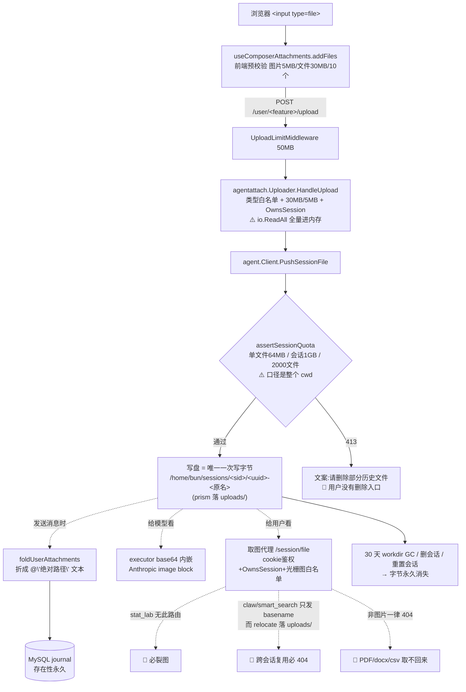
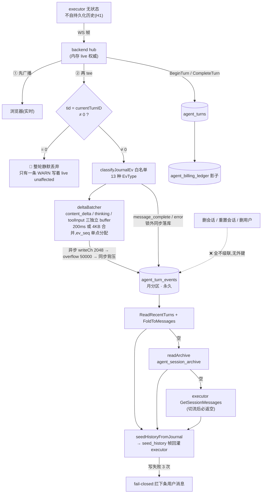
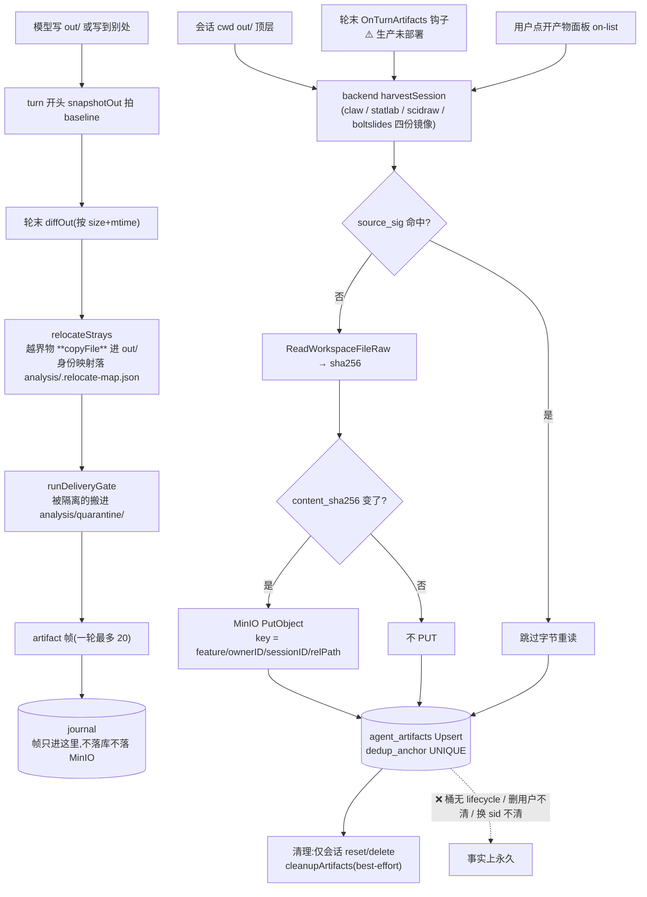

# Agent 数据存储地图(总图)— 2026-08-07

> 本文是四份分路取证报告的合成件,**不是新调查**。原始证据与逐行引用见:
> [01-uploads.md](01-uploads.md)(上传附件)· [02-transcript.md](02-transcript.md)(会话记录)·
> [03-artifacts.md](03-artifacts.md)(产出文件)· [04-infra-lifecycle.md](04-infra-lifecycle.md)(基础设施与生命周期)
>
> 全程只读:未改任何代码、未在生产做任何写操作。

---

## 〇 · 读这份文档前必须知道的三件事

### 1. 数字有两套口径,不能混用

| 口径 | 谁测的 | 环境 | 特征 |
|---|---|---|---|
| **prod** | 04 | 生产主机 `154.201.87.103` `/home/scholar` | `AGENT_EXECUTOR_FEATURES` **不含 stat_lab** ⇒ `agent_artifacts` 里 stat_lab 为 0 行 |
| **dev** | 01 / 02 / 03 | 本机 macOS docker-compose | 含 stat_lab,且 08-06 跑过一次 stat_lab 压测 ⇒ 数据形状完全不同 |

🔴 **一条流传中的事实需要更正**:「生产 `agent_artifacts` 1035 行 / 226 会话 / 97.7% 属 stat_lab」——
那是 **dev** 库。生产实测 **580 行 / 162 会话,claw 550 · sci_draw 28 · boltslides 2 · stat_lab 0**
(04 §八)。本文所有表格里的数字都标了 `[prod]` 或 `[dev]`。

### 2. 三类数据的耐久性等级完全不同

```
产出文件   →  MinIO + MySQL 双写,永久      ← 最耐久
会话记录   →  MySQL,永久,但只有一份       ← 耐久但单点
上传附件   →  只有磁盘一份,30 天 GC        ← 最不耐久
```

这个梯度是**反直觉的**:用户会认为「我传上去的原始数据」比「AI 生成的报告」更值钱,
实际系统里恰好相反(01 §7.3)。

### 3. 唯一的 blocker 是备份

生产 `crontab -l` 只有 `security_monitor.sh` 一行,`/home/scholar/backups/` 目录**不存在**
(04 §5.2)。MySQL 4.9G + MinIO 1.8G + 会话工作区 2.4G **全部零备份、零异地**。
下面所有「永久保留」的说法,都要读成「永久保留**在一块没有副本的盘上**」。

---

## 一 · 主表:数据种类 → 落点 → 格式 → 写入时机 → 生命周期 → 备份

### 1.1 Agent 三类核心数据

| # | 数据种类 | 物理落点 | 格式 / 关键字段 | 写入时机 | 生命周期 / GC | 备份 |
|---|---|---|---|---|---|---|
| **A1** | **上传附件字节**(图片/PDF/Office/CSV/纯文本) | executor 容器 `/home/bun/sessions/<sid>/<uuid>-<原名>`(claw/smart_search/stat_lab 落 **cwd 根**);`.../uploads/<uuid>-<原名>`(prism)。宿主 `./data/agent-sessions/` | 原始文件字节,文件名 = `<uuid>-<原名>`(UUID 前缀被前端历史剥离器依赖,不可改) | `POST /user/<feature>/upload` → `PushSessionFile` → `workspace.ts:243 pushSessionFile`(**唯一落盘点**) | 删/重置会话立即 `rm -rf`;否则 **30 天 workdir GC**。**无单文件删除入口** | ❌ 无(不进 MinIO、不进 MySQL) |
| **A2** | 附件的**存在记录**(不是字节) | MySQL `agent_turns.role_user_text` + `agent_turn_events`(EvUserMessage payload) | user_message content 首部折出的 `@"绝对路径" ` 文本前缀 | `foldUserAttachments`(ws.go:608),转发给 executor 之前 | **无 TTL,永久** | 随 MySQL(即无) |
| **A3** | 跨会话物化的附件副本 | 目标会话 `.../uploads/<basename>`(`relocateDir` 对所有 feature **硬编码 "uploads"**) | 同 A1,但**丢掉 uuid 前缀外的路径信息** | 用户在 A 对话上传、切到 B 对话发送时,`EnsureLocal` 在配额校验后 / 折叠前同步执行 | 随目标会话删/GC。**源文件不删** | ❌ |
| **A4** | 引用文献物化产物 | 会话 cwd `references/paper-<id>.md` / `<file>.pdf` / `INDEX.md` | markdown + PDF | `POST /user/<feature>/reference`(与上传同一条 PutWorkspaceFile 通道) | 随会话目录删/GC | ❌ |
| **B1** | **对话事件流(历史唯一真源)** | MySQL `agent_turn_events`,**月度 RANGE 分区**(分区键 `created_at`) | `payload` = JSON,即发给浏览器的 wire 帧原字节。EvType 白名单 13 种 | 轮内实时:`hub` 先 broadcast → `classifyJournalEv` 白名单 tee → deltaBatcher(200ms 或 4KB 合并)→ MySQL。**终帧(message_complete/error)锁外同步落库** | 🔴 **永久保留、全库零 DELETE**。唯一周期任务是每天 05:40 的分区延展(只加不删)。删会话/删项目/删用户**均不级联**,无外键 | ❌ |
| **B2** | 轮账本(工作单元) | MySQL `agent_turns` | `role_user_text`(用户原文)/ status / kind / model_main / seq / client_turn_id(幂等键) | `BeginTurn` 幂等 INSERT(running)→ `CompleteTurn` 翻终态;blocked 轮走 `RecordBlockedTurn`(client_turn_id 加 `blocked:` 前缀隔离) | 永久、零删除、零级联;reaper 每 10min 把 >30min 的 running 翻 aborted | ❌ |
| **B3** | 切流前老会话归档 | MySQL `agent_session_archive`(一会话一行) | `messages_json` LONGTEXT,整包 `SessionMessage[]`,不可增量更新 | 仅 bootstrap 由 env 驱动:`AGENT_ARCHIVE_FROM_JSONL=/fork-data`(compose **默认非空**)⇒ **每次 boot 跑一遍幂等扫描** | 永久、零删除 | ❌ |
| **B4** | per-turn 影子计费账本 | MySQL `agent_billing_ledger` | input/output/cache_read/cache_creation tokens,turn_id 为 PK | `CompleteTurn` 时随终态一起写 | 永久、零删除 | ❌ |
| **B5** | 用户/实体 ↔ session 映射 | MySQL `agent_sessions`(PK = owner_kind + owner_id + feature_key) | title / pinned_model / usage_watermark / prompt_injected / reset_count | 建会话时 INSERT;`ResetSession` 用 `UpdateSessionID` repoint 到新 sid | 删会话/删项目删行;**删用户不删** | ❌ |
| **C1** | **产出文件字节** | MinIO `scholar-agent-artifacts`,key = `<feature>/<ownerID>/<sessionID>/<relPath>`(kind=dir 再 `+".zip"`) | 原始字节。**路径派生 key,非内容寻址 ⇒ 同名再交付覆盖同一 key ⇒ 无版本** | 轮末 `OnTurnArtifacts` 钩子(**生产未部署**)+ 用户点开产物面板的 on-list 兜底。内容 sha256 变了才 PUT | 🔴 **桶不挂任何 lifecycle**。唯一回收 = 会话 reset/delete 的 `cleanupArtifacts`(best-effort,失败只 log) | ❌ |
| **C2** | 产出文件元数据 | MySQL `agent_artifacts` | rel_path(恒 `out/<basename>`)/ mime / size / content_sha256 / source_sig / storage_key / `dedup_anchor = sha256(sid\0relPath)` UNIQUE | 与 C1 同步 Upsert-on-conflict(只更内容列,身份列不动) | 同 C1。`DeleteStaleBySession` 是**死代码** ⇒ out/ 里删掉的文件永久残留一张卡 | ❌ |
| **C3** | 越界产物的身份映射表 | 会话 cwd `analysis/.relocate-map.json`(引擎保留区,模型写不进) | JSON:源路径 → out/ 名 | `relocateStrays` 每轮按需写 | 随会话工作区删/GC;损坏即当空表(优雅退化) | ❌ |
| **D** | 会话工作区整体(cwd / uploads/ / references/ / analysis/ / out/ / 模型自生成中间文件) | executor `/home/bun/sessions/<sid>` ← 宿主 `./data/agent-sessions` | 任意文件 | 上传 / 引用物化 / **模型 Write·Edit·Bash 直写** | ✅ **30 天 TTL GC**(`EXECUTOR_WORKDIR_TTL_DAYS` 默认 30,6h 扫一次)—— **全链路唯一真正删数据的 TTL** | ❌ |

### 1.2 相邻链路(不属 agent 三类,但同一块盘 / 同一套生命周期问题)

| 数据 | 落点 | 生命周期 | 备注 |
|---|---|---|---|
| Prism 论文正文(struct 轨,当前唯一在用) | MySQL `prism_projects.doc_struct` + `prism_struct_versions` 追加版本链 | 🔴 零 GC;**`DeleteProjectCascade` 漏删这两张表** ⇒ 删项目后正文仍在库 | dev 实测已有 1 行孤儿 |
| Prism legacy 正文(冻结只读) | `prism_files` + `prism_file_versions.body` | 零 GC,但删项目那条链删对了(0 孤儿) | |
| Prism 编译产物 | MinIO `scholar-prism`,`prism/<pid>/<cid>/<key>.{pdf,log}` | ✅ 48h GC(每项目最新一条永久)。`expires_at` **只用于缓存命中判定,不是 TTL** | 桶不挂 lifecycle |
| 审稿稿件 | MinIO `scholar-peer-review-assets`,key 恒 `tmp/<submissionID>/<uuid><ext>` | 🔴 桶挂了 `tmp/` 24h ILM,而 key 从未迁出 tmp/ ⇒ **提交 24h 后对象被清空,DB 40 行全是死链**(dev 桶实测 0 字节) | 注释声称的 `submitted/` 迁移在代码里根本不存在 |
| legacy fork jsonl | 宿主 `./data/agent` → `/fork-data:ro` | 无 GC,归档已迁完,只读挂着 | prod 244M 死重 |

### 1.3 MinIO 全部 7 桶的 lifecycle 实测

读的是 MinIO 自己的 bucket 元数据(`.minio.sys/buckets/<b>/.metadata.bin/xl.meta` 内嵌 XML),不是代码:

| bucket | lifecycle | 备注 |
|---|---|---|
| `scholar-paper-pdfs` | `tmp/` 24h | + 每日 05:00 孤儿对账 reaper |
| `scholar-peer-review-assets` | `tmp/` 24h | 🔴 key 全在 tmp/ 下,等于全量 24h 过期 |
| `scholar-feedback-attachments` | `tmp/` 24h | key 也全在 tmp/,**未查实**是否同样被清 |
| **`scholar-agent-artifacts`** | **NO_LIFECYCLE** | `storage.go:147-151` 只 `ensureBucket`,**且没有任何解释性注释**(同文件里 feature-tools / skill-bundles 至少注明了「永久资源」)——看不出是决策还是遗漏 |
| `scholar-prism` | NO_LIFECYCLE | 有应用层 48h GC |
| `scholar-feature-tools` | NO_LIFECYCLE | 注释明说永久资源 |
| `scholar-skill-bundles` | NO_LIFECYCLE | 注释明说永久资源 |

⚠️ 除 `MINIO_BUCKET_PAPER_PDFS` 外,**六个桶名从未出现在 `.env` / compose**,全吃 `config.go` 默认值。

---

## 二 · 三条链路图

### 2.1 上传附件:一份字节,零耐久层



**读法**:字节只有一份、只在磁盘、30 天后消失;而它的「存在记录」在 journal 里永久 ⇒
30 天后老会话里 chip 还在、点开必 404 = **幽灵 chip**(结构性,不是 bug)。

### 2.2 会话记录:双通道 + 三级回退



**读法**:live 走内存(用户永远看得见),耐久走 tee(可能整轮丢且事后查不出来);
读回来时三级回退 → 折叠 → 回灌无状态 executor。

### 2.3 产出文件:唯一有双写的一类



🔴 **帧面 ≠ 收割面**:帧受 20 张上限 + 交付闸过滤,收割是无条件重扫 `out/` 顶层。
「卡片没出现但文件已落库」和「卡片出现过但当时没落库」两种偏差都可能存在,且两条路径无一致性校验。

---

## 三 · 同一份数据存了几份

### 3.1 单点(只有一份,丢了就没了)

| 数据 | 唯一副本 | 说明 |
|---|---|---|
| **上传附件字节** | 会话工作区磁盘 | 不进 MinIO、不进 MySQL、无归档。**最脆弱的一类** |
| **引用文献物化 PDF** | 会话工作区磁盘 | 同上(源论文可从 `scholar-paper-pdfs` 重新拉,但物化件本身单点) |
| **对话事件流** | MySQL `agent_turn_events` | executor 已无状态、fork jsonl 已退役 ⇒ **不存在第二份**。整个系统「AI 说过什么」只有这一份 |
| **轮账本 / 影子计费** | MySQL `agent_turns` / `agent_billing_ledger` | 同上 |
| **Prism 论文正文** | MySQL `prism_struct_versions` + `doc_struct` | 会话 cwd 里的 `document.md` 是**可丢弃投影**,DB 才是权威 |
| **模型的中间产物 / analysis bundle** | 会话工作区磁盘 | 30 天后消失 ⇒ 产物可下载但**不可复现** |

### 3.2 有两份(双写)

| 数据 | 副本 A | 副本 B | 一致性 |
|---|---|---|---|
| 产出文件 | MinIO 对象(字节) | MySQL `agent_artifacts`(元数据 + sha256) | dev 实测 1040 行 ↔ 1040 对象,prod 580 ↔ 580,**当前 1:1 零孤儿**。但删对象是 best-effort、无对账 reaper ⇒ 未来会漂 |
| 产出文件(第三份) | 会话工作区 `out/` 原件 | — | 30 天后消失,**不是可靠副本** |
| 附件存在性 | journal 里的 `@"path"` 文本(永久) | 磁盘字节(30 天) | 🔴 **TTL 不一致 ⇒ 幽灵 chip** |
| 老会话历史 | `agent_session_archive`(整包 JSON) | `data/agent` 的 legacy jsonl(只读) | 归档已迁完;jsonl 是历史来源不是副本,且同盘 |

### 3.3 被复制成 N 份(冗余放大)

| 数据 | 放大原因 | 代价 |
|---|---|---|
| 跨会话引用的附件 | `EnsureLocal` 是**复制不是移动**,源文件不删 | N 个会话引用 = **N+1 份字节**,且每份各扣各自会话的 1GB 配额 |
| 被 relocate 的越界产物 | `relocateStrays` 用 `copyFile` 不是 rename | 源 + `out/` 各一份(会话内,随会话消失) |
| 上传文件在 backend 内存 | `io.ReadAll` 全量驻留(有意设计) | 峰值 = 文件大小(≤30MB)× 并发数;**未查实**是否有 /upload 限流 |

### 3.4 一句话

> **AI 生成的东西有两份(MinIO + MySQL),用户自己传的东西只有一份(磁盘,30 天)。**

---

## 四 · 丢数据的风险点(按严重度)

> 每条按「什么情况下丢 / 丢多少 / 能不能恢复」三段写。

### 🔴 blocker

**B-1 · 生产完全没有备份**
- **什么情况下丢**:磁盘或文件系统一次故障、误删、勒索、误 `docker-compose down -v`。
- **丢多少**:MySQL 4.9G(含 527k 行对话正文)+ MinIO 1.8G(含 580 个交付物对象)+ 会话工作区 2.4G(含全部用户上传件)= **全部**。
- **能不能恢复**:**不能**。`agent_turn_events` 是永久保留的唯一真源、无第二副本;binlog 开着且 30 天保留(实测吃 2.6GB,**比 scholar 库本体 1.5GB 还大**),但**在零全量备份下 PITR 无意义**,纯开销。
- **状态**:三件套脚本(`backup-all.sh` / `backup-cron.sh` / `install-backup-cron.sh` / `RESTORE.md`)写得很完整,质量不错,**从未在生产执行过**——`crontab -l` 只有 `security_monitor.sh`,`/etc/cron.d` 与 systemd timers 也无相关项,`backups/` 目录都没被创建过。dev 上最近一份手动全量是 **2026-06-04(64 天前)**。
- ⚠️ 装备份前必须先 `docker system prune`:当前可用 16G,一次全量约需 4-5G,`KEEP=14` 默认值会撑爆磁盘。

**B-2 · `BeginTurn` 失败 ⇒ 整轮零事件入库**
- **什么情况下丢**:MySQL 抖动 / `hookCtx` 被 cancel / 3 次重试仍撞唯一键。`hub.go:1876-1899` 失败后**没有 return**,`currentTurnID` 保持 0,后续 tee 闸门把这一轮**每一帧**静默丢弃,live 照常跑。
- **丢多少**:整整一轮(用户提问 + 全部思考 + 全部工具调用 + 最终回答)。
- **能不能恢复**:**不能,且事后无法检测**——丢的轮在 `agent_turns` 里连行都没有(不是残缺,是不存在),`WriteFailures()` 也不计它。唯一痕迹是一条文案为 `"live unaffected"` 的 WARN,措辞会让人以为无害。
- dev 实测 `turns_without_events = 0`,说明目前未发生。

**B-3 · `DeleteProjectCascade` 漏删 Prism 正文版本链**
- **什么情况下丢**:反过来——用户点「删除项目」时**该删的没删**。`prism/repository.go:99-121` 只删 `file_versions/files/compiles/edits/projects`,漏了 `prism_struct_versions` 与 `prism_revision_items`,而 struct 轨是**当前唯一在用的正文轨**。
- **丢多少**:不丢用户数据,丢的是**删除语义的可信度** + 存储泄漏(平均 15.4KB/版本,prod 53.9MB / 3913 行)。
- **能不能恢复**:数据还在(这正是问题)。函数注释自称删了「全部子表(版本/文件/编译/编辑/对话)」,与实际不符。dev 实测已有 1 行孤儿。

### 🟠 high

**H-1 · 删用户 = 不删任何 AI 数据**
- `DeleteUser` 只清账户/计费/文献集 + `papers/<uid>/` 的 MinIO 对象;注释 `repository.go:486-488` 自陈未清 agent 数据,而实际漏得更多(连 `agent_artifacts` 在那句 TODO 里都没被提到)。
- **留下什么**:`agent_turns.role_user_text`(用户原文)+ `agent_turn_events`(**prod 406MB 对话正文与全部工具输出**)+ `agent_session_archive` + `agent_artifacts` 行 + MinIO 对象(**storage_key 里还带着已删用户的 uid**)+ 会话工作区(最长 30 天)+ `prism_*` 全族 + `peer_review_*` 全族 + `user_staging_*`。
- 全库对 `agent%` / `prism%` 表**零外键**,应用层也没做级联,没有任何 reaper 兜底。
- 另:**没有用户自助注销入口**(grep 零命中),只有 admin 能删 ⇒ 「删除权」目前靠人工。
- prod 实测 `agent_artifacts LEFT JOIN users` 孤儿 = 0 ⇒ **尚未引爆的合规缺口,不是现存脏数据**。

**H-2 · 换 session id 的动作会制造永久孤儿(journal 已发生,产物机制相同)**
- **触发**:`ResetSession` 的 repoint、agent 端 404 自愈的 `UpdateSessionID`。历史与产物都**按 session id 索引**,旧 sid 的行随即:列表看不见(`ListBySession(newSid)` 查不到)、清理够不着(reset/delete 只按当前 sid 清)。
- **丢多少**:dev 实测 journal 侧已有 14 会话 / 37 轮孤儿 + 2 行孤儿归档(⚠️ 与协调者手上的 prism 64 / claw 10 / smart_search 7 **口径不一致,未对齐**,只有 smart_search 的 7 两边吻合);产物侧当前孤儿 0,**只是还没轮到**。
- **能不能恢复**:数据还在库里,但对用户不可达。`DownloadArtifactByID` 仍可下载(只校验 OwnerID+FeatureKey)。

**H-3 · 会话工作区 30 天 GC 带走用户原始数据 + 可复现性**
- **什么情况下丢**:30 天不活跃(活跃信号 = `<workDir>.active` mtime ∨ 目录 mtime),或删/重置会话。
- **丢多少**:该会话的**全部上传附件、引用 PDF、analysis bundle、源数据、模型中间产物**。产出文件因已落 MinIO 而活着。
- **能不能恢复**:**不能**。dev 实测:209 个有产物的 stat_lab 会话,盘上只剩 18 个目录(17 个为空)⇒ **交付物"看得见下得到",但重算/返修所需的一切已经没了**。prod 实测 GC 在正常工作(最老目录 Jul 8,今 Aug 7,边界精确吻合;近 2 天移除 19 个目录),169 行「DB 有行、工作区已灭」。

**H-4 · `agent_turn_events` 永久保留 + 增速在翻倍**
- prod 实测 **526,848 行 / 406.2MB**;7 月 262,057 行(≈8.5k/天),8 月**前 7 天已 272,970 行**(≈39k/天,**速率 ×4.6**)≈ 17MB/天 → **~6GB/年**。49G 盘只剩 16G 可用。
- dev 侧更极端:08-06 单日 11.5 万行 / 16.4MB,是此前全部历史的 3 倍多(stat_lab 压测)。
- 设计上**零删除路径**:14 个 cleanup 定时任务**没有任何一个碰 agent 四张核心表**。
- 按 07 月稳态外推 ~90MB/年,按 08-06 强度外推 ~6GB/年 —— **两者差 60 倍**,风险敞口完全取决于 stat_lab 采纳曲线。

**H-5 · 会话磁盘配额只挡 backend 推送路径,模型自己写完全无帽**
- `assertSessionQuota` 全仓只有 `workspace.ts:224/250` 两个调用点。模型的 `Write`(registry.ts:209 直接 `writeFile`)/ `Edit` / Bash 里的重定向·下载·解压**全不过闸**。
- prod 实测最大两个会话各 **413MB**(200+ 篇 `ref-*.pdf`,走的恰好是过闸的 agentattach 路径,且 <1GB 帽)。模型侧那条无帽路径一旦被触发,唯一兜底是 30 天 TTL 和整机磁盘满。
- 派生问题:1GB 会话帽算的是**整个 cwd**(产物 / pip 装的东西全计入),而超额文案叫用户「删除部分历史文件」——**用户没有任何删除单个文件的入口**(前端 `removeItem` 只改 UI 不发请求;`DeleteWorkspaceFile` 全仓零业务调用方,是造好没接线的能力)。该指引不可执行。

**H-6 · 用户上传的原始数据可能被洗成平台侧持久交付物**
- claw / smart_search / stat_lab 的上传落在 **cwd 根**,而 `.csv/.xlsx/.pdf/.docx/.md` 全在 `DELIVERABLE_EXTS` 里。它们没被当产物靠的**不是排除规则(uploads/ 那条对它们无效)而是时序**——baseline 在 turn 开头拍。
- 两条击穿路径:① 模型就地改写 `data.csv`(stat_lab 清洗数据的典型动作)→ size/mtime 变 → `diffOut` 判变更 → `relocateStrays` copyFile 进 `out/` → harvest 落 MinIO(桶不挂 lifecycle、harvest upsert-only 永不回收);② 绕过前端在轮次进行中直接打 `/upload`——后端**无「本轮进行中则拒绝」守卫**。
- dev 抽查 Top-10 `rel_path` 全是模型自己起的名、无 UUID 前缀 ⇒ **目前未实际发生**(未做全量匹配)。但机制上没有任何东西挡着。对 stat_lab 这类可能含 PHI 的数据尤其要紧。

**H-7 · stat_lab 取图端点根本不存在**
- 前端 `makeAgentConversationHook.ts:103` 为四个 feature 无差别拼 `/user/<feature>/session/file`,后端只注册了 claw / smart-search / prism 三条。stat_lab 开着 `enableAttachments` 且 accept 白名单含 png/jpg/webp/gif。
- **后果**:模型能看见图(走 base64 内嵌的通道 A),用户自己的气泡里永远裂图,且**无任何错误提示** ⇒ 用户以为没传上去而反复重传,每次重传都真的写盘、真的扣配额。
- (sci_draw / boltslides 影响为零:`enableAttachments:false`。)

**H-8 · 跨会话物化的附件在 claw / smart_search 上必然 404**
- 落点硬编码 `uploads/`,而这两个 feature 前端只发 basename、claw 后端还额外 `filepath.Base` 收窄到根目录 —— 这**正是 relocate 要修的那个场景**(A 对话传、B 对话发)。修完之后模型能读到文件了,用户气泡里的图却变成裂图 = **半边修复**。prism 不受影响。

**H-9 · 分区裁剪恒为 0**
- 分区键是 `created_at`,所有读路径按 `turn_id` 过滤、不带任何时间谓词。EXPLAIN 实测两条读路径都扫**全部 19 个分区**。MySQL 分区 = 每分区一棵局部索引 ⇒ 单次历史读要做 N 次索引 dive,而延展任务每月 +1 且**永不 DROP** ⇒ N 单调增长,一年 +12。
- 这是**随系统年龄线性劣化、与数据量无关**的那类问题,今天感觉不到。

**H-10 · journal 完整性没有任何运行期可观测**
- `WriteFailures()` 全仓只有一个调用点,且只在**优雅退出**时打一行日志。运行期累计丢了多少行,要等到优雅重启那一刻才知道;`docker kill` / OOMKill 时连这一行也没有。没有指标、没有告警、没有查询接口。

### 🟡 medium

| 风险 | 什么情况下丢 | 丢多少 | 能否恢复 |
|---|---|---|---|
| **非优雅退出丢异步写队列** | SIGKILL / OOMKill。`writeCh` 缓冲 2048 + overflow 封顶 50000 行 | 中段 `tool_use` / `tool_result` / `content_start`(终帧是同步写的,不丢) | 不能。历史变成「有结论没过程」,而 `FoldToMessages` 对这种残缺**不报错**,静默产出少了工具块的 transcript |
| **删对象 best-effort,无重试无对账** | `cleanupArtifacts` 先删 DB 行再 `DeleteObjects`,后者部分失败只 `slog.Error` | MinIO 对象成为无人可发现的永久孤儿(DB 行已删 ⇒ 再也拿不到 storage_key) | 不能。文献集 PDF 有孤儿对账 reaper,agent-artifacts 没有 |
| **claw 收割无前置大小闸** | 交付 >20MB 的文件 | 该文件永远不落库,**零日志**(另三份镜像有 16/16/12MB 闸 + `slog.Warn`) | 不能,且无人知道 |
| **目录形态产物只有 claw 支持** | 模型在 `out/` 下建目录交付 | statlab/scidraw/boltslides `e.IsDirectory → continue` 静默丢弃 | 不能,且无任何日志 |
| **幽灵 chip** | 30 天后回看老会话 | 附件字节已灭,chip 还在(按 UUID 前缀还原),点开必 404 | 不能。`sessions.ts:450-454` 注释已承认后果并称「前端对缺文件已有 404 兜底」,但用户看到的是**无解释的裂图**,没有「文件已过期」的语义 |
| **非图片附件用户永久取不回来** | 传完 PDF/docx/csv 之后 | 两份取图代理都硬性要求 `previewType=="image"`,否则 404;没有其它端点服务会话 cwd | 不能。**方向不对称**:out/ 产物反而有 MinIO 备份可下载 |
| **56 个会话三处都无历史** | 已发生 | 用户点进去是彻底的空对话 | 不能,且**无法解释成因**(既不是被删也不是没说过话)。启动日志 `no_jsonl_or_empty=56` 每次 boot 都打,但没人看 |
| **轮硬超时后的散帧黑洞** | 轮超时后 executor 仍产出真实内容 | 既不广播也不入 journal ⇒ 永久不可见 | 不能。是刻意设计(避免渲染无主残帧),但代价没被记录在任何地方 |
| **轮末收割钩子生产未部署** | 生产 `scholar_agent` / `backend` 都是 08-05 的镜像,钩子是 08-07 加的 | 在部署前,产物耐久化的唯一触发点仍是**用户点开产物面板**;没点过就永久丢失且零日志 | 部署后前向修复,历史不补 |
| **binlog 30 天 / 2.6GB 纯开销** | — | 占 49G 盘中的 2.6G,而无全量备份使其毫无恢复价值 | 不建议直接关(是未来上从库/上备份的前提)。正确顺序是**先装备份,再让 binlog 有意义** |
| **prism 版本链零 GC** | — | prod 105MB / 6262 行,323 项目均摊 330KB,随项目数线性无上界 | grep 零 DELETE、零 retention 常量 |
| **30.7% 产物 mime 记成 octet-stream** | docx/xlsx/pptx | 仓库内**两张 mime 表不一致**:`workspace.ts mimeOf` 无 Office 映射,而同仓 `turn/artifacts.ts ARTIFACT_MIME` 有(只喂帧不参与收割) | 当前影响仅 Content-Type(前端按扩展名分类不受影响);任何将来按 mime 分流的逻辑会踩空 |

### 🔵 low

- `DeleteStaleBySession` 是死代码 ⇒ `out/` 里删掉的文件在产物列表永久残留一张仍可下载的旧卡(在 `artifact_harvest.go:60-61` 被**显式接受**为「可接受,远好于重进即丢」)。
- `title/description` 通道生产零产出(dev 1040 行里 title 非空 = 0)。manifest 解析刚在 08-07 补给三份镜像,未验证。
- 取图路径会把已 GC 的会话目录**重建成空目录**(先 `getOrCreateEphemeral` 再读文件)。**未查实**是否 touch `.active` 从而影响下一轮 GC ——若会,则「浏览旧会话」会无限延长空目录寿命。
- 43 个孤儿工作区目录(磁盘有、`agent_sessions` 无行,prod 合计仅 3MB)无任何回收者;GC 只看 mtime 不看 DB。来源**未查实**。
- SPSS/Stata/SAS 专有格式的拒收文案**只在前端**(2026-08-06 加的带出路引导),后端 `parseAndValidateUpload` 无对应分支,退化成通用文案,把该卡片最想接的用户推回死循环。
- `idx_sid_id(agent_session_id, id)` **零查询使用**,是纯写放大(dev 20.8MB 索引的一部分)。
- `ev_seq` 由内存计数器分配,duplicate key 被 `createWithRetry` 当成成功 ⇒ 若某条路径在 `dropTurn` 之后仍 Append,帧会静默消失且 `failCnt` 不增。读码判定**当前不可达**,但该不变式**无任何测试或断言守护**。
- `agent_turns.user_id` 是 `int unsigned`,`agent_sessions.user_id` 是 `bigint unsigned` —— 同一语义列两种宽度。
- `JournalValidator` 的比对目标是 `client.GetSessionMessages`,而 executor 已无状态 ⇒ 比对对象大概率恒空,可能是「一条永远绿的规则」。`.env` 里 `AGENT_JOURNAL_VALIDATE=off`,所以没人发现。
- executor 三道配额帽在 compose / `.env.example` 里**完全没有设置**,跑代码内默认值 ⇒ 运维侧对「会话磁盘上限」零可见性,调参要改代码或临时加 env;且 `envNum` 曾有 NaN 静默全关的坑(注释自述)。
- backend 每次上传把整个文件读进内存(≤30MB,有意设计),**未查实**是否有针对 `/upload` 的速率限制。

---

## 五 · 容量与增长

### 5.1 生产磁盘全景 [prod]

`/dev/vda1 49G · 已用 34G · 可用 16G(69%)`;`./data` 合计 **9.4G**。

| 项 | 占用 | 增速 / 上界 |
|---|---|---|
| MySQL 全库 | **4.9G** | scholar 库 1.5G + umami 153M + **binlog 2.6G** + innodb_redo 513M |
| ├ `agent_turn_events` | **406.2MB / 526,848 行** | 8 月 ≈39k 行/天 ≈17MB/天 → **~6GB/年**,7→8 月速率 ×4.6 |
| ├ `feature_tools` | 278.0MB | 非 agent 范畴,清理策略**未查** |
| ├ `usage_logs` | 94.8MB | stranded 死重,cleanup 明确声明不再清理 |
| ├ `prism_struct_versions` | 53.9MB / 3,913 行 | 零 GC,随项目数线性 |
| ├ `prism_file_versions` | 51.9MB / 2,349 行 | 零 GC |
| ├ `agent_session_archive` | 31.5MB / 111 行 | 一次性归档,不再增长 |
| ├ `agent_turns` | 6.6MB / 2,065 行 | |
| └ `agent_artifacts` | 69.5MB(表空间)/ 580 行 | |
| 会话工作区 | **2.4G / 883 目录** | 30 天 TTL 是唯一上界;单会话最大 **413MB**;Top10:413/413/130/80/71/66/65/56/52/49 MB |
| MinIO 全部桶 | **1.8G** | paper-pdfs 1.1G · feature-tools 537M · **agent-artifacts 75M / 580 对象** · prism 40M · peer-review 3.9M · feedback 456K · skill-bundles 空 |
| legacy fork jsonl | 244M | 静止死重 |
| 弃用旧 datadir `data/_data` | 209M | 静止死重,不被任何容器挂载 |
| Redis 主池 / correctness 池 | 54M / 12M | 512mb allkeys-lru / 128mb noeviction |
| frontend-assets 灰度分包 | 40M(仅 prod 挂) | 无 GC,按构建频率线性 |
| 容器 stdout 日志 | nginx 42M / backend 26M / agent 4.2M | ✅ 有界:`max-size 10m × max-file 7` = 每容器 ≤70M |
| **docker 镜像 / 构建缓存** | 镜像 13.16G(**可回收 10.16G**)+ build cache 2.37G + 悬空 volume 647M | 从不 prune |

**一眼可回收 ≈10.7G**:镜像 10.16G + build cache 2.37G + `data/_data` 209M + fork jsonl 244M + `usage_logs` 95M。
`docker system prune` 一条命令就能把可用空间从 16G 抬到 26G ——**这直接卡住「装备份」这件事**。

### 5.2 事件流内部结构 [dev,150,821 行 / 68.7MB]

| ev_type | 行数占比 | 字节占比 | 平均 B | 最大 |
|---|---|---|---|---|
| `thinking` | **68.4%** | 15.5% | 106 | 0.7KB |
| `content_delta` | 17.9% | 4.5% | 119 | 4.9KB |
| `content_start` | 5.7% | 0.9% | 75 | — |
| `tool_result` | 2.0% | **24.4%** | 2,404 | **301KB** |
| `permission_request` | 2.0% | 8.7% | 860 | 38.6KB |
| `tool_use` | 2.0% | 8.1% | 801 | 38.6KB |
| 其余(artifact/user_message/message_complete/evidence/error/…) | 2.0% | 4.0% | | |

**读法**:行数压力来自 `thinking`(合并策略有效,平均 106B/行,但仍占 68% 的行,且 fold 时会产出
`type:"thinking"` message 回喂模型);字节压力来自 `tool_result`(**未查实** agent 侧是否对其体积封顶)。
`permission_request` 3028 条 ≈ `tool_use` 3021 条几乎一对一 ⇒ 自动 approve 的 permission 帧全量入库,
这 2.48MB 是**纯审计冗余**(前端 fold 不产 message)。

### 5.3 per-feature 集中度 [dev]

| feature | 事件数 | 占比 | 事件/轮 |
|---|---|---|---|
| **stat_lab** | 131,389 | **87%** | **184.8** |
| claw | 9,346 | 6% | 99.4 |
| prism | 3,523 | 2% | 176.2 |
| sci_draw | 3,158 | 2% | 175.4 |
| smart_search | 2,540 | 2% | 72.6 |
| boltslides | 865 | <1% | 216.3 |

[prod] `agent_sessions` 分布(1009 行):prism 342 · claw 305 · smart_search 207 · peerreview 139 · sci_draw 14 · boltslides 2。

### 5.4 产物分布 [两套口径并列]

| | prod | dev |
|---|---|---|
| 行数 / 会话数 | 580 / 162 | 1040 / ~226 |
| MinIO 占用 / 对象数 | 75MB / 580(**1:1**) | 20MB / 1040(**1:1**) |
| feature 分布 | claw 550 · sci_draw 28 · boltslides 2 · **stat_lab 0** | stat_lab 1011 · claw 14 · sci_draw 10 · boltslides 5 |
| 增速 | ~1.3MB/天(6/16→8/7 线性) | ~1.4 天/MB |

`rel_path` 100% 在 `out/` 下;`owner_kind` 实测只有 `user`(prism 走 `owner_kind=project` 的独立链路,不进本表)。

---

## 六 · 本地(dev)与线上(prod)的差异

### 6.1 卷挂载

| 卷 | dev | prod | 影响 |
|---|---|---|---|
| `./data/mysql` `./data/minio` `./data/redis` `./data/redis-persist` `./data/prism-work` `./data/agent-sessions` `./data/agent:/fork-data:ro` | ✅ 相同 | ✅ 相同 | 存储链路结构一致 |
| `./data/frontend-assets` | ❌ **刻意不挂**(compose:548-556 有注释说明) | ✅ 挂(prod:511) | prod 灰度分包 40M 无 GC;dev 一天 6 次构建曾堆到 848MB |

⚠️ **既有记忆里的「dev 缺 sessions 挂载致 203/209 会话 bundle 已灭」在当前 compose 上已不成立**——
dev 与 prod 的 `agent-sessions` 挂载写法完全相同。dev 侧 bundle 消失更可能是容器重建 / 30 天 GC 的结果。
(**未查实**该记忆记录时的 compose 版本。)

### 6.2 端口暴露

| | dev | prod |
|---|---|---|
| `scholar_agent`(executor API) | `ports:` 有映射(compose:402) | ❌ 只 `expose: 3456`,不向 host 映射 |
| nginx | ✅ | ✅ |
| mysql / redis / minio | ❌ 都不映射 | ❌ 都不映射 |

代码注释写明理由:executor API = provider 密钥 + 全 workspace 文件操作 + 路径穿越面,
「临时本机调试可临时加回,但**绝不进生产**」。

### 6.3 环境变量

| env | dev(`.env` 实测) | prod(`.env` 实测) | 影响 |
|---|---|---|---|
| `AGENT_EXECUTOR_FEATURES` | 含 **stat_lab** | **不含 stat_lab** | 🔴 **prod 与 dev 数据形状差异的根因** —— prod `agent_artifacts` 里 stat_lab 为 0 行 |
| `AGENT_TURN_JOURNAL` | `shadow` | `shadow`(compose 默认同值) | journal 开启 |
| `AGENT_JOURNAL_VALIDATE` | `off` | 未见 | 校验器不跑 |
| `NODE_ENV`(agent 容器) | **刻意不设** | `production` | prod 走 secure-by-default:未沙箱 Bash 拒执行 + 未配 token fail-closed;dev 本机单租户可裸跑 Bash |
| `EXECUTOR_WORKDIR_TTL_DAYS` | 未设 | 未设 | 两边都跑默认 30 天 |
| `EXECUTOR_PUSH_FILE_MAX_BYTES` / `_SESSION_DISK_MAX_BYTES` / `_SESSION_FILE_MAX_COUNT` | 未设 | 未设 | 两边都跑代码默认 64MB / 1GB / 2000 |
| `AGENT_ARCHIVE_FROM_JSONL` | compose 默认 `/fork-data`(**非空**) | 同 | **两边每次 boot 都跑一遍幂等归档扫描** |
| `MINIO_BUCKET_*` | 只有 `PAPER_PDFS` 在 `.env.example`;其余 6 个桶名从未出现 | 同 | 桶名等于代码写死 |
| `BACKUP_OFFSITE_DEST` | 未配 | 未配 | 即使装了备份也是同盘,单盘故障主备一起没 |

### 6.4 运行状态

| | dev | prod |
|---|---|---|
| 会话工作区 | 20K / 18 目录(17 个空) | **2.4G / 883 目录**,最老 Jul 8(30 天边界精确吻合) |
| workdir GC 是否在跑 | 未观察 | ✅ 实测近 2 天移除 19 个目录 |
| cleanup 14 个定时任务 | 未观察 | ✅ 实测 04:15–05:40 那一轮 11 个 task 名全部出现,hot content 今天删了 719 篇 |
| 轮末 `OnTurnArtifacts` 钩子 | 代码在 | ⚠️ **未部署**(`Up 2 days`,agent 启动日志 08-05 00:35;钩子是 08-07 加的) |
| crontab | 空 | 只有 `security_monitor.sh` |
| 最近一份全量冷备 | 2026-06-04(64 天前,手动) | **从未有过**(`backups/` 目录不存在) |

---

## 七 · 明确「未查实 / 不确定」

按重要性排序,**不要把这些当结论用**:

1. **MinIO ILM 规则本体在生产未直读到**。`mc ilm rule list` 在容器内回 `Access Denied`(healthcheck 的 local alias 无管理凭据),配 alias 属写操作按只读约束放弃。「prod ILM 已设置」是由「启动无 warn 日志」**反推**的。dev 侧是直读 bucket 元数据 xl.meta,可信度更高。
2. **孤儿口径未对齐**。02 的 SQL 定义(`agent_turns.agent_session_id` 在 `agent_sessions` 无对应行)得 prism 1 / claw 2 / smart_search 7;协调者手上是 prism 64 / claw 10 / smart_search 7。只有 smart_search 吻合。**不确定哪个更贴近「用户看不到的历史」的真实量**。
3. **是否已有上传文件被就地改写后进了 `agent_artifacts`**。只抽查 Top-10 `rel_path`(全无 UUID 前缀),未做全量匹配。
4. **`tool_result` payload 是否有上游封顶**。dev 库最大 301KB,未去 agent 侧查截断常量。`payload` 是 JSON 列(内部 LONGBLOB 4GB 上限),应用层无截断。
5. **MySQL binlog 之外是否有其它恢复手段**(从库 / 快照 / 云盘备份)。未查。若有,B-1 可以降一档。
6. **`getOrCreateEphemeral` 在取图路径上重建空会话目录的副作用**:是否 touch `.active`、是否影响下一轮 GC 判定。未读全 `createSession` 的 marker 逻辑。
7. **43 个孤儿工作区目录的来源**。只测了数量与大小(prod 合计 3MB)。
8. **`/upload` 是否被全局 `RateLimitMiddleware` 覆盖**。`io.ReadAll` 全量进内存是有意设计,但并发下线性放大,未查实有无限流。
9. **`dirUsage` 在生产 overlayfs / bind-mount 上的实际耗时**(2000 文件量级,每次写入全量递归 stat)。注释说「毫秒级」,未实测。
10. **FK ON DELETE CASCADE 的实际清单**以 `repository.go:472-473` 的注释为准,**未逐条核对 DDL**;`user_memory_blocks` 是否被带走**未查**。
11. **`feature_tools`(prod 278MB)/ `hot_papers`(72MB)/ `seo_*`(85MB)的清理策略**。非 agent 范畴,未追。
12. **`scholar-feedback-attachments` 的 key 也全在 `tmp/` 下**,是否与 peer-review 同样被 24h ILM 清空。未查。
13. **`kind='dir'` 从未在生产出现**:是模型从不建目录,还是 claw 用量本身就小,无法区分 ⇒ `harvestDir` 这条路径**在生产从未被验证过**。
14. **`agent_artifacts` 是否曾被人工清理过**:dev AUTO_INCREMENT=1056 vs 1040 行,差 16。未追。
15. **前端如何消费历史分页 / `hasMore`**。只看了后端契约(默认 30 轮),未看前端。
16. **`/root/` 下的手工 dump 残留**(`dump_claw.sql` / `security_backup_20260220_*` / `w0-backup/`)的内容与新鲜度。未查——它们是一次性人工动作,不是备份体系。
17. **各表压缩后的实际备份体积**。没跑过备份,§5 的「一次全量 4-5G」是按未压缩体积估的。
18. **既有记忆「dev 缺 sessions 挂载」记录时的 compose 版本**。当前两份 compose 的该挂载完全相同(见 §6.1)。

---

## 八 · 关键文件索引

| 关注点 | 文件 |
|---|---|
| 上传落盘唯一点 | `agent/src/server/workspace.ts:243 pushSessionFile` |
| 配额三帽 | `agent/src/server/workspace.ts:22-24` + `assertSessionQuota:70-95` |
| 上传业务校验 | `backend/internal/agentattach/upload.go` |
| 跨会话物化 | `backend/internal/agentattach/relocate.go` |
| 取图代理(两份镜像) | `backend/internal/claw/file.go:54` · `backend/internal/agentattach/image.go:49` |
| 附件折叠进 journal | `backend/internal/agentbridge/ws.go:608 foldUserAttachments` |
| journal 契约 / EvType 全表 | `backend/internal/agentbridge/eventlog.go` |
| journal MySQL 实现 + fold | `backend/internal/agentbridge/eventlog_store.go` |
| 写侧合并 batcher | `backend/internal/agentbridge/eventlog_batcher.go` |
| tee 点 / seed / 轮生命周期 | `backend/internal/agentbridge/hub.go`(tee 闸门 `:1626-1639`,BeginTurn `:1876-1899`) |
| 读路径三级回退 | `backend/internal/agentbridge/bridge.go:917-948` |
| 归档(fork / jsonl) | `backend/internal/agentbridge/archive.go` · `archive_jsonl.go` |
| 产物帧生成 / relocate | `agent/src/turn/artifacts.ts` |
| 产物收割(四份镜像) | `backend/internal/claw/artifact_harvest.go` · `statlab/artifact.go` · `scidraw/artifact.go` · `boltslides/artifact.go` |
| 轮末收割钩子 | `backend/internal/agentbridge/artifact_dispatch.go` |
| MinIO 桶与 lifecycle | `backend/internal/storage/storage.go:48-208` |
| 工作区 GC | `agent/src/server/sessions.ts:450-540` |
| 全部定时清理任务 | `backend/internal/common/cleanup/cleanup.go` + `library_cleanup.go` |
| 删用户 | `backend/internal/user/repository.go:470-559` |
| 删 prism 项目(漏表) | `backend/internal/prism/repository.go:99-121` |
| 备份三件套 | `scripts/backup-all.sh` · `backup-cron.sh` · `install-backup-cron.sh` · `RESTORE.md` |
| 建表 / 分区 | `docker/mysql/migrations/0046` · `0047` · `0051` · `0071` · `0000_utils.sql:134-173` · `0025_agent_artifacts.sql` |
