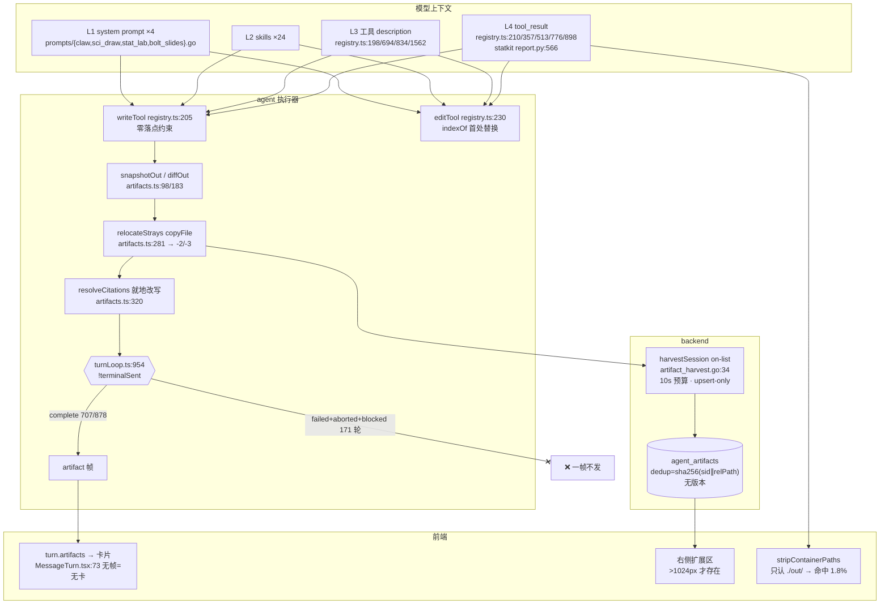
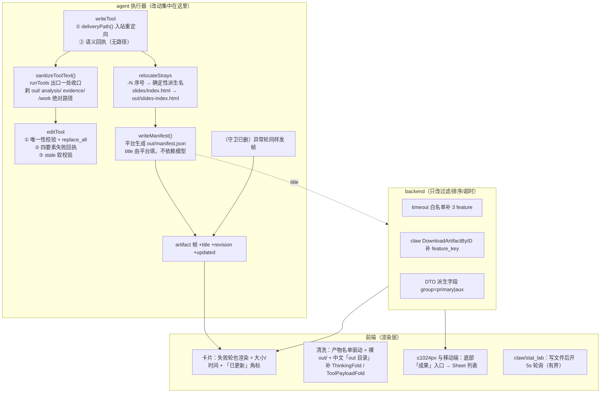

# 方案 A · 交付面止血术（最小手术 · 两周可上线）

> 定位：在**不动 `agent_artifacts` schema、不动 `out/` 物理落点、不引入新的模型可见工具**的前提下，
> 给出「今天就能止血的最大集合」，并诚实画出它的天花板。
> 边界内可改：`turnLoop` 的发帧时机与守卫 · `artifacts.ts` 的搬运/去重 · Edit/Write 的语义与回执 ·
> 四份 system prompt · 工具 `tool_result` 文案 · 前端渲染与清洗 · backend 的过滤/排序/超时白名单。
>
> 取证依据：本目录 01/02/03/04/05/09 六份报告 + 协调者的生产库实测。本文不重复取证，只在每条动作上标
> 「对应哪条事实」。所有 `file:line` 均为 2026-08-07 工作树实读。

---

## 〇 · 一句话主张

**今天这条链路的三条痛点，有一条是 bug（一行守卫吃掉 19.5% 的轮），一条是错层（把「交付」这个语义动作
交给「写对目录」这个隐式约定去实现），一条是自伤（我们在 57 个点教模型说 `out/`，只在 1.5 个点禁止它）。**

最小手术能把前两条压到接近零、把第三条压到个位数，**代价是彻底放弃「版本」这个概念** ——
本方案会让「同一份文件被改到第 3 版」在生产上真的发生（今天它 99.4% 不发生，被 `-2/-3` 分叉掩盖着），
而三层都没有版本，用户将拿不回 v1。这不是本方案能修的，见 §14。

与另外两个方案的分野：**A 不改变任何契约的形状，只改变它们的取值与文案。**
不新增表、不新增工具、不新增帧类型（只给既有 `artifact` 帧加可选字段）、不改端点签名。
因此它的全部风险都是「行为变了但结构没变」，回滚代价 = `git revert` + `docker-compose restart`。

---

## 一 · 三条痛点在链路上的精确落点（一页地图）



| 用户原话 | 主机制 | 生产实测 |
|---|---|---|
| 「文件输出在用户端看不到」 | `turnLoop.ts:954` 的 `!terminalSent` 守卫 | **171/878 轮（19.5%）零帧**；complete 轮里也只 303/707 有帧 |
| 「编辑改不到」 | `relocateStrays` 的 `copyFile` 建立**快照关系**而非引用关系（R1）+ Edit 首处替换报成功（R3）+ 引用展开就地改写（R2）+ 压缩失忆（R4） | `-N` 副本行 14 条**成对同存**；原地更新行 6/1035 = **0.6%** |
| 「说输出到 out 目录」 | 57 个正面注入点 vs 1.5 个禁令；前端清洗器只认 `./out/` | 助手正文泄漏 **221/709 = 31.2%**；清洗器命中率 **1.8%** |

**外加一条协调者实测、三份报告都低估了的**：`agent_artifacts` 里 **629/1035 行（60.8%）文件名含 ≥8 位十六进制哈希段**，
`title` 非空行 **0**。也就是说「用户完全无法判断哪份是答案」的规模比 `out/` 泄漏还大，
而且 `manifest.json → title` 这条已经写好的通道**从未在生产被用过一次**（`claw/artifact.go:46-49` 是死机制）。

---

## 二 · 方案的三条不变量

A 方案的全部动作都从这三条推出来，且互相不冲突：

> **I1 · 产物的存在与否，不取决于本轮结不结得成。**
> 落地 = 删掉一个守卫。这是唯一一条「改一行、修 19.5%」的动作。

> **I2 · 模型编辑的那个 inode，必须就是用户下载的那个 inode。**
> 落地 = 把落点纠偏从「轮末复制」前移到「写入时刻重定向」。
> 一旦入站重定向生效，`relocateStrays` 就从主路径退化成边缘兜底，`-2/-3` 自然消失。

> **I3 · `out/` 这个词，不出现在任何回到模型的字符串里。**
> 落地 = `tool_result` 出口一处收口（机械），而不是在 prompt 里加第二条禁令（劝导）。
> 依据：本仓已有结论「否定式规则没用，须正面模板」（`claw-ascii-diagram-relapse`）+
> 04 报告实测「claw 有全仓最详尽禁令仍泄漏 7.5%，且模型会**同时**说正确说法和路径」。

---

## 三 · 目标态架构



---

## 四 · 九个核心动作

### M1 · 拆掉 `!terminalSent` 守卫（P0 · 0.5 天）

**改哪**：`agent/src/turn/turnLoop.ts:954-978`。

```ts
// 改前
if (!terminalSent && outBaseline) { await emitArtifacts(...); }
else if (outBaseline)             { await runDeliveryGate(input.workDir); }

// 改后
if (outBaseline) {
  try { await emitArtifacts(input.workDir, outBaseline, sink); }
  catch (e) { log.warn("emit artifacts failed", { ... }); }
}
// else 分支整段删除 —— runDeliveryGate 已在 emitArtifacts:363 内，语义等价且只跑一次
```

**为什么安全（三条已验证的顺序前提）**：
1. `finally` 的发帧顺序是 `artifact → research_state → error → message_complete`
   （`turnLoop.ts:954 / 988 / 1017 / 1024`）。`sendError` 只登记不发送（`:420-424` 已改成 pendingError），
   所以 artifact 帧仍然先于 error 帧到达。
2. backend journal 的 tee 有 `if tid != 0` 守卫（`hub.go:1616`），`endTurn()` 由 error 触发 ——
   artifact 在 error 之前，`tid` 未清零，**入库**。这与 2026-08 给 `research_state` 做的修复是同一条链路，
   已被验证过一次。
3. 前端 `fold.ts:194-204` 的 `case 'error'` 在设置完字段后才 `turnIdx++`，
   而 `case 'artifact'`（`:142-150`）挂到 `current` —— 顺序天然正确。
   `MessageTurn.tsx:350` 的产物卡渲染条件里**没有** `!turn.errorMessage`，失败轮的卡片会正常渲染在错误提示之上。

**残余风险**：用户 stop（`signal.aborted`）也会发帧。这是**期望行为**——停之前写完的东西应该拿到。
但 abort 路径上 `emitArtifacts` 会多跑一次 `snapshotOut` + `runDeliveryGate`（statkit 子进程），
在用户连点 stop 时可能叠加。加一条：`emitArtifacts` 内对 `signal?.aborted` 跳过 deliveryGate（闸的意义是拦交付，
而 abort 轮的文件下一轮还会被闸看到）。

**对应事实**：171/878 轮零帧；02 报告 §3.2 表第 1 行；01 报告 §2.2(10)。

---

### M2 · 落点纠偏前移到写入时刻（P1 · 1.5 天）—— 本方案的核心

**改哪**：`agent/src/tools/registry.ts` 的 `writeTool.run`，新增纯函数 `deliveryPath()`（建议放
`agent/src/turn/deliveryPath.ts`，与 `artifacts.ts` 共享扩展名常量）。

```ts
// deliveryPath(rel: string): string | null —— 纯函数、无状态、可单测
// 返回 null = 不重定向；返回 "out/<basename>" = 重定向
export function deliveryPath(rel: string): string | null {
  const clean = rel.replace(/^\.\//, "");
  if (clean.includes("/")) return null;                 // ① 只处理裸文件名
  if (ROOT_SKIP_FILES.has(clean)) return null;          // ② prism/boltslides 工作文件
  const ext = extname(clean).toLowerCase();
  if (clean.toLowerCase().endsWith(".fig.json")) return `out/${clean}`;   // sci_draw A 车道
  if (!DELIVER_ON_WRITE_EXTS.has(ext)) return null;
  return `out/${clean}`;
}
// DELIVER_ON_WRITE_EXTS = DELIVERABLE_EXTS ∪ {.png .jpg .jpeg .webp .txt}
//   刻意不含 .py / .json / .zip / .bib —— 见下方「三条取舍」
```

**为什么是「只处理不含 `/` 的 file_path」**：
这是**最保守且完全可判定**的条件，而它恰好命中主路径。`deliveryGate.ts` 模块注释与
`artifacts.test.ts:229-231` 都自陈「模型最常见的落点是会话根 `Write("MBI分析结果.docx")`」。
带目录的写入（`报告/第一章.md`、`slides/index.html`）保持原样交给 M3 的 relocate 兜底 ——
那些路径承载着模型自己的组织意图（out/ 子目录 = zip 语义），不该被平台猜。

**三条取舍（必须写进代码注释，否则下一个人会「顺手补全」）**：
| 扩展名 | 决定 | 理由 |
|---|---|---|
| `.py` | **不重定向** | sci_draw skill 教的是 `Write("out/x.py")`（自带前缀，本函数不动它）；而 claw/stat_lab 里模型写的 `.py` 多半是临时脚本。生产已有 209 行 `.py` 被当交付物列出（20.2%），不该再扩大 |
| `.json` | **不重定向**（`.fig.json` 例外） | `out/manifest.json` 是平台元数据通道，重定向裸 `.json` 会撞它；且模型常写配置/中间态 json |
| `.zip` / `.bib` | **不重定向** | zip 通常是模型自己打包的中间物；`.bib` 是 prism 工作文件（已在 ROOT_SKIP_FILES） |

**Edit 侧对称处理**：`editTool` 与 `readTool` 也调 `deliveryPath()`，但语义不同 ——
**只在原路径不存在、而重定向后的路径存在时**才回落到 out/。这样模型下一轮 `Edit("报告.md")`
自动打到 `out/报告.md`，无需它知道发生过重定向。这是纯粹的入站别名，与
`confine.ts:30-38` 已有的 `/work` 别名翻译是同一个模式（已验证的既有形态）。

**收益（可从代码逐条推出）**：
- R1 分叉在主路径上消失：模型写的和用户下载的是**同一个 inode**，`Edit` 直接更新用户那份卡片。
- `-2/-3` 不再产生：`relocateStrays` 在主路径上不再有输入。
- `report.md` + `report.docx` 双卡问题缓解：`.md` 草稿仍会成卡（`diffOut:198-206` 只压 `X.docx.md`），
  但至少不会每轮 `+1`。
- `agent_artifacts` 的 `updated_at > created_at` 比例会从 0.6% 显著上升 —— 这既是收益也是新风险（§14.1）。

**残余风险**：
- 模型如果**故意**把草稿写在会话根（`Write("draft.md")` 当便签），现在会变成一张交付卡。
  缓解：`ROOT_SKIP_FILES` 扩充 `draft.md / notes.md / scratch.md / tmp.md`，并在 Write description
  里给出「不想交付就写进子目录」的正面出口。**这条无法彻底解决**——没有显式交付动作，就没有
  「这是草稿」的表达方式，这正是 §14.2 的天花板。
- 重定向后 `confinePath(forWrite)` 仍然跑（保留区/越界拒写不变），无安全面变化。

---

### M3 · `relocateStrays`：序号后缀 → 确定性派生名（P1 · 0.5 天）

**改哪**：`agent/src/turn/artifacts.ts:269-287`。

```ts
// 改前：for (let i = 2; await occupied(name) && i < 50; i++) name = `${stem}-${i}${ext}`;
// 改后：同名冲突时用**源路径派生**的稳定名，而不是递增序号
function derivedName(srcRel: string): string {
  //  slides/index.html → slides-index.html
  //  a/b/c/report.md   → b-c-report.md   （最多取末两级目录，防超长）
  const parts = srcRel.split("/");
  const base = parts.pop()!;
  const dirs = parts.slice(-2).filter(Boolean);
  return dirs.length ? `${dirs.join("-")}-${base}` : base;
}
```

冲突时不再加序号，**直接覆盖并 warn**（因为派生名对同一源路径是恒定的，覆盖 = 就地更新，正是想要的）。
`copyFile` 保留不变（**不改成 rename**）：M2 之后走到这里的都是带目录的构建产物
（boltslides 的 `slides/`、模型自建的工程目录），把它们 `rename` 走会破坏下一轮的构建。
这是刻意的非对称：**主路径靠入站重定向做到零副本，边缘路径接受副本但保证幂等。**

**顺带修两处静默丢弃**（01 报告 §2.1(8)，同一函数内，零成本）：
`copyFile` 的 `catch { continue }`（`:282`）与 `mkdir` 失败的早退（`:249`）各补一条 `log.warn`。

---

### M4 · `tool_result` 出口一处收口：`sanitizeToolText()`（P0 · 1 天）

**改哪**：`agent/src/turn/runTools.ts` 组装 `tool_result` 的地方（`:130-139`）——
**一处收口，覆盖全部工具，包括 statkit 的 JSON 返回值**。

```ts
// agent/src/turn/toolText.ts —— 新文件，纯函数，全量单测
const RULES: Array<[RegExp, string]> = [
  [/(^|[\s`"'([])\.?\/?out\/([^\s`"')\]]+)/g, "$1《$2》"],   // out/x.docx → 《x.docx》
  [/\/home\/bun\/sessions\/[^\s`"')\]]*\/([^\s/`"')\]]+)/g, "《$1》"],
  [/(^|[\s`"'([])(analysis|evidence)\/[^\s`"')\]]*/g, "$1（引擎内部区）"],
  [/(^|[\s(])\/work(\/[^\s`"')\]]*)?/g, "$1（工作区）"],
];
export function sanitizeToolText(s: string): string { /* 依次 replace，长度上限保护 */ }
```

**为什么在这一层而不是前端**：03 报告 §7.5 的结论是「路径泄漏必须在 agent 出口而不是前端展示层解决」，
04 报告 §七.3 算出「L4 一处改动覆盖 197/215 = 91.6% 的泄漏轮」。
模型不是从 system prompt 记住 `out/table1_cn-core_7227ab2adcf1.docx` 的 —— 它是 3 秒前从工具结果里读到的。

**同时改死这些原文**（都在 registry.ts，是它们自己在灌 `out/`）：

| 位置 | 改前 | 改后 |
|---|---|---|
| `:198` Write.description | `To deliver a file to the user, write it under ./out/ .` | `Files you write with a plain file name (no directory) are automatically delivered to the user as a downloadable card. Use a subdirectory for scratch work you do NOT want delivered.` |
| `:219` Edit.description | `Replace the first occurrence…` | 见 M6 |
| `:210` Write 回执 | `wrote out/x.md` | `已写入《x.md》（4821 字）。它已作为可下载成果呈现给用户；继续修改请对同一文件名调用 Read/Edit。` |
| `:239` Edit 回执 | `edited x.md` | 见 M6 |
| `:694` ExportDocument.desc | `written under ./out/ (the user-delivery directory)` | `The result is delivered to the user as a downloadable document; its display name is returned.` |
| `:776` 回执 | `exported out/x.docx (N bytes) — delivered to…` | `已生成《x.docx》（N 字节）并交付给用户。` |
| `:357` Bash 闸失败 | `…并把已完成内容写入 out/ 供用户下载。` | `…并把已完成内容用 Write 写成文件交付给用户。` |
| `:513` 导出闸失败 | `…已用 Write 落盘为 out/<名称>.md…` | `…已用 Write 写成《名称.md》…` |
| `:834` BuildDeck.desc | `writes a single inlined .html into ./out/` | `builds and delivers a single self-contained .html to the user.` |
| `:898` 回执 | `Deck built and delivered: out/deck.html` | `演示稿已生成并交付：《deck.html》。` |
| `:1562` StatReport.desc | `bundle (path under analysis/, …)` | 保留 `bundle` 参数（它是工具入参，模型必须能传），但描述里去掉 `analysis/` 目录名 |

**残余风险**：`sanitizeToolText` 是正则改写，会误伤「正文真的在讨论 `out/`」的场景（用户让模型跑
`mkdir -p out && echo > out/report.md` 时的 Bash 回显）。这个误伤面比前端清洗小得多（tool_result
不是给人看的），但**Bash 的 stdout 要豁免**（`registry.ts` 的 bash 分支单独走不脱敏路径，
因为改写命令回显会让模型对自己刚跑的命令产生错误认知）。这条豁免本身是 §14.3 的一部分泄漏下限。

---

### M5 · StatReport 产物改语义名（P1 · 1 天）

**改哪**：`registry.ts:1554-1620` 的 StatReport 包装（**不改 python**）。
拿到 `report.py` 的返回 JSON 后，在回执组装前做一次落盘改名 + 回执重写。

```
statkit 产出                                   → 改名后
out/table1_cn-core_0bad84c81690.docx           → out/三线表_中文核心期刊.docx
out/results_cn-core_0bad84c81690.md            → out/Results段_中文核心期刊.md
out/analysis_0bad84c81690.py                   → out/复现脚本_中文核心期刊.py
```

命名模板：`<产物中文名>_<system_name_zh>.<ext>`（`system_name_zh` 已在返回 JSON 里）。
目标已存在且内容不同 → 追加人类可读序号 `_第2次`（**不是 hex，不是 -2**）。

回执改成：
```json
{"ok":true,"delivered":[
  {"title":"三线表（中文核心期刊格式）","format":"docx"},
  {"title":"Results 段落","format":"md"},
  {"title":"可复现脚本","format":"py"}],
 "methods_zh":"…","results_zh":"…","authoring_notes_zh":[…]}
```
**没有任何路径键**。模型要向用户介绍产物时，手里只有中文标题 —— 它照抄就是对的说法。

**收益**：直接消灭 60.8% 的哈希文件名（新增行口径）+ 197/215 泄漏轮里的绝大部分（stat_lab 占 201/221）。
同一 system 重跑 → 同名覆盖 → `agent_artifacts` 同一行 upsert → **卡片就地更新**，这正是今天 0.6% 的那格。

**残余风险**：同一会话对**两个不同数据集**跑同一 system，第二次会命中「内容不同」分支落成
`_第2次`。用户仍需自己分辨，但「三线表_中文核心期刊_第2次.docx」比
`table1_cn-core_442fde7bc89c.docx` 好一个数量级。真正的解是产物带「这是对哪份数据的分析」的元信息 —— §14.4。

---

### M6 · Edit 语义对齐 + 四要素失败回执（P0 · 1 天）

**改哪**：`registry.ts:217-244`。签名新增一个可选参数（不是新工具）：

```ts
{
  name: "Edit",
  description:
    "Replace old_string with new_string in a file. old_string must match EXACTLY (including all "
    + "whitespace and indentation) and must be UNIQUE in the file — if it appears more than once, "
    + "the call fails and asks you to add surrounding context. Pass replace_all: true to replace every "
    + "occurrence on purpose. Always Read the file first; if the platform changed it since your last "
    + "Read, the failure message will say so.",
  input_schema: { properties: {
    file_path: {type:"string"}, old_string: {type:"string"}, new_string: {type:"string"},
    replace_all: {type:"boolean", description:"replace every occurrence instead of requiring uniqueness"}
  }, required: ["file_path","old_string","new_string"] },
}
```

行为（抄 Anthropic 官方语义 + aider 的失败回执四要素，见 09 报告 §5.3 / §1.8）：

| 情形 | 回执 |
|---|---|
| 命中 1 处 | `ok`：`已更新《x.md》：替换 1 处，文件 4821 → 4903 字。` |
| 命中 N>1 且无 `replace_all` | **`isError`**：`edit failed: 在《x.md》中找到 N 处匹配。请扩大 old_string 到唯一匹配，或显式传 replace_all: true。首处上下文：…（前后各 1 行）` |
| 命中 N>1 且 `replace_all` | `ok`：`已更新《x.md》：替换 N 处。` |
| 命中 0 处 | **`isError`** 四要素（见下） |
| `new_string` 已在文件中且 `old_string` 不在 | `isError`：`edit failed: 未找到 old_string，但 new_string 已存在于文件中 —— 这次修改可能已经生效，请先 Read 确认，不要重复提交。` ← **幂等重试的终止条件，直接掐死循环** |

零命中的四要素回执：
```
edit failed: 在《综述.md》中未找到 old_string。
① 匹配是逐字符精确的，包含全部空白、缩进与标点，常见原因是空白或全半角差异。
② 该文件共 12043 字符 / 187 行。你在本轮 Read 过它（第 3 轮）。   ← 或「你本会话尚未 Read 过它」
③ 平台在你上次 Read 之后改动过这个文件（引用句柄展开 / 交付整理），请先重新 Read。 ← 命中 stale 时才出现
④ 最接近的片段（第 42-46 行）：
   …实际文本…
```
其中 ④ 用 `SequenceMatcher` 等价实现（相似度阈值 0.6，返回目标行 ±5 行）——
这是 09 报告 §1.8 里 aider 唯一被实测背书的那一档容错，**不做无阈值的编辑距离全局模糊匹配**
（aider 自己用一个裸 `return` 把那层关掉了）。

**stale 软校验（打掉 R2 的关键）**：在执行器进程内维护
`Map<workDir+relPath, {mtimeMs, size, turn}>`，`readTool` 成功时写入，`editTool` 执行前比对。
不匹配 → 回执里出现 ③。**刻意做成软校验（提示而不拒绝）**：本仓的 `resolveCitations`
（`artifacts.ts:320`）会在每轮末就地改写交付文件，硬拒绝会让「带引用的长文交付」在第二次编辑时
100% 卡死。软校验把 R2 从「静默失败」变成「可自救」。
进程重启后 Map 为空 → 退化为不提示（不是误报），这是安全方向的退化。

**不做的**（09 报告负面清单）：不加 `undo_edit`（Anthropic 已下线）、不加 `MultiEdit`（会是第 5 个模型可见工具，
越界）、不做「失败 N 次自动整篇重写」（Cline #3183 实测毁文件）。

---

### M7 · 复活 `manifest.json` 的 title 通道，由**平台**写（P1 · 0.5 天）

**改哪**：`agent/src/turn/artifacts.ts` 的 `emitArtifacts`，在发帧前写/合并 `out/manifest.json`。

今天这条通道是死的（生产 title 非空行 = 0），因为它依赖模型主动写、而且只有 claw 的 prompt 教过。
本方案**不再依赖模型**：平台按确定性规则生成 title，模型写的 manifest（如果有）优先级更高。

```
title 生成规则（纯函数，无 LLM）：
  1. 若模型写过 out/manifest.json 且有该文件条目 → 用模型给的（保留既有语义）
  2. 否则按文件名去技术化：
     三线表_中文核心期刊.docx      → 「三线表（中文核心期刊格式）」
     results_xxx.md / Results段_*.md → 「Results 段落」
     analysis_*.py / 复现脚本_*.py   → 「可复现分析脚本」
     <任意>.svg                     → 「科研配图 · <stem>」
     其余                            → stem 原样（去掉扩展名与 ≥8 位 hex 段）
```

**收益**：`harvestSession` 已经在读 manifest（`artifact.go:82`），零 backend 改动即可让
`agent_artifacts.title` 从 0 行变成几乎全覆盖；前端 `TurnArtifacts.tsx:107`
`primary = artifact.title || artifact.name` 这条早已写好的通道立刻生效。

**并同步进 artifact 帧**（M8），让轮内卡片在 DTO 到达之前就有中文标题。

**残余风险**：`manifest.json` 自身在 agent 侧的 `snapshotOut` 里**不被排除**
（`artifacts.ts:107-121` 只跳点开头），会成为一张卡（01 报告 §2.1(12)）。
本动作会让它每轮都变更 → 每轮多一张 `manifest.json` 卡。**必须同时在 `snapshotOut` 里排除它**
（一行，与 backend `shouldListArtifact` 口径对齐）。这是本动作的强制配套，漏了就制造新 bug。

---

### M8 · `artifact` 帧加三个可选字段（P1 · 0.5 天）

不改帧类型、不改 backend `classifyJournalEv`（`hub.go:2086`）、不改 journal 存储（payload 是 JSON）。
前端与 backend 对未知字段都是忽略语义，**纯增量**。

```ts
sink.frame({
  type: "artifact",
  name, path, kind, mime, size,
  title?: string,      // M7 的语义名
  revision?: number,   // 本会话该 path 第几次被交付（执行器进程内计数；重启后从 1 重新计，只影响文案）
  updated?: boolean,   // revision > 1，即「这次是更新既有产物」
});
```

前端（`shared/types/chat.ts` 的 `TurnArtifact` + `fold.ts:142-150` + `agent-history.ts:324-342`）
三处各加透传，卡片据此渲染「已更新」角标（M9）。

---

### M9 · 前端：五处渲染 + 一处清洗重写（P1/P2 · 2 天）

**9.1 卡片语义（`TurnArtifacts.tsx`）**
- 渲染 `title || name`（已有）+ **补上 `size` 与 `updated` 角标**：
  `综述.md · 23 KB · 已更新（第 2 版）`。今天卡片上没有大小、没有时间、没有版本（03 报告 §3.8）。
- 同一 `path` 在更早轮出现过时，早轮卡片加一行弱提示「此文件已被后续更新，下载得到的是最新版」。
  这不解决版本问题，但**消除欺骗**（今天早轮卡片下载到新内容且界面零标注）。
- `IMAGE_EXTS` 补 `.avif`，与 `artifact-format.ts:23` 对齐（03 报告 §2.1c）。

**9.2 失败轮卡片**（M1 的前端配套）：`MessageTurn.tsx:350` 已无 error 守卫，零改动即生效；
但要在 `TurnErrorNotice` 上方加一句「本轮未完成，但以下成果已生成」的上下文提示，避免用户困惑。

**9.3 清洗器重写（`shared/lib/strip-container-paths.ts`）**
今天的正则只认 `./out/`，命中率 1.8%。改成**三层**：

```ts
// ① 产物名单驱动（无歧义、零误伤）—— 调用方把本会话 artifacts 的 name/title 传进来
//    "out/table1_x.docx" / "`table1_x.docx`" → 「《三线表（中文核心期刊格式）》」
// ② 锚定正则：out/ 后面必须跟已知交付扩展名，才认定为容器路径
const OUT_ANCHORED = /`?\.?\/?out\/([^\s`)）,，。;；]+\.(?:md|docx|xlsx|pptx|pdf|csv|html|svg|png|jpg|py|json))`?/gi;
// ③ 中文短语：「out 目录」「out/ 目录下」「工作目录」「分析目录」→「成果区」
const ZH_PHRASE = /(?:`?\.?\/?out\/?`?\s*(?:目录|文件夹)(?:下|中|里)?)|工作目录|分析目录/g;
```
① 消灭歧义（`checkout/` `layout/` 不可能命中已知产物名），② 用扩展名锚定替代 `./` 前缀锚定 ——
这正好覆盖生产实测的 98.2% 裸 `out/` 形态，③ 覆盖用户原话「说文件输出到 out 目录下」。

**补三个未清洗的展示面**（03 报告 §5.4）：`ThinkingFold`（`MessageTurn.tsx:229-231` 裸传，
且流式期默认展开）、`ToolPayloadFold`（`ToolCallBlock.tsx:274-308` 的 input JSON）、`TurnErrorNotice`。

> ⚠️ 这是**渲染层**清洗。journal 里存的仍是原文，后台会话监控、导出、小程序镜像各自会再暴露一次
> （02 报告 §九.7）。本方案接受这一点：真正的收敛在 M4/M5 的源头。

**9.4 窄屏与移动端入口**（03 报告 §3.2/§3.3）
`≤1024px` 与 `/m/claw` 增加一个底部固定的「成果（N）」按钮 → 打开 Sheet，内容复用
`ClawArtifactPanel` 的列表态（**不是新组件**，`features/claw/components/preview/` 下既有）。
今天窄屏只有「从卡片点预览」一条路，帧没发就零入口。
移动端只支持 claw 路由这件事**不在本方案范围**（要新增三条路由 = 新页面 = 超出「渲染改动」）。

**9.5 轮中可见性（有界轮询）**
`claw` / `stat_lab` 今天不轮询（`ConversationWorkspace.tsx:173`）。改成**条件轮询**：
本轮出现过 `Write` / `ExportDocument` / `StatReport` / `BuildDeck` 的 `tool_use` 之后才开启，
间隔 **5s**（不是 boltslides 的 2.5s），`busy` 结束即停。
代价是每次触发一次 on-list 全量 harvest（`artifact_harvest.go:34`，10s 预算内读所有 out 文件 + MinIO PUT）——
条件触发 + 5s 把这个代价压到只有真正产出文件的会话才付。
**这只把「4 分钟看不到」压到「5 秒延迟」，不是根治**（03 报告 §七.1）。

---

## 五 · 数据模型（零 schema 改动）

**不新增表、不新增列、不写迁移文件。** 三处载体：

| 载体 | 位置 | 生命周期 | 用途 |
|---|---|---|---|
| `agent_artifacts.title` / `.description` | 既有列（`0025`） | 随行 | M7 平台生成的语义名，经 `manifest.json` 通道进库 |
| `out/manifest.json` | 会话 `out/` | 随 workdir（30 天 GC） | 平台⇄backend 的既有契约（`artifact.go:46-49`），本方案把它从「模型可选写」改成「平台必写」 |
| 执行器进程内 `Map` | agent 内存 | 进程生命周期 | M6 的 stale 记录 + M8 的 revision 计数。**刻意不落盘**：这两项丢失只影响文案质量，不影响正确性；落盘会引入一个新的、无人维护的状态文件（本仓已有教训：数据完整性别靠 env / 别靠侧车） |

**明确不做**：不给 `dedup_anchor` 加内容维度、不开 MinIO versioning、不加 `version` 列。
这三件都是「有版本」的必要条件，任何一件都超出「不动 schema」。见 §14.1。

---

## 六 · 协议帧

只有一处变化，且是纯增量：

```
帧类型      改动
artifact    +title?: string  +revision?: number  +updated?: boolean
其余        无
```

**兼容性核对**（三层都已确认）：
- backend `hub.go:2086` 的 `classifyJournalEv` 按 `type` 分流，payload 原样入 journal、原样广播 —— 无需改。
- backend `eventlog_store.go:512-528` 折成 `Type=="artifact"` 的 SessionMessage，content 即原 payload —— 无需改。
- 前端 `fold.ts` / `agent-history.ts` 需各加 3 个字段透传（否则回放时角标丢失）。
- `eventlog_validate.go` 若对 artifact payload 有字段白名单需复核（**上线前必查**，本方案假设它不校验 artifact 帧字段）。

---

## 七 · 工具签名与回执（汇总表）

| 工具 | schema 变化 | 回执变化 | 行为变化 |
|---|---|---|---|
| `Write` | 无 | 语义化、无路径、含字数 | **入站落点重定向**（M2） |
| `Edit` | +`replace_all?: boolean` | 唯一性错误 / 四要素失败 / 结构化成功 | 唯一性校验 + stale 提示 + 相似片段定位（M6） |
| `Read` | 无 | 头部加 `[《x.md》 · 12043 字 · 187 行]` | 记录 stale 基线（M6）。**CJK 假截断顺手修**：`registry.ts:183` 的 `buf.length > MAX_READ_BYTES` 判据与 `:185` 的字符截断单位不一致，改成同以字符为单位判定 —— 一行，消灭 05 报告 §3.3 那条 100% 触发的假警告 |
| `ExportDocument` | 无 | 去路径 | 无 |
| `BuildDeck` | 无 | 去路径 | 无 |
| `StatReport` | 无 | **完全重写**：`delivered[{title,format}]`，无路径无 hash | 落盘改名（M5） |
| `Bash` | 无 | 闸失败文案去 `out/`；**stdout 不脱敏** | 无 |

**没有新增工具。** `replace_all` 是既有工具的参数，模型对它的先验来自 Claude Code，属于「对齐训练分布」
而非「新增能力面」。

---

## 八 · 提示词改动

### 8.1 抽一段公共交付纪律（`backend/internal/prompts/delivery.go`，新文件）

四份 prompt 今天各写各的，禁令只有 claw 有（04 报告 §一）。抽一个常量，四处 include：

```go
// DeliveryDiscipline —— 四个有写面的 feature 共用的交付表达纪律。
// 🔴 正面模板优先：本段刻意**不出现** "./out/" 字样。
//    依据：claw 有全仓最详尽的禁令仍泄漏 7.5%，且实测模型会同时说正确说法与路径
//    （04 报告 turn=98）；而禁令段自己重复了 3 次 ./out/ 是经典自伤形态。
const DeliveryDiscipline = `
# 成果怎么交给用户
用户在**网页聊天界面**里看你，他没有文件管理器、没有文件树、没有 IDE、看不到任何目录。
- 你写出的成品会**自动**作为下载/预览卡片出现在你这条回复的正下方 —— 这是唯一的交付方式，
  你不需要做任何额外动作，也不需要告诉用户它在哪。
- 【正面模板】介绍成果时**只说成果本身**，用书名号带上它的名字：
  「已为你生成《锂电池固态电解质综述》，可在下方查看或下载」
  「《三线表（中文核心期刊格式）》已生成，可直接插入论文」
- 【先写后说】只有文件真的写成功了，才允许说「已生成 / 可下载 / 见下方卡片」。
  写入失败就如实说失败并把内容放进正文，绝不编造补救办法。
- 你在对话里**永远用成果的名字**称呼它（《综述.md》），不用它在系统里的位置。
`
```

**同时删掉的反面注入**（这些是 04 报告实测的直接燃料）：
- `sci_draw.go:63-64` 的「路径铁律」整段 —— 尤其那句**「也不必加 ./ 前缀」**，
  它正在系统性地生产清洗器唯一不认的形态。A/B/C 车道保留 `out/<名字>.fig.json` 的写法教学
  （Bash 渲染必须知道路径），但把它从「铁律」降级为一行技术说明，并移出「交付与披露」一节。
- `claw.go:114-138` 里 10 处 `./out/` 压到 **1 处**（只在「多文件打包」那一条必须解释子目录时出现）。
- `stat_lab.go` 补 `DeliveryDiscipline`（今天一个字没有，泄漏 36%）。
- `bolt_slides.go:48` 的「别贴文件路径/技术细节」换成 `DeliveryDiscipline`。
- `agent-skills/` 侧 24 处：sci-draw 三个 SKILL.md 的 `./out/` 保留（它们教的是 Bash 命令，真需要路径），
  但 `workbench/SKILL.md:16-22` 那段把 `/work` 和 `/home/bun/sessions` 做成世界观基础的文字**必须改写**
  ——保留「直接用文件名读、不要 cd」这个有效结论，删掉两个绝对路径的解释。

### 8.2 轮首工作区状态注入（**本方案唯一一处越界动作，需明示**）

`turnLoop.ts:180` 每轮开头已经算了 `snapshotOut`，这份事实从未告诉过模型（05 报告 §6.2）。
本动作在首条 user 消息前追加一段 ≤200 字的带内文本：

```
【当前成果区】本会话已交付给用户的成品：《综述.md》(23KB, 你在上一轮更新过)、
《对比表.csv》(4KB)。要修改其中任何一份，直接用它的文件名调用 Read / Edit —— 不要新建同名文件。
```

**为什么值得越界**：05 报告 §7.C3 判定这是「本次调研认为最高杠杆的单点改动」。它同时补偿四件事：
① 压缩/重连后的失忆（R4）；② 模型不再宣称交付了不存在的文件；③ 给模型一份**不含路径的、可以直接对用户说的**
产物清单；④ 平台背着模型改文件（R2）的告知通道。

**为什么它仍在「最小」范围内**：不新增工具、不新增帧、不改 messages 结构（只是首条 user 的 in-band prefix，
与 backend 已有的 system prompt prefix 是同一机制）。
**开关**：`EXECUTOR_WORKSPACE_DIGEST=0` 可关（这一条是文案质量而非数据完整性，允许挂 env）。

---

## 九 · backend 改动（三处，全在允许范围）

| # | 改动 | 位置 | 理由 |
|---|---|---|---|
| B1 | `isObjectServePath` 白名单补 `/boltslides/artifact`、`/sci_draw/artifact`、`/stat_lab/artifact` | `middleware/timeout.go:57` | **真 bug**：三个 feature 的产物下载落 15s GET 超时，大 docx/deck 弱网下会被掐成坏文件。当年给 claw 补白名单的事故注释就在同一函数里，镜像时没跟着复制（02 报告 §八） |
| B2 | `DownloadArtifactByID` 补 `row.FeatureKey != FeatureKey → 404` | `claw/artifact.go:283-295` | 另三个镜像都有，claw 缺（02 报告 §4.2） |
| B3 | DTO 加派生字段 `group: "primary" \| "aux"` | `claw/artifact.go` 的 ArtifactDTO 组装 | 209 行 `.py`（20.2%）与中间 `.md` 今天与三线表并列展示。按扩展名 + title 规则派生，**不落库、不改表**；前端据此分「主要成果 / 附带材料」两组 |

**排序**：`ListBySession` 保持 `created_at ASC`（`repository.go:65`）—— `ConversationWorkspace.tsx:196`
的 `autoOpenLatestArtifact` 依赖「末尾是最新」，改后端排序会静默破坏 boltslides。
面板里的「最新在最下面」由**前端展示层反转**解决。

**明确不做**：收割脱离 HTTP GET、`OnArtifact` 钩子、GC、删用户级联。全是大手术，见 §14.6。

---

## 十 · 迁移与回滚

**零数据库迁移。** 不写 SQL 文件。

| 动作 | 开关 | 回滚方式 | 回滚后是否留下脏数据 |
|---|---|---|---|
| M1 拆守卫 | **无开关** | `git revert` + `restart scholar_agent` | 否（多发的帧已入 journal，回放时多显示卡片，无害） |
| M2 落点重定向 | `EXECUTOR_DELIVERY_REDIRECT=0` | 改 env + restart | 否。已重定向的文件留在 out/，是正确位置 |
| M3 派生名 | 无开关 | revert | 否 |
| M4 回执脱敏 | `EXECUTOR_SANITIZE_TOOL_TEXT=0` | 改 env + restart | 否 |
| M5 StatReport 改名 | `STATKIT_FRIENDLY_NAMES=0` | 改 env + restart | **是**：已改名的行留在 `agent_artifacts`（旧 hex 名的行也还在，upsert-only 不删）。回滚后新产物回到 hex 名，同一会话里两种命名并存 |
| M6 Edit 语义 | **无开关** | revert | 否 |
| M7 manifest | 无开关 | revert（**必须同时 revert `snapshotOut` 排除 manifest 的那一行**，否则每轮多一张 manifest 卡） | 否 |
| M8 帧字段 | 无开关 | 前端忽略未知字段，可单边回滚任一侧 | 否 |
| M9 前端 | 无开关 | revert + `docker-compose up -d --build frontend-user` | 否 |
| 8.1 prompt | 无开关 | revert + `restart scholar_backend`（prompt 在 backend）；skill 改动需 `restart scholar_agent` | 否 |
| 8.2 轮首注入 | `EXECUTOR_WORKSPACE_DIGEST=0` | 改 env + restart | 否 |

**开关原则**（本仓教训）：**数据完整性不挂 env**（M1/M6/M7 无开关），
只有「文案/命名/体验」类挂开关。M5 是唯一会留下命名不一致的动作 —— 上线后不建议回滚，
要么不上、要么不回。

**部署顺序**（有依赖）：
1. agent（M1-M8）→ 观察 24h：帧数、`artifact relocate` warn 计数、Edit 失败率
2. backend（B1-B3 + prompt）→ 观察 24h：泄漏率 SQL
3. frontend（M9）—— 必须**在** M8 之后，否则新字段无处消费（但反过来无害）

**前端强约束自查**（`frontend-user/CLAUDE.md`）：M9 不新增任何第三方包、不新建 `.css`、
不用 Context 传状态、Sheet 复用既有 `shared/ui/sheet`、清洗器仍是 `shared/lib` 的纯函数（无依赖）、
所有新样式走 `globals.css` token（角标用 `text-12` + `bg-brand-green-soft`）。
提交前跑 `./scripts/check-design-system.sh`（跨包镜像口径）。

---

## 十一 · 分期与工时

单人天，「一个熟悉本仓库的工程师」，含自测与回归测试编写，不含等待观察窗。

### P0 · 止血（3.5 天）— 单独上线即有价值

| # | 动作 | 天 |
|---|---|---|
| M1 | 拆 `!terminalSent` 守卫 + abort 路径跳闸 | 0.5 |
| M4 | `sanitizeToolText` + 11 处 description/回执改写 | 1.0 |
| M6 | Edit 唯一性 + `replace_all` + 四要素回执 + stale 软校验 | 1.0 |
| — | Read 的 CJK 假截断修复（一行 + 单测） | 0.2 |
| B1/B2 | timeout 白名单 + claw feature_key | 0.3 |
| — | 回归测试：`artifacts.test.ts` 补「异常轮发帧」不变量；`registry` 补 Edit 六种回执断言 | 0.5 |

### P1 · 收敛（4.5 天）

| # | 动作 | 天 |
|---|---|---|
| M2 | `deliveryPath()` + Write/Edit/Read 三处接线 + 单测（含三条取舍的反例） | 1.5 |
| M3 | 派生名 + 两处静默丢弃补 warn | 0.5 |
| M5 | StatReport 改名 + 回执重写 | 1.0 |
| M7 | 平台生成 manifest + `snapshotOut` 排除 manifest | 0.5 |
| M8 | 帧三字段 + 前端三处透传 | 0.5 |
| 8.2 | 轮首工作区状态注入 | 0.5 |

### P2 · 表达面（3 天）

| # | 动作 | 天 |
|---|---|---|
| 8.1 | 公共 `DeliveryDiscipline` + 四份 prompt 改写 + skill 侧 workbench 改写 | 1.0 |
| M9.1/9.2 | 卡片语义（title/size/updated/早轮提示）+ 失败轮上下文 | 0.5 |
| M9.3 | 清洗器三层重写 + 补三个展示面 + 行为矩阵单测 | 0.7 |
| M9.4 | 窄屏/移动 Sheet 入口 | 0.5 |
| M9.5 | 条件轮询 | 0.3 |
| B3 | DTO group 派生 + 前端分组 | — （并入 M9.1） |

**合计 11 单人天。** 按 5 工作日/周 + 观察窗，两周内可完成 P0+P1+P2 的编码与上线，
但**验收数据要到第三周才有统计意义**（泄漏率与帧覆盖率的分母需要新会话累积）。

---

## 十二 · 验收判据

全部可 SQL 化或可机械判定。**上线前先跑一遍取基线**（本方案给出的基线数来自协调者实测）。

### 12.1 「看不到」

| 指标 | 口径 | 基线 | 目标 |
|---|---|---|---|
| 异常轮帧覆盖 | `agent_turns.status IN ('failed','aborted','blocked')` 且该 turn 有 `agent_turn_events.ev_type='artifact'` 的比例 | **0%**（171 轮） | ≥ 该类轮中「out/ 实际有新文件」的比例（预期 >90%） |
| 全轮帧覆盖 | 有 artifact 帧的轮 / 有 out/ 变更的轮 | 303/707 complete 轮有帧（分母未知） | 两者差值 < 5% |
| 死下载按钮 | 前端 `agentArtifactUrl` 路径直读返回 4404 的次数（nginx access log 或前端 clientlog） | 未测 | 单调下降；M9.1 后二进制卡在无 id 时改为「准备中」而非可点 |

### 12.2 「改不到」

| 指标 | 口径 | 基线 | 目标 |
|---|---|---|---|
| `-N` 后缀行 | `SELECT COUNT(*) FROM agent_artifacts WHERE rel_path REGEXP '-[0-9]+\\.[a-z]+$' AND created_at > <上线时刻>` | 14 条（历史） | **新增 0** |
| 哈希文件名行 | `rel_path REGEXP '[0-9a-f]{8,}'`，新增行口径 | 60.8% | **新增 < 5%**（残余是模型自己起的名） |
| 原地更新率 | `updated_at > created_at` 的行占比，新增行口径 | 0.6%（6/1035） | **> 15%** |
| Edit 失败率 | `agent_turn_events` payload 含 `old_string not found` 的轮 / 有 Edit 调用的轮 | **需先测** | 相对基线下降 ≥ 40% |
| relocate 改名 | `docker logs scholar_agent \| grep -c "artifact relocate renamed"` | 未测 | 趋近 0（M2 之后主路径不再产生 stray） |

### 12.3 「说 out 目录」

```sql
-- 泄漏率（分 feature），窗口 = 上线后新产生的轮
SELECT s.feature_key,
       COUNT(DISTINCT CASE WHEN JSON_UNQUOTE(JSON_EXTRACT(e.payload,'$.text')) LIKE '%out/%'
                            OR JSON_UNQUOTE(JSON_EXTRACT(e.payload,'$.text')) LIKE '%out 目录%'
                            OR JSON_UNQUOTE(JSON_EXTRACT(e.payload,'$.text')) LIKE '%工作目录%'
                       THEN e.turn_id END) AS leaked,
       COUNT(DISTINCT e.turn_id) AS total
FROM agent_turn_events e JOIN agent_sessions s ON s.session_id = e.agent_session_id
WHERE e.ev_type='content_delta' AND JSON_EXTRACT(e.payload,'$.text') IS NOT NULL
  AND e.created_at > '<上线时刻>'
GROUP BY s.feature_key;
```

| feature | 基线 | 目标 |
|---|---|---|
| 全站 | 31.2% (221/709) | **< 5%** |
| stat_lab | 36.0% (201/559) | **< 5%**（M5 单点即覆盖大部分） |
| sci_draw | 76.5% (13/17) | **< 15%**（B 车道 Bash 必须知道路径，下限非零） |
| claw | 7.5% | < 3% |
| 内部词 `bundle` / `StatRun` / `StatReport` | 60 / 31 轮 | 各 < 5 轮 |

### 12.4 行为判定（人工，各 3 例）

1. 让 stat_lab 做一次分析 → 三张卡的标题是中文语义名、无 hex、无 `out/`；回复正文里零路径。
2. claw 写一份综述 → 让它「把第三节的结论改一下」→ **卡片数量不增加**，下载到的是新内容。
3. 造一个 24 轮长任务撞 `round_cap` → 对话流里那一轮下方**有**产物卡 + 一句「本轮未完成但已生成」。
4. 文件里放 3 处相同字符串 → Edit → 收到「找到 3 处，请扩大上下文或传 replace_all」而非静默改第一处。
5. 带 `[[E1]]` 的长文，第二轮编辑 → 失败回执里出现「平台在你上次 Read 之后改动过这个文件」。
6. 1000px 宽窗口 / 手机 → 能从底部「成果」入口看到全部产物。

---

## 十三 · 与后续大手术的接口（不挖坑）

本方案刻意在三个地方**留出**而不是**占用**未来的设计空间：

- **`artifact` 帧的字段是可选增量**，将来引入稳定 `artifact_id` 时，`title/revision/updated` 可原样保留。
- **`deliveryPath()` 是纯函数**，将来若引入显式交付动作（`deliver: true` 参数或 `present_files` 式动词），
  它退化成一条 fallback 规则，删除成本 = 删一个 import。
- **`sanitizeToolText()` 是出口收口**，将来路径从模型上下文里彻底消失后，它变成一条永远不命中的规则 ——
  届时应当**删掉它**而不是留着（本仓对「永远绿的规则」有明确的负面结论）。

**本方案会给后续手术制造的唯一债务**：M5 的语义名与 `dedup_anchor = sha256(sid‖relPath)` 绑定，
一旦将来改名规则再变一次，同一份产物会在 `agent_artifacts` 里留下两行。
因此 M5 的命名模板应当**一次定死**，写进代码注释并配单测。

---

## 十四 · 本方案解决不了什么（天花板）

这一节是本方案能不能被采纳的判据。以下每一条都在最小手术的边界之外，**必须留给更大的手术**。

### 14.1 🔴 压不住：版本。而且本方案让它更痛

三层都没有版本概念，且三层都被约束条件锁死：
- DB：`dedup_anchor = sha256(session_id‖rel_path)` 是 UNIQUE（`0025:41`），一个 (会话,路径) 只能有一行 —— 改它 = 改 schema。
- MinIO：key 是路径派生（`artifact_harvest.go:173`），`ensureBucket` 没开 versioning —— 第二次 PUT 物理覆盖。
- 前端：`useAgentArtifactBytes` 的 queryKey 是 `[feature,'artifact-bytes', id]` + `staleTime 5min`
  —— 内容变了 id 不变，浏览器还会拿 5 分钟的旧字节（02 报告 §七.3）。

**今天用户实际在用 `-2/-3` 后缀当版本用**（02 报告 §七的原话）。M2/M3 把它消灭之后，
「改一份文件」变成真正的就地覆盖 —— **用户将拿不回 v1，且界面上除了一个「已更新」角标没有任何补偿**。
这是本方案最诚实的一处取舍：**我们用「不可回退的正确」换掉了「可回退的错误」**。

如果这个取舍不可接受，唯一的最小缓解是把 M2 关掉（`EXECUTOR_DELIVERY_REDIRECT=0`），
回到分叉态 —— 但那等于不修「改不到」。**两者不可兼得，必须由产品拍板。**
真正的解是平台侧写入前快照 + 用户可见版本链（09 报告 §档 4，Anthropic 官方安全实践第 2 条），
那需要新表或 MinIO versioning，**不在本方案范围**。

### 14.2 压不住：产物是「猜」出来的，不是「声明」出来的

约束里写死了「不引入新的模型可见工具」，所以「什么是给用户的」仍然由
4 个黑白名单（`DELIVERABLE_EXTS` / `ROOT_SKIP_DIRS` / `DEEP_SKIP_DIRS` / `ROOT_SKIP_FILES`）
+ 3 个预算 + 1 个 20 帧上限来猜。每一条都是一个静默丢失面（01 报告 §2.1 列了 9 类）：

- `.png` 写在会话根 → 扩展名白名单外 → 两条通道同时看不到（M2 把 `.png` 纳入重定向集合缓解了**裸文件名**那一半，
  子目录里的仍然全丢）。
- 一轮 >20 个交付物 → 第 21 个起既不发帧**也不被搬进 out/** → 永久丢失。M1 不改这个上限（改了会放大
  400 次 copyFile + 400 个 MinIO 对象）。
- 写进 `src/` `build/` `public/` → `DEEP_SKIP_DIRS` 任意层整棵跳过 → 永久不可见。
- 「帮我写一份 README」→ 落 `ROOT_SKIP_FILES` → 零帧零搬运零收割。这是完全合法的用户诉求，
  被 prism/boltslides 的工作文件名单误伤，**本方案不敢动那份名单**（动了会打断 prism 主稿链路）。

根治 = 显式交付动作（`Deliver(name, content)` 或 `Write(deliver: true)`），让「什么是给用户的」
成为一等公民。**这是 01 报告 §六.2 的结论，也是本方案边界外的第一条。**

### 14.3 压不住：路径泄漏的最后一公里（下限非零）

M4/M5/8.1 能把 31.2% 压到个位数，但**不可能到 0**，三条硬约束：
1. **sci_draw 的 B/C 车道**（Bash 跑 python 渲染 svg）在物理上要求模型知道文件路径 ——
   `python3 out/x.py` 这条命令必须写对。工具 chip 的 Bash 摘要在前端会经清洗，
   但模型正文里解释「我用脚本渲染了图」时仍可能带出路径。
2. **Bash stdout 不脱敏**（M4 的刻意豁免）：改写命令回显会让模型对自己刚跑的命令产生错误认知。
3. **渲染层清洗管不到 journal**：`agent_turn_events` 里存的仍是原文。后台会话监控
   （`internal/agentbridge` 的 transcript 视图）、小程序镜像、任何导出通道都会再暴露一次。
   03 报告 §七.5 明说「路径卫生必须在 agent 出口而不是前端展示层解决」——
   本方案在 agent 出口只收口了 `tool_result`，**没有收口模型正文**（那需要一条新的轮末 guard，
   而 `turnLoop.ts:744-880` 的 guard 集成点共享 `MAX_CORRECTIVE_ROUNDS=2` 预算，加第四条会挤掉语言纠偏）。

**唯一被数据验证为 0 泄漏的形态是 prism**（0/19），而它的做法是**架构上让模型没有理由提文件**
（交付走 DB 真源 + 工具栏导出按钮，`spec.go:42-46` 禁掉会写 out/ 的工具）。那是方案 B/C 的领域。

### 14.4 压不住：产物之间的语义关系

M5 能把 `table1_cn-core_0bad84c81690.docx` 变成《三线表（中文核心期刊格式）》，
但当同一会话对**两份不同数据**跑同一体系时，用户仍然要在
「三线表（中文核心期刊格式）」和「三线表（中文核心期刊格式）_第2次」之间猜。
产物没有「它是对哪份输入的分析」这个元信息 —— 那需要产物携带 provenance，
而 `agent_artifacts` 没有这个列（改 schema）。

### 14.5 压不住：轮中可见性的根本延迟

`emitArtifacts` 的机制是「轮首 snapshot → 轮末 diff」（`turnLoop.ts:180` + `artifacts.ts:341`），
**结构上就不可能在轮中途发帧**。M9.5 的条件轮询把「4 分钟看不到」压到「≤5 秒延迟」，
代价是每次触发一次 on-list 全量 harvest。

根治需要 agent 侧 fs watch（E2B / Cloudflare 的做法，见 11 报告）+ 增量帧 +
backend 事件驱动收割（2026-07 设计的 `OnArtifact` 钩子，从未实现）。**边界外。**

### 14.6 压不住：收割链路的六种静默丢失

`harvestSession` 仍然同步跑在 10s 的 HTTP GET 预算里（`artifact.go:191`），
仍然是 upsert-only 永不回收，仍然依赖「有人在 30 天内打开过那个会话」（02 报告 §四.4：
**MinIO 是唯一耐久层，但它的填充完全依赖用户打开页面** —— 这是整套设计里最脆的一根线）。
本方案对以下全部无能为力：
- 用户关标签后那轮才结束 → 无人发 GET → 不收割
- workdir 被 30 天 GC 后第一次 GET → `tree.State != "ok"` → 直接 return nil → **产物永久丢失，零日志**
- 10s 预算内没收完 → 后半段静默不入库
- 目录产物在 `collectDirForZip` 超时 → `harvestDir` 直接 return，无行无日志
- 删用户不删产物（`agent_artifacts` 无 FK、不在 `user/repository.go` 的清理清单里）
- MinIO 无 TTL、无 GC、无孤儿对账

### 14.7 压不住：移动端与窄屏的产品缺口

M9.4 给 `≤1024px` 和 `/m/claw` 加了成果入口，但：
- `/m/claw` 之外**没有** stat_lab / sci_draw / boltslides 的移动路由（`routes.tsx:19-35`）。
  用户在桌面用数据分析生成三线表，手机上打开那个会话链接 → feature 作用域的 `OwnsSession` 判否 →
  HTTP 404 → 静默跳回空白页。加三条移动路由 = 三个新页面，超出「渲染改动」。
- pptx 在自家预览器里完全没有分支（`artifact-format.ts:89-114`），是「我们自己生成、自己看不了」的格式。
- docx 预览把三线表画成全网格表（`DocxPreview.tsx:53` 无条件给每个 `td` 加边框）——
  这条**能顺手修**（改一个 className 条件），已并入 M9.1 的 0.5 天里，但更根本的
  docx 保真预览（09 报告 §7 的 unpack/repack 口径）不在范围。

### 14.8 压不住：R4（上下文失忆）的根

8.2 的轮首注入能告诉模型「有哪些文件、多大、上轮改过」，但**给不了文件内容**。
`shadowTurn.ts:56-91` 在重连/重启/内存驱逐后把每次工具调用折成一行
`【已调用 Read file_path="out/综述.md"】返回 48213 字符`，文件内容 100% 消失 ——
这是**无条件的**，与上下文压力无关，30 分钟空闲即触发（`sessions.ts:414`）。
模型仍然会拿幻觉的 `old_string` 去 Edit，只是现在**失败回执会告诉它先 Read**（M6 的 ②）。
从「静默失败」变成「多花一次往返自救」是真实收益，但根治需要
「被编辑过的交付文件在压缩层保留可寻址存根」——那是 compact/shadowTurn 的手术，边界外。

---

## 十五 · 一句话总结

**A 方案是止血，不是治疗。** 它能在两周内：把 19.5% 的隐形轮变成可见、把「改不到」的主路径机制
（copyFile 分叉 + 首处替换静默成功）消灭、把 31.2% 的路径泄漏压到个位数、把 60.8% 的哈希文件名
换成中文语义名、把死了的 `title` 通道接上线。

它的代价是**把「版本」这个缺口从被 `-2/-3` 掩盖的状态暴露出来**，
它的边界是**产物仍然靠猜而不是靠声明**。

这两件事，一件需要新表，一件需要新工具 —— 都在本方案的约束条件之外，
也正是方案 B/C 应当回答的问题。
