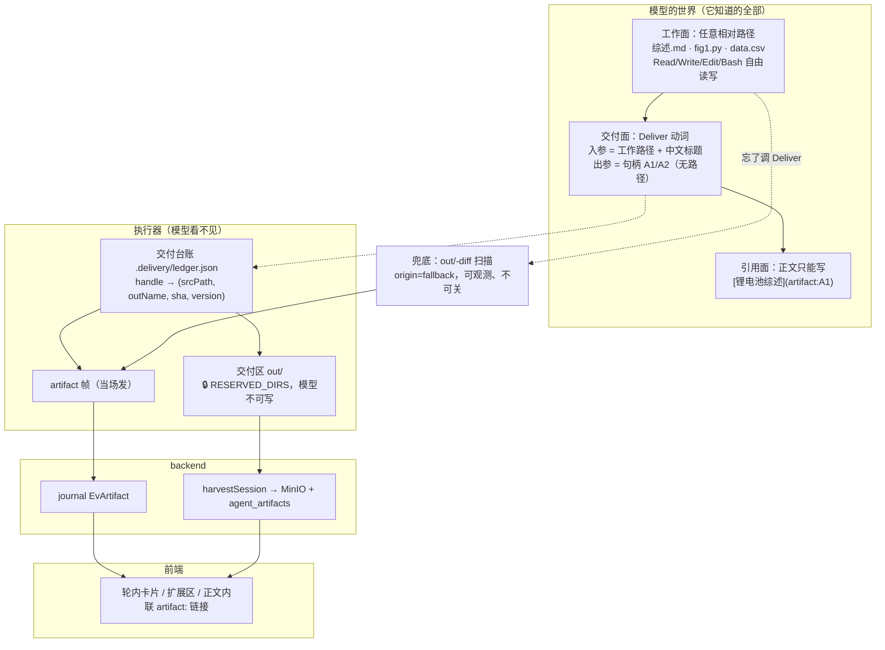

# 方案 B · 交付动词化：`out/` 从模型世界里彻底消失

> 2026-08-07 · 设计稿（未实现）
> 定位：`docs/research/artifact-delivery-2026-08/` 专项的**候选方案之一**。
> 取证真源是同目录 01–11 号报告 + 主协调者的生产库实测，本文不重复取证，只在需要立论的地方引用 `file:line`。
> 读者假定：已经读过 01/03/04/05/06/07，知道 `emitArtifacts` / `relocateStrays` / `harvestSession` 是什么。

---

## 〇 · 主张

**今天的交付语义是「一个目录约定」：模型把文件写进 `./out/`，平台事后扫描目录 diff，猜出哪些是产物。**

这个设计有一个不可修复的结构性后果：**`out/` 必须进入模型的输入**（system prompt 18 处、skill 24 处、
工具 description 4 处、tool_result 7 个产出点，合计 57 处 / 12 文件 / 3 种语言），
而任何进入模型输入的字符串都会以某个概率出现在模型输出里。生产实测 31.2%。
claw 用一条否定式铁律把它压到 7.5% —— 这已经是禁令的性能上限，**而 7.5% 仍然是每 13 轮暴露一次**。

本方案的主张：

> **交付是一个动词，不是一个位置。模型在任意位置工作，产出完成后调用 `Deliver`；
> `Deliver` 返回的是一个不透明句柄（`A1` / `A2`），不是路径。
> `out/` 变成模型物理上写不进去、语义上不知道存在的目录。**

三条推论，每条都是一次结构性收敛：

1. **泄漏问题从「防御」变成「不存在」。** 模型不知道 `out/` 这个词，就不会说它。
   剩余风险从"57 个注入点 × 否定式禁令"降级为"模型自己起的工作文件名"（`综述.md`）——
   低一个量级，且那本来就是可以对用户说的东西（"《锂电池综述》"）。
2. **交付时刻从「轮末 finally」提前到「工具调用当场」。** 19.5% 的异常终止轮（171/878）
   今天一张卡都不发（`turnLoop.ts:954` 的 `!terminalSent` 守卫）；`Deliver` 在轮中执行，
   帧当场就出去了，撞 `round_cap` / `budget` / 用户 stop 都不影响已交付的部分。
3. **产物获得稳定身份。** `handle` 是主键而不是路径，"同一份东西的新版本"第一次可以表达。
   `报告-2.md` / `报告-3.md` / 629 行哈希文件名（60.8%）这一整族现象，根因都是
   "用路径当身份 + 路径由模型的内部组织逻辑决定"。

**与其它方案的分野**：
- 不是"把 diff 扫描做得更全"（那是在错误的层加规则，每加一条白名单就多一个静默丢失面）；
- 不是"在前端加正则清洗"（`stripContainerPaths` 实测命中率 1.8%，是一条几乎永远绿的规则）；
- 不是"把禁令写得更凶"（claw 已经证明了禁令的上限，且本仓库有 ASCII 框图复发的前科）；
- 是**把交付语义的载体从路径换成动词，让"说出内部路径"这件事在模型的叙事里失去必要性**。

---

## 一 · 架构

### 1.1 三面分离



**关键的一刀在 `out/` 那个格子上加了锁。** `agent/src/sandbox/reserved.ts:39` 的
`RESERVED_DIRS` 已经是一套双闸机制（`confine.ts` canonical 路径拒写 + `bwrap.ts` `--ro-bind` 盖住 jail 内 Bash），
把 `out` 加进去是一行常量改动。加锁之后：

- 模型 `Write("out/报告.md")` → `refusing to write into engine-reserved directory`；
- 模型 Bash `echo > out/x` → jail 内只读，EROFS；
- 于是"我把文件写到了 out/ 目录"**在事实层面变成假话**，模型没有理由说它。

这是本方案与"只改提示词"的根本差别：**提示词是建议，保留区是物理事实。**
（reserved.ts:24 的警告"加错一个常用目录名 = 全站 Bash 写入失败"在这里适用 ——
所以 skill 里那 24 处教写 `out/` 的地方必须与保留区同批次改，见 §5.3。）

### 1.2 完整时序（对照 01 号报告的 T0–T6）

```
T0  runTurn 入口
    · outBaseline = snapshotOut(workDir)            ← 保留，降级为兜底基线
    · ledger = readDeliveryLedger(workDir)          ← 新增，读 .delivery/ledger.json
    · 台账文本 append 到最后一条 user 消息尾部       ← 走 digest 已验证的同一个 seam
                                                       (turnLoop.ts:305-320 附近)

T1..Tn  模型自由工作：Write("综述.md") / Bash / Edit("综述.md")
        回执里没有一个 out/ 字样

Tk  模型调 Deliver({items:[{path:"综述.md", title:"锂电池固态电解质综述", summary:"..."}]})
    ① 校验：存在 / 非目录 / 非空 / ≤12MB / 不在保留区 / confinePath 不越界
    ② 身份解析：replaces 显式 → 用该 handle
                 否则 srcPath 命中台账 → 复用该 handle（版本 +1）
                 否则 → 新 handle A<n>
    ③ [[E<n>]] 引用句柄就地展开 —— **写进交付副本，不动模型的源文件**（解 R2，见 §6.2）
    ④ copyFile(srcPath → out/<outName>)  outName 由台账固定，**永不加 -N**
    ⑤ 写台账
    ⑥ **sink.frame({type:"artifact", handle:"A1", title:"…", origin:"declared", version:1, …})**
       ← 当场发帧，不等 finally
    ⑦ tool_result：{delivered:[{handle:"A1", title:"…", kind:"file", size:42131, version:1}]}
       **不含任何路径**

Tn+1  模型正文：「已完成 [锂电池固态电解质综述](artifact:A1)，核心结论是…」

T_finally（turnLoop.ts:940-1025）
    · emitArtifacts 保留，但只发**未被 Deliver 声明过**的条目，标 origin:"fallback"
    · `!terminalSent` 守卫**去掉**（异常轮也跑兜底扫描）
    · 交付闸位置不变（在 relocate 之后）

T5/T6  backend / 前端：帧字段扩展，路径不再是 join key（handle 是）
```

### 1.3 为什么不做「Write 加 deliver:true 参数」

评审过，**不做**。三个理由：

1. `Write` 是"落盘"，`Deliver` 是"交付"，二者的失败语义完全不同：写失败要重试，
   交付失败要换内容。挤在一个工具里，`isError` 就没法分型。
2. 二进制产物（docx/pptx/xlsx/pdf）不经 `Write` 产生 —— 它们来自 ExportDocument / BuildDeck /
   StatReport / Bash 里的 python。`Write` 上的旗标覆盖不到主力产物类型。
3. `Deliver` 独立存在才能承载 `replaces` 语义（"这是那件东西的新版本"），
   而这正是"改不到"的解药。挂在 Write 上会逼模型每次重写全文。

Anthropic 从第一代 `artifacts(command=create|update)` 迁到第二代
`create_file + present_files` 走的正是这条路（07 号报告 §2.3），且它明确说明理由是二进制产物。

---

## 二 · 数据模型

### 2.1 交付台账（执行器侧，会话本地）

路径：`<workDir>/.delivery/ledger.json`。

选点理由：dot 开头 → `snapshotOut` 的 `artifacts.ts:108/142` 两处扫描都跳过；
backend `shouldListArtifact`（`claw/artifact.go:151-156`）也排除 dot；
所以它天然不会被误当成产物。**不放 `analysis/`**：那是 statkit bundle 的保留区，
语义不同，混进去会让"bundle 是数字唯一真源"这条立论多一个例外面。
`.delivery/` 需要同时进 `RESERVED_DIRS`（模型不可写，否则可以伪造 handle 与版本）。

```jsonc
{
  "v": 1,
  "seq": 3,                              // handle 分配游标，只增
  "items": [
    {
      "handle": "A1",
      "title": "锂电池固态电解质综述",
      "summary": "近三年 42 篇文献的对比综述",
      "role": "main",                    // main | support
      "srcPath": "综述.md",              // 模型自己起的工作路径（相对 workDir）
      "outName": "锂电池固态电解质综述.md", // 交付区文件名，由 title 派生，一旦分配永不变
      "kind": "file",                    // file | dir
      "mime": "text/markdown",
      "size": 42131,
      "sha256": "…",
      "version": 2,
      "firstTurn": 3,
      "lastTurn": 7,
      "status": "live",                  // live | revoked
      "supersedes": null                 // 显式 replaces 链（同一 handle 内升版本时为 null）
    }
  ]
}
```

**三条不变式**（要有测试钉住）：

- **I1 · handle 单调分配**：`A<seq>`，`seq` 只增；删除/撤回不回收编号（回收会让历史正文里的
  `artifact:A2` 指向另一件东西）。
- **I2 · handle → outName 一一对应且终身不变**：这是 R1（`报告-2.md` 分叉）消失的机制。
  第二次 Deliver 同一 handle 时 `copyFile` **覆盖**同一个 `outName`，
  于是 backend 的 `dedup_anchor = sha256(session\0out/<outName>)` 不变 → upsert 同一行 →
  前端同一张卡就地更新。
- **I3 · srcPath 是身份的次级键**：模型忘带 `replaces` 时，用 `srcPath` 反查台账复用 handle。
  这是防"模型忘了自己交付过"的兜底，实测价值最高的一条（模型对 handle 的记忆比对自己路径的记忆差）。

`outName` 冲突处理：两个不同 handle 的 title 派生出同名 → 加数字后缀。
**这个后缀用户永远看不到**（卡片显示 `title`，下载走 `Content-Disposition: filename*=UTF-8''<title>.<ext>`），
所以它不再是 §4.2 那种"用户看到三份 `table1_cn-core_*.docx` 不知道选哪个"的问题。

`title → outName` 的 slug 规则：保留中文与常见标点外的可打印字符，去掉 `/ \ : * ? " < > |` 与控制字符，
截断到 80 字符，扩展名从 `srcPath` 继承。**不做拼音转写、不做哈希** —— 哈希文件名正是要消灭的东西。

### 2.2 帧协议（wire）

`artifact` 帧**加字段，不改类型**（旧前端拿到多余字段自动忽略，向后兼容）：

```jsonc
{
  "type": "artifact",
  // 既有字段（保留，兜底路径与老会话仍然只有这些）
  "name": "锂电池固态电解质综述.md",
  "path": "out/锂电池固态电解质综述.md",
  "kind": "file", "mime": "text/markdown", "size": 42131,
  // 新增
  "handle": "A1",                 // 缺省 = 兜底帧（无句柄）
  "title": "锂电池固态电解质综述", // Deliver 的 title；兜底帧为空
  "summary": "近三年 42 篇文献的对比综述",
  "role": "main",                 // main | support
  "origin": "declared",           // declared | fallback  ← 可观测性的关键位
  "version": 2,
  "replaces": null                // 显式取代的 handle（跨 handle 时才非空）
}
```

新增一个帧类型：

```jsonc
{ "type": "artifact_revoked", "handle": "A2", "reason": "superseded" }
```

backend 接线：`hub.go:2086` 的 `classifyJournalEv` 加一个 case → 复用 `EvArtifact`
（撤回也入 journal，回放才能还原"这张卡已作废"）。`eventlog_store.go:512-528` 的折叠
逻辑同步扩字段。**不新增 Ev 常量**，避免 journal 版本迁移。

⚠️ `eventlog_validate.go` 目前对 artifact 帧无字段白名单校验，加字段无需改它；
但要在 `eventlog_store_test.go` 里补一条"字段全透传"的断言，否则某天有人加了白名单，
新字段会静默丢掉（本仓已有 `userMessage` 被解析层丢掉的前科，见 `types.ts:60-62`）。

### 2.3 DB（backend）

新迁移，编号在现有最大号之后（当前最大 0034+，实际取号时以 `ls docker/mysql/migrations/` 为准）：

```
NNNN_agent_artifacts_handle_fields.sql
  CALL add_column_if_not_exists('agent_artifacts','handle',       "varchar(16) NOT NULL DEFAULT ''");
  CALL add_column_if_not_exists('agent_artifacts','origin',       "varchar(16) NOT NULL DEFAULT 'fallback'");
  CALL add_column_if_not_exists('agent_artifacts','artifact_role',"varchar(16) NOT NULL DEFAULT ''");
  CALL add_column_if_not_exists('agent_artifacts','version',      "int unsigned NOT NULL DEFAULT 1");
  CALL add_column_if_not_exists('agent_artifacts','revoked_at',   "datetime NULL");

NNNN+1_agent_artifacts_handle_indexes.sql
  CALL add_index_if_not_exists('agent_artifacts','idx_session_handle','session_id,handle',FALSE);
```

**刻意不做的三件事**：

1. **不把 `handle` 加进 `dedup_anchor`。** anchor 仍是 `sha256(session\0rel_path)`
   （`agentartifact/model.go:49-52`）。因为 I2 保证了 handle↔relPath 一一对应，
   加进去只是把同一件事表达两遍，却会让存量 1035 行全部失配、必须重算。
2. **不做真版本表。** `version` 只是一个展示用计数。真做多版本要给 MinIO key 加版本段
   （`claw/<owner>/<session>/out/<name>@v<N>`），那是另一个方案的地盘；本方案里
   "同名覆盖"是**刻意保留**的行为——用户要的是"最新版就是那份"，不是版本树。
   代价写在 §9.4。
3. **不给存量行补 handle。** `handle=''` 的行前端按"无句柄产物"渲染（就是今天的行为）。
   回填脚本要按 session 分组 + 按 created_at 排序才能生成稳定编号，而这个编号
   与历史正文里的任何东西都对不上（历史正文里只有 `out/xxx`），**补了也没有消费者**。

`user_edited` 那一列（0078 加的死列，`model.go:37-39` 自陈无代码读写）**顺手复活**：
`Deliver` 覆盖一个 `user_edited=1` 的产物时先发警告帧。但这是 P2 的 nice-to-have，
不在本方案关键路径上。

---

## 三 · 工具签名

### 3.1 `Deliver`

```jsonc
{
  "name": "Deliver",
  "description":
    "Hand finished files to the user. The user sees each one as a download/preview card directly under your reply. Call it as soon as a deliverable is finished — do not wait until the end of the turn. List the most important item first. Returns a short handle for each item; refer to deliverables in your reply only as [Title](artifact:HANDLE). Never describe where files live.",
  "input_schema": {
    "type": "object",
    "properties": {
      "items": {
        "type": "array", "minItems": 1, "maxItems": 10,
        "items": {
          "type": "object",
          "properties": {
            "path":     { "type": "string", "description": "The file you wrote, relative to your working directory." },
            "title":    { "type": "string", "description": "用户看到的中文标题，如「锂电池固态电解质综述」。不要写文件名。" },
            "summary":  { "type": "string", "description": "一句话说明这份东西是什么（可选）。" },
            "role":     { "type": "string", "enum": ["main", "support"], "description": "main = 用户要的主成果；support = 配套材料（脚本 / 原始数据 / 图源）。默认第一项 main，其余 support。" },
            "replaces": { "type": "string", "description": "若这是先前交付物的新版本，填它的句柄（如 A1）。" }
          },
          "required": ["path", "title"]
        }
      }
    },
    "required": ["items"]
  },
  "parallelSafe": false
}
```

**签名上的每一个决定都对应一条取证：**

| 字段 | 为什么 |
|---|---|
| `title` **必填**且要求中文标题 | 生产实测 `agent_artifacts` 有 title 的行 = **0**（manifest.json 那条通道从未被用过一次，是死机制）。必填是唯一能让 title 通道活过来的办法。它同时消灭 60.8% 的哈希文件名——文件名不再由模型的内部组织逻辑决定。 |
| `role` | 03 号报告 §3.4：sci_draw 的 `.py` 脚本被 `isFigureArtifact` 静默丢掉，**没有任何入口能到达它**。有了 `role` 之后前端可以"主产物大卡 + 配套材料折叠一行"，而不是二选一。也对齐 MCP 的 `annotations.audience/priority`（07 号 §8.2）。 |
| `replaces` | "改不到"的解药。用户说"改一下第三节"，模型改自己的工作文件，再 `Deliver(path:"综述.md", replaces:"A1")` → 覆盖同一个 outName → 同一张卡更新。今天生产里 `updated_at > created_at` 的行只有 **6/1035 = 0.6%**，说明"就地更新"几乎从不发生。 |
| **返回值不含路径** | 这是切断"模型知道路径 → 说出路径"链条的关键一刀（07 号 §3.2 第 2 条）。模型下一句要提"文件在哪"时，脑子里最新鲜的是 `A1`。 |
| `maxItems: 10` | 一次交付 10 件以上基本是模型在刷屏；超出让它分批。同时给 `ARTIFACT_MAX_FRAMES=20` 留出兜底空间。 |

**返回值**：

```jsonc
{
  "delivered": [
    { "handle": "A1", "title": "锂电池固态电解质综述", "kind": "file",
      "size": 42131, "version": 2, "updated": true }
  ],
  "reminder": "在回复里用 [锂电池固态电解质综述](artifact:A1) 引用它。"
}
```

`reminder` 是**紧贴生成点的带内指令**。本仓已有判断：`registry.ts:349-350` 明写
"失败点带内指令紧贴生成点，比全局 prompt 可靠 —— flash 对远距离规则失效已被审计证明"。
正文引用格式是这次要建立的新习惯，必须放在离生成最近的那一层。

**失败语义**（每条都必须是硬失败 + 可自纠的回执，对齐 07 号 §6.3 的三原则）：

| 情况 | 回执 |
|---|---|
| 文件不存在 | `deliver failed: 综述.md not found. Write the file first, then Deliver it.` + 列出工作目录下最接近的 3 个文件名 |
| 空文件 | `deliver failed: 综述.md is empty (0 bytes).` |
| 目录 | `deliver failed: 综述/ is a directory. Deliver individual files, or archive it first.`（对齐 "Share files, not folders"） |
| >12MB | `deliver failed: 综述.md is 18.4MB, over the 12MB delivery limit.` —— **在交付时刻拒绝，而不是等到用户点下载才 404**（今天 12–20MB 的产物是"有卡但下不动"的死按钮，01 号 §2.2(13)） |
| `replaces` 指向不存在的 handle | `deliver failed: no delivered item with handle A9.` + 附当前台账 |
| 路径落在保留区/越界 | 复用 `confinePath` 的既有文案 |

**幂等**：同一 handle、同一 sha256 重复 Deliver → 返回 `{updated:false}`，**不发帧、不升版本**。
（防模型在一轮里反复 Deliver 同一件东西刷屏。）

### 3.2 `ListDeliveries`（可选，P1）

```jsonc
{ "name": "ListDeliveries", "description": "List what you have already delivered to the user in this session.",
  "input_schema": { "type": "object", "properties": {} }, "parallelSafe": true }
```

返回台账的只读投影（handle / title / version / srcPath / kind）。
它是 §4 带内注入被上下文压缩吃掉时的**回读通道**。
不做成必选：多一个工具就多一份 token 常驻成本，而带内注入覆盖 95% 的情况。

### 3.3 `Undeliver(handle, reason?)`（P1）

今天"模型删掉 `out/x.md` 不产生任何帧，而 backend 收割 upsert-only 永不删行"
（02 号 §1.4）⇒ 一个已作废的产物会永久留在面板并且仍可下载。
`Undeliver` 发 `artifact_revoked` 帧 + 把台账项标 `revoked` + backend 打 `revoked_at`，
前端置灰并禁用下载。**不物理删 MinIO 对象**（用户可能已经引用过那个链接）。

### 3.4 三个构建型工具改为「自动交付」

`ExportDocument`（`registry.ts:713-776`）、`BuildDeck`（`:831-898`）、`StatReport`（`:1554+`）
今天各自硬编码 `outRel = "out/…"` 并把这个路径写进 tool_result —— 这是 L4 层泄漏的头号来源
（stat_lab 35.2% 泄漏率的直接产物就是 `statkit/verbs/report.py:566` 的
`{"table_docx":"out/table1_cn-core_7227ab2adcf1.docx", …}`）。

改法：

1. 它们不再写 `out/`（写不进去了 —— 保留区），改写到工作目录；
2. 内部调用同一个 `deliver()` 函数（与 `Deliver` 工具共用实现），`title` 由工具自己生成
   （`ExportDocument` 用源文件的 H1 或 `title` 入参；`StatReport` 用「三线表（中文核心期刊体系）」这类模板串）；
3. tool_result 改成 `{"delivered":[{"handle":"A3","title":"三线表（中文核心期刊体系）"}], "methods_zh":"…"}`
   —— **一个路径字符串都不剩**。

`StatReport` 这一项单独说：它一次产 3 件（docx 表 / md Results 段 / analysis.py 脚本），
正好是 `role` 的样板用例：docx = `main`，md = `main`，py = `support`。
今天这三个都被当同级产物列出（.py 占 `agent_artifacts` 的 20.2%，209 行），
用户面对一堆 `analysis_<hash>.py` 完全不知道该不该点。

---

## 四 · 模型如何知道「我上一轮交付过什么」

三层，成本递增、覆盖递增：

### 4.1 本轮内 —— `Deliver` 的返回值

已在 §3.1。覆盖"同一轮内先交付再引用"。

### 4.2 跨轮 —— 带内台账注入（主力）

走 `turnLoop.ts:305-320` 附近**已验证的那个 seam**：append 到本轮最后一条 user 消息尾部。
（该 seam 已被 `langDirective` / `budgetDisclosure` / `evidenceBlock`(digest) 三个特性验证过，
不进 system → 不破上游隐式前缀缓存 → 历史里冻结不回改。）

台账为空时注入空串 —— 行为逐字回落到今天，存量会话不更差。

注入文本（示例）：

```
【本会话已交付给用户】
  A1 《锂电池固态电解质综述》 v2 · Markdown · 41KB · 源文件 综述.md
  A2 《四种电解质性能对比》 v1 · Word · 18KB · 源文件 对比表.md
在回复正文里引用它们只能写 [标题](artifact:A1) 这种形式。
要更新其中一件:改好源文件后重新调用 Deliver 并带上 replaces:"<句柄>"。
「源文件」是你自己的工作文件名,只供你继续编辑用,不要写进回复。
```

**"源文件"那一列是本方案里唯一一处刻意的信息泄漏，必须说清代价与理由：**

- 理由：不给它，模型在长会话上下文被压缩后（`compact.ts:38-41` 的 `TOOL_ARG_KEYS`
  不保 `Write.content`；`context-budget.ts:60` 把老轮 tool_result 砍到 200 字符）
  **手里连自己写过哪个文件都不剩** —— 这是 05 号报告的 R4，是把 R1/R2/R3 从偶发放大成常态的乘数。
  用户说"改一下综述"，模型只能 Glob 去猜。
- 代价：模型可能在正文里写"我更新了 综述.md"。这仍是泄漏，但它泄漏的是**模型自己起的名字**，
  不是平台的内部组织逻辑。用户看到"综述.md"顶多觉得啰嗦，不会形成"这个系统有个 out 目录"的错误心智模型。
  **这正是 OpenAI 从 `【13†source】` → `sandbox:/mnt/data/x` → `citeturn0file0`
  三代演进里第二代的取舍**（06 号 §四）：半可读优于全泄漏，全不透明优于半可读。
  我们在这一格上主动停在"半可读"，因为全不透明（模型也不知道自己的文件叫什么）会让编辑不可能。
- 缓解：那一行加了显式的"不要写进回复"边界声明，且正面模板（`[标题](artifact:A1)`）
  给了引用倾向一个更省力的合法出口。

### 4.3 兜底告知 —— 让"平台替你交付了"变成模型能看见的事

兜底扫描（§5.1）捡到未声明的产物时，在**下一轮**的台账里加一段：

```
上一轮有 2 个文件是系统替你交付的(你没有调用 Deliver):
  A3 《fig1.svg》 · 来自 fig1.svg
  A4 《data.csv》 · 来自 data.csv
它们的标题只能用文件名兜底,用户看到的是原始文件名。下次产出成品后请自己调用 Deliver 并给中文标题。
```

这一条同时是**指标采集口**（§10 的 declared 率）与**自纠信号**。
没有它，兜底就是"一条永远绿的规则"——本仓库被这个模式坑过多次。

---

## 五 · 兜底：`out/`-diff 从主路径降级为补漏

### 5.1 保留什么、改什么

**`emitArtifacts` 整条链路保留**（`snapshotOut` / `scanRootDeliverables` / `diffOut` /
`relocateStrays` / `runDeliveryGate` / `resolveCitations`）。理由是记忆里那条铁律：
[删默认端点Path2已回滚] —— **agent 必需的兜底不要删**。

四处改动：

| # | 改动 | 理由 |
|---|---|---|
| B1 | **去掉 `turnLoop.ts:954` 的 `!terminalSent` 守卫** | 19.5% 的轮（171/878）今天零帧。异常轮恰恰是最需要把已产出内容交给用户的时候。Deliver 已经把主路径的帧提前发了，但 Bash 产物仍靠兜底 —— 这个守卫必须去掉。 |
| B2 | **兜底帧带 `origin:"fallback"`，且跳过台账里已声明的 outName** | 去重。判据是 `outName` 而不是 sha（同一份东西 Deliver 后模型可能又改了源文件）。 |
| B3 | **`relocateStrays` 的 `-N` 改名逻辑保留但降权** | 有 Deliver 之后，走到 relocate 的都是"模型没声明的越界文件"，它们本来就没有身份可言。`-N` 在这条路径上是合理的。R1 的严重性由"主路径"降到"兜底路径"。 |
| B4 | **`resolveCitations` 不再就地改写模型的源文件** | 见 §6.2。展开发生在 Deliver 的 copy 阶段（写目标副本），源文件不动。这是 Deliver 架构的白拿收益，直接消灭 R2。 |

**兜底不加 env 开关，永远在跑。** 可以关的兜底 = 迟早被关掉的兜底。

### 5.2 兜底的洞原样保留（诚实声明）

`DELIVERABLE_EXTS` 白名单（不收 `.png/.txt/.json/.zip/.py/.tex`）、`DEEP_SKIP_DIRS`
（任意层跳 `src/ public/ build/ tmp/ …`）、`ROOT_SKIP_FILES`（误伤 `README.md` / `index.html` /
`references.bib`）、`ARTIFACT_MAX_FRAMES=20`、根扫描三个预算、`stat()` 失败静默 skip、
`copyFile` 失败零日志丢弃 —— **本方案一条都不修**。

理由：修它们等于继续投资"扫描 + 启发式识别"这条错误的路。本方案的赌注是
**把 declared 率推到 85%+，让兜底的覆盖面不再是主要矛盾**。
如果上线后 declared 率上不去，那说明方案的核心假设错了，此时该做的是回滚而不是补白名单。

唯一例外：`copyFile` / `mkdir` 失败的两处零日志丢弃（`artifacts.ts:247-251, 280-284`）
补上 `log.warn` —— 那是 1 行的事，且"静默失败"是本仓反复吃亏的形态。

### 5.3 `out/` 进保留区的连带改动清单（P0 必须同批次）

加锁之后，任何还在教模型写 `out/` 的地方都会变成"每次都被拒的浪费轮次"。必须同批次改完：

```
agent-skills/sci-draw-skills/charts/SKILL.md      6 处
agent-skills/sci-draw-skills/molecules/SKILL.md   5 处
agent-skills/sci-draw-skills/figures/SKILL.md     5 处
agent-skills/claw-add/guides/data-figures/SKILL.md 4 处
agent-skills/bolt-slides-add/slides/SKILL.md      4 处
agent/src/tools/registry.ts                       :198(Write.desc) :694 :834 :1562
                                                  :357 :513(失败回执里的 out/)
                                                  :210 :239 :776 :898(成功回执)
agent/src/evidence/render.ts                      :335 CITATION_CONTRACT
agent/stat-kit/statkit/verbs/report.py            :515 :566-567
backend/internal/prompts/claw.go                  10 处（整段 25 行重写）
backend/internal/prompts/sci_draw.go              8 处
backend/internal/prompts/bolt_slides.go           :48
backend/internal/prompts/stat_lab.go              （新增交付段，今天一个字都没有）
agent/src/turn/deliveryGate.ts                    :182 :224-229（死代码，顺手清）
```

⚠️ `agent-skills/` 是唯一生效源（记忆 [skill唯一源]），改完必须 `docker-compose restart scholar_agent`
才生效（记忆 [ASCII框图复发]：改 prompt 须 restart）。

拒写时的回执必须是**正面指引**而不是"拒绝"：

```
out/ is not a writable location. Write your file anywhere in your working directory,
then call Deliver to hand it to the user.
```

---

## 六 · 提示词改动

### 6.1 单一真源：`backend/internal/prompts/delivery.go`

今天四个 feature 各挂各的静态 prompt（`claw/spec.go:178` / `scidraw/spec.go:133` /
`statlab/spec.go:153` / `boltslides/spec.go:130`，全部 `NewStaticPicker`），
claw 那条铁律不会被复用到别的 feature —— 这就是 stat_lab 泄漏率 35.2%、
sci_draw 76.5%（主协调者实测口径）而 claw 只有 7.5% 的直接原因。

新增一个 const，四份 prompt 各自 `+ prompts.DeliverySection`：

```go
// backend/internal/prompts/delivery.go
//
// 交付语义的**唯一真源**。四个有写面的 feature(claw / sci_draw / stat_lab / boltslides)
// 必须拼接本段。禁止在各自的 prompt 里另写交付说明 —— 上一代四份镜像漂移的代价是
// 泄漏率 7.5% / 35.2% / 76.5% / 25%(2026-08-07 生产实测)。
const DeliverySection = `
# 你如何把成果交给用户

你在为一个通过**网页聊天界面**访问的远程用户服务。他看到的只有你的回复,
以及回复下方的成果卡片 —— 没有文件管理器、没有目录、没有 IDE。

- 你的工作目录是一块**只有你能看到**的草稿盘。在里面怎么组织文件都可以,用户看不到。
- 产出一份用户应当能下载/留存的成品后,**调用 Deliver 把它交给用户**:
  Deliver({items:[{path:"你写的文件", title:"用户看到的中文标题", summary:"一句话说明"}]})
  它会返回一个句柄(如 A1),成品会作为下载/预览卡片出现在你这条回复下方。
- **没有调用 Deliver 的文件,用户拿不到。** 成品一做完就交付,不要攒到最后 ——
  中途出问题时,已经交付的部分仍然到得了用户手上。
- **在正文里引用成品,只能写成 [标题](artifact:句柄)**,例如
  「详细对比见 [四种电解质性能对比](artifact:A2)」。这是唯一被允许的引用形式。
- **要修改一件已交付的成品**:改你自己的源文件,然后重新 Deliver 并带上 replaces:"句柄"。
  用户那张卡会就地更新成新版本,而不是多出一张卡。
- 交付之后用一两句话说明你做了什么就够了,**不要解释文件放在哪、不要描述你的工作环境**。
`
```

**与今天那段 25 行的对比 —— 三个结构性差别：**

1. **`out/` 出现 0 次**（今天 claw 10 次、sci_draw 8 次）。
2. **否定式禁令从 6 条降到 2 条**，且都不再点名任何具体路径 token
   （今天那条铁律自己就写了 3 次 `./out/`，包括一个完整的错误示范 `"文件已保存到 ./out/report.md"`
   —— 反例本身也是一次曝光）。
3. **给倾向一个合法出口**：模型天然想说"我把东西给你了，在这儿"。
   `[标题](artifact:A1)` 就是那句话的合法形态。这是 [ASCII框图复发] 那条记忆的正面应用
   —— 否定式规则没用，须正面模板。

### 6.2 顺带修掉的 R2

`artifacts.ts:310-337` 的 `resolveCitations` 今天在发帧前**就地覆盖模型的源文件**
（把 `[[E7]]` 展开成完整题录或破引用标记）。05 号报告已复现：模型下一轮拿自己写的原文去 Edit，
**必然** `old_string not found`，而回执只有一句 not found。

有了 Deliver 之后这条自然消失：展开发生在 `srcPath → out/<outName>` 的复制阶段，
**写的是目标副本，源文件一个字节不动**。

这与 `ExportDocument` 现有的做法一致（`registry.ts:749` 写隐藏侧车 `.<name>.cited.md`，
刻意不改模型的源文件）—— 05 号报告 §2.5 指出"两处对同一问题给出相反答案，是 R2 能存在的直接原因"。
本方案把两处统一到正确的那一边。

### 6.3 剩余泄漏面的处置

| 面 | 处置 |
|---|---|
| `ThinkingFold`（`MessageTurn.tsx:229-231` 裸传 `thinkingText`，流式期默认展开） | 加 `stripContainerPaths`。思维链里出现路径的概率远高于正文。 |
| 工具 input JSON（`ToolCallBlock.tsx:274-308` 只过 `maskToolSource`） | 加路径清洗。`Deliver` 的 input 里有 `path` 字段，会被展开看到。 |
| `stripContainerPaths` 只认 `./out/`（命中率 1.8%） | 扩到裸 `out/`，用 `(?<![\w/.])out/` 负向后瞻避开 `checkout/` `layout/` `about/`。**加锁之后误伤面大幅缩小**（模型不再被系统性训练写 `out/`，剩下的都是真泄漏）。 |
| `Edit` 失败回执把宿主绝对路径灌进上下文（`/home/bun/sessions/<sid>/…`，05 号 §1.3 D2） | 回执里的路径统一相对化到 workDir。1 行。 |
| stat_lab skill 教模型用 `/work` 与 `/home/bun/sessions/<会话id>` 思考（`workbench/SKILL.md:16-22`） | **不改**。那段解决的是真实的浪费轮次问题（`cd` 报错）。它泄漏的是 Bash 的工作目录概念，与交付语义无关，属于另一条战线。实测 `/work` 只出现在 2 轮正文里。 |

---

## 七 · 前端改动

### 7.1 `artifact:` 链接解析（核心新增）

现成注入点：`shared/components/chat/MarkdownRenderer.tsx:141-150` 的 `a` 覆写。

```tsx
a: (props) => {
  const href = props.href ?? '';
  if (href.startsWith('artifact:')) {
    const handle = href.slice('artifact:'.length);
    const art = resolveArtifact(handle);            // 见下
    if (!art) {
      // 🔴 降级铁律:解析不到 → 渲染成纯文本 label,丢掉 href。
      // 绝不渲染成死链接 —— "点了 404 的卡比没有卡更糟"(agent/src/turn/artifacts.ts:214)。
      return <span className="font-medium">{props.children}</span>;
    }
    return <InlineArtifactChip artifact={art} onPreview={…} />;
  }
  return <a href={href} target="_blank" rel="noopener noreferrer" …>{props.children}</a>;
}
```

**解析表 `resolveArtifact(handle)`** 的数据来源，按优先级：

1. 本轮 `turn.artifacts`（帧，含 handle）—— 实时与回放都有；
2. 会话级 `useAgentArtifacts` 的 DTO 列表（按 `handle` 索引）—— 跨轮引用（模型第 5 轮引用第 2 轮交付的 A1）；
3. 都没有 → 返回 null → 降级纯文本。

注入方式：**不能用 Context**（前端 CLAUDE.md 明确禁止 Context 传共享状态）。
用 `MarkdownRenderer` 的 props 传一个 `artifactResolver?: (h: string) => TurnArtifact | undefined`，
在 `MessageTurn.tsx` 里构造（它已经同时持有 `turn.artifacts` 与 DTO 列表，
`mergeTurnArtifacts` 就在那儿，`:72-86`）。`MarkdownRenderer` 被非 claw 场景复用
（审稿报告 / news body_md），该 prop 缺省时行为逐字不变。

`InlineArtifactChip` 是新组件，放 `shared/components/chat/`（四个 feature 共用）。
形态：一行内联的胶囊 —— 文件类型图标 + title + 大小 + 「预览 / 下载」。
样式只用 `globals.css` token，不新建 `.css`（前端 CLAUDE.md）。
体积上它复用 `TurnArtifacts` 已有的下载 URL 构造与图标表，净增 gzip < 2KB，不触发动态 import 门槛。

### 7.2 `fold.ts` / `agent-history.ts`：去重键从 path 换成 handle

```ts
// fold.ts:142-150 现状:同轮同 path 去重
case 'artifact': {
  const arts = (current.artifacts ??= []);
  const key = msg.handle || msg.path;            // handle 优先
  const i = arts.findIndex((a) => (a.handle || a.path) === key);
  if (i >= 0) arts[i] = toTurnArtifact(msg);     // 后到覆盖(同 handle 升版本)
  else arts.push(toTurnArtifact(msg));
  break;
}
case 'artifact_revoked': {
  const a = current.artifacts?.find((x) => x.handle === msg.handle);
  if (a) a.revoked = true;
  break;
}
```

`agent-history.ts:324-342` 的回放侧必须**同构改动**（记忆铁律：实时 fold 与历史 fold 必须同构）。
`PrismMessageTurn.tsx` 走另一条路径，本方案不动 prism（prism 无产物收割，`spec.go:42-46`
明确禁用 `ExportDocument`）。

### 7.3 卡片渲染

`shared/types/chat.ts:180` 的 `TurnArtifact` 扩字段：
`handle? / title? / summary? / role? / origin? / version? / revoked?`。

`TurnArtifacts.tsx` 的改动：

- `primary = artifact.title || artifact.name` 这行**不变**，但从今天起 title 真的有值了
  （今天生产 title 非空行数 = 0，这条通道从未被使用过）；
- `role === 'support'` 的项收进一个「配套材料 (2)」的折叠行，默认收起。
  这直接解掉 03 号 §3.4：sci_draw 的 `.py` 不再需要被 `isFigureArtifact` 静默 filter 掉，
  它以 support 身份出现在折叠里；
- `version > 1` 时 title 后挂一个 `v2` 徽标；
- `revoked` 的卡片置灰 + 禁用下载 + 一行「已被新版本取代」。

### 7.4 「让 AI 改这个」回链（P2，但价值极高）

03 号报告 §4 的结论：**用户想改一个产物时，UI 上的抓手是零。**
唯一能做的是自己把文件名打进输入框，而卡片上显示的是中文 title 不是文件名，
模型收到"把《锂电池综述》改一下"之后得自己 Glob 去猜。

有了 handle 之后这条链第一次可闭合：

- 卡片加一颗「修改」按钮 → 调 `ChatComposerHandle.prefill`（`ChatComposer.tsx:100,142`，已存在，
  今天唯一调用点是 hero 示例卡）；
- prefill 文本 = `修改 [锂电池固态电解质综述](artifact:A1)：`，光标落在冒号后；
- 模型收到的 user 消息里带着 `artifact:A1`，配合 §4.2 的台账（handle → srcPath），
  它**确定地**知道要改哪个文件。

这一条把"改不到"从"模型猜错文件"降到"模型 Edit 用错 old_string"——后者是 Edit 契约的问题
（见 §9.1），但至少不再是指代问题。

### 7.5 移动端 / 窄屏

内联 `artifact:` 卡片是**唯一一个在所有端都存在的入口**（正文一定会渲染）。
这顺带缓解了 03 号 §3.2/§3.3：≤1024px 右侧扩展区整体不渲染、`/m/claw` 无产物列表。
**但不解决**：兜底交付（fallback，无 handle、正文里没有链接）在窄屏仍然只剩轮内卡片。
写在 §9。

---

## 八 · `out/` 从 DTO 与 URL 退场

包袱盘点（02 号 §4.1 + 前端 `api/artifacts.ts`）：

```
DTO 字段        ArtifactDTO.Path = "out/xxx.md"     (backend/internal/claw/artifact.go:64)
                ClawArtifact.path                   (frontend .../api/artifacts.ts:24)
URL query       GET <base>/session/artifact?path=out/xxx&download=1
                GET <base>/session/artifact.zip?dir=out/xxx
路径白名单      artifactRelPath 只放行 out/<basename>  (artifact.go:124-138)
MinIO key       claw/<owner>/<session>/out/<name>      (artifact_harvest.go:173)
```

**三期退场，每期可独立回滚：**

| 期 | 动作 | 可回滚性 |
|---|---|---|
| **E1** | DTO 加 `handle` 字段；前端优先按 handle 索引，`path` 仅作 fallback join key。`path` 字段**保留不动**。 | 纯增量 |
| **E2** | 前端停止构造 `?path=out/…` URL —— 有 `id` 走 `/artifact/:id`（已存在），无 id 的老数据才回落 path。同时 `?dir=` 只在 `kind==='dir'` 且无 id 时用。 | 改前端一处，回滚一个 commit |
| **E3** | backend 给两条 path 端点加 deprecation 计数（slog + 一个计数器）；连续 30 天零调用后删路由。 | 删之前有数据支撑 |

**明确不动的两样：**

1. **`artifactRelPath` 的白名单不删。** 它是路径穿越的安全边界（`artifact_test.go:34,103` 有测试），
   与"用户看不看得到 out/"无关。
2. **MinIO key 不改。** 改 key 等于全量迁移 1035 个对象 + 重算 storage_key，
   而 key 对用户完全不可见。
   （`dedup_anchor` 同理，见 §2.3。）

**DTO 里的 `path` 什么时候能真的删？** 当 `handle=''` 的存量行（1035 行 / 226 会话）
全部超出用户会回访的窗口时。没有可靠的判据，所以**规划上就当它永远留着**——
它只是一个内部 join key，不进 UI 就不构成泄漏面。这里不追求"删干净"。

---

## 九 · 本方案解决不了什么

这一节比前面八节都重要。

### 9.1 编辑可靠性只解掉四条里的两条

05 号报告的 R1–R4：

| | 状态 |
|---|---|
| **R1** relocateStrays 副本分叉（`报告-2.md` / `报告-3.md`） | ✅ **解掉**。I2 保证 handle→outName 终身不变，重复 Deliver 覆盖同一文件。生产里 14 条 `-N` 后缀行新增归零。 |
| **R2** resolveCitations 就地改写源文件 | ✅ **解掉**（§6.2，白拿收益）。 |
| **R3** `Edit` 用 `indexOf` 首处替换、无唯一性校验、报成功 | ❌ **完全不解**。这是 `registry.ts:235-238` 那 4 行的问题，与交付语义正交。模型想改第 2 处出现，仍然静默改掉第 1 处并收到 `edited x.md` + `isError:false`。 |
| **R4** 上下文压缩后模型手里零文件原文 | 🟡 **缓解不解**。§4.2 的台账让它知道"有哪些文件、叫什么名"，但不知道**内容**。`old_string` 仍然只能靠记忆猜。 |

**R3/R4 需要一次独立的 Edit 契约手术**（uniqueness 检查 + `replace_all` + read-before-edit +
失败回执带候选行号与 mtime + 成功回执带 diff，07 号 §6.3 有完整契约）。
那是另一条工作线，约 4–6 人天，**与本方案无依赖、可并行、优先级不低于本方案**。
不要因为本方案上线了就认为"改不到"已经解决 —— R3 是唯一一条会**静默改错地方**的缺陷，
其余至少会报错。

另外 CJK 的假截断（05 号 §3.3：256KB–768KB 的中文文件 100% 收到错误的"已截断"警告，
让模型不敢 Edit 改用 Write 整篇重写）也不在本方案范围。

### 9.2 幻影交付只堵住一半

`Deliver` 校验文件**存在、非空、大小合规**，所以"模型宣称交付了一个不存在的文件"这一半被堵死。
但**内容真实性完全不管**：

- `Deliver(path:"三线表.docx", title:"MBI 量表三因子验证性因子分析结果")` 而文件里是一张空表 —— 过；
- title 与内容不符 —— 过；
- 数据是编的 —— 过（那是 `deliveryGate` / statkit numcheck 的地盘，而那道闸的三条假防线
  在 stat_lab 全栈审计里已被证伪）。

本方案让"交付"这个**动作**变可信，不让"产物"变可信。这两件事不要混。

### 9.3 兜底路径的所有洞原样存在

§5.2 已列。补一句量化预期：假设 declared 率做到 85%，剩下 15% 走兜底，
而兜底本身有 8 类结构性漏点（01 号 §2.1）。**最终仍会有文件是两条通道都看不到的**
（典型：Bash 里 `plt.savefig('fig.png')` 写在会话根 —— `.png` 不在 `DELIVERABLE_EXTS` 里）。
本方案对这一类的唯一改善是：模型如果调了 Deliver，`.png` 就能交付（`Deliver` 不做扩展名过滤）。
**没调就还是丢。**

### 9.4 没有真正的版本历史

`version` 只是计数器。第二次 Deliver 物理覆盖 MinIO 对象，**上一版不可恢复**。
用户"我想要昨天那一版"→ 做不到。

Claude Code 的做法是每次写前存整份快照（`~/.claude/file-history/<session>/<hash>@vN`，07 号 §七），
实现简单、恢复无歧义、代价是空间。我们的产物有 12MB 上限、空间可控，**技术上完全可做**，
但它需要 MinIO key 加版本段 + DB 加版本表 + 前端版本切换器，约 5–7 人天，
且与本方案的关键路径无关。**刻意排除。**

同时注意一个反直觉后果：今天 `报告.md` / `报告-2.md` / `报告-3.md` 三张卡并存
其实**意外地**提供了一种粗糙的版本史（虽然用户无法分辨哪个是最新）。
本方案把它收敛成一张卡之后，那个意外的能力也没了。这是刻意的取舍：
"一张会更新的卡" > "三张不知道哪张对的卡"。

### 9.5 存量数据与历史会话

- `agent_artifacts` 存量 1035 行 `handle=''`、`title=''`。前端按今天的样子渲染（文件名 + 无句柄）。
  **不回填**（§2.3 理由）。
- 历史会话正文里的 221 轮 `out/` 泄漏在 journal 里冻结，**无法回溯清洗**
  （journal 是历史真源，改它等于改历史）。用户翻旧会话仍然会看到。
- 629 行哈希文件名（`table1_cn-core_0bad84c81690.docx`）同上，只影响新产物。

### 9.6 交付时刻 ≠ 耐久时刻

`Deliver` 发帧是即时的，但**耐久（MinIO）仍然依赖 on-list harvest**
（`artifact_harvest.go:34`，用户打开会话页才触发，10s 请求预算内跑完）。
02 号 §4.4 那条最脆的线原样存在：**"从没打开过该会话 + workdir 被 30 天 GC" = 产物永久丢失。**

本方案可以顺手接一个钩子（`Deliver` 成功后 agent 主动 POST backend 触发单文件收割），
但那需要 agent→backend 的反向调用通道（今天不存在，agent 是被调方），
是一次架构级新增。**排除在本方案外**，写进 §10 的已知缺口。

### 9.7 无法保证四份 prompt 真的都拼了 `DeliverySection`

`prompts.DeliverySection` 是 Go const 拼接，**编译期没有任何东西强制**某个 feature 的
prompt 必须包含它。这正是今天四份镜像漂移的机制。
唯一的防线是一条 Go 测试（§10 的 G3）：遍历四个 spec 的 Picker 输出，
断言 `strings.Contains(prompt, deliveryMarker)`。测试是防线，不是保证 ——
新增第五个 feature 时没人会想起来把它加进那个表。

### 9.8 其它明确不在范围内

- 移动端 / ≤1024px 的产物面板缺失（03 号 §3.2/3.3）—— 只被内联卡片部分缓解；
- pptx 不可预览、docx 三线表被画成全网格表（`DocxPreview.tsx:53`）；
- 跨会话的产物库 / 全站产物聚合页；
- 目录产物（`kind:"dir"`）的 zip 路径 —— 只有 claw 有路由，另三个 feature 的 dir 卡片是死卡片（02 号 §3.2 第 6 条）；
- claw 的 `DownloadArtifactByID` 缺 `feature_key` 校验（02 号 §4.2）—— 顺手修 1 行，但不是本方案主体；
- 注销用户后产物留在 MinIO 无人可删（02 号 §4.3 第 2 条）。

---

## 十 · 分期、工时、验收

工时按"一个熟悉本仓库的工程师"单人天，含自测，不含跨时区评审等待。

### P0 · 交付动词骨架（10–13 天）

| # | 事项 | 天 |
|---|---|---|
| P0-1 | `agent/src/delivery/ledger.ts`（读写台账、handle 分配、slug、I1–I3 不变式）+ 单测 | 2 |
| P0-2 | `Deliver` 工具（registry.ts）+ `ToolCtx` 加 `sink`/`turn`（runTools.ts 透传）+ 当场发帧 | 2 |
| P0-3 | `out` 进 `RESERVED_DIRS` + 拒写正面回执 + `bwrap` ro-bind 验证 | 1 |
| P0-4 | `emitArtifacts` 改造：去 `!terminalSent` 守卫、`origin` 字段、按 outName 去重、`resolveCitations` 移到 Deliver | 1.5 |
| P0-5 | `prompts/delivery.go` + 四份 prompt 重写 + 24 处 skill 改写 + 工具 description/回执去 `out/` | 2 |
| P0-6 | 前端：帧字段透传（fold + agent-history 同构）、`TurnArtifact` 扩字段、卡片 title/role/version | 2 |
| P0-7 | 前端：`MarkdownRenderer` 的 `artifact:` 解析 + `InlineArtifactChip` + 降级路径 | 1.5 |
| P0-8 | backend：DTO 加 handle/origin/role/version、迁移两支、harvest 从帧补字段 | 1 |

P0 结束后可上线：模型用动词交付、正文用句柄引用、异常轮不再丢帧、`out/` 从模型世界消失。

### P1 · 身份与自纠（7–9 天）

| # | 事项 | 天 |
|---|---|---|
| P1-1 | `replaces` 全链路（版本、覆盖、卡片 v2 徽标） | 1.5 |
| P1-2 | 带内台账注入（走 digest seam）+ 兜底告知段 | 1.5 |
| P1-3 | `ListDeliveries` + `Undeliver` + `artifact_revoked` 帧 + 前端置灰 | 2 |
| P1-4 | `ExportDocument` / `BuildDeck` / `StatReport` / statkit `report.py` 改为自动交付、返回句柄 | 2.5 |
| P1-5 | 兜底可观测：declared/fallback 计数进 `research_state` 帧 + slog + 一条 SQL 看板口径 | 1 |

### P2 · 退场与打磨（5–7 天）

| # | 事项 | 天 |
|---|---|---|
| P2-1 | `out/` 从 URL query 退场（E1/E2）+ deprecation 计数 | 1.5 |
| P2-2 | 卡片「修改」按钮 → composer prefill 回链 | 1 |
| P2-3 | 清洗器扩正则（裸 `out/`）+ ThinkingFold / 工具 input JSON 接清洗 | 1 |
| P2-4 | 护栏测试族（见下）+ `feature_key` 校验补齐 + `copyFile` 失败补日志 | 1.5 |
| P2-5 | 三线表 docx 预览边框修正（`DocxPreview.tsx:53`）—— 顺手，与 stat_lab 主交付直接相关 | 0.5 |

**合计 22–29 单人天。** 建议 P0 单独发一次、观察一周指标再上 P1
（P1-4 会改 stat_lab 的引擎输出，那是用量最大的 feature，559/709 轮）。

### 护栏测试（不写就等于没做）

| 编号 | 断言 | 位置 |
|---|---|---|
| G1 | `Deliver` 两次同一 srcPath → `out/` 里只有一个文件、handle 相同、version=2 | `agent/src/delivery/ledger.test.ts` |
| G2 | `Deliver` 失败（不存在/空/超限/目录）→ `isError:true` 且 **不写台账、不发帧、不产生 out/ 文件** | 同上 |
| G3 | 四个 feature 的 Picker 输出都含 `DeliverySection` 标记串 | `backend/internal/prompts/delivery_test.go` |
| G4 | `prompts/*.go` + `agent-skills/**` + `registry.ts` 全文 `out/` 出现次数 = 0（白名单：兜底实现文件 `artifacts.ts` / `artifact_harvest.go`） | 一条 grep 型测试，挂 pre-push |
| G5 | 异常终止轮（模拟 `round_cap`）仍能发出已 Deliver 的帧 | `agent/src/turn/artifacts.test.ts` 扩 |
| G6 | 帧新字段经 backend journal 往返后逐字保留 | `eventlog_store_test.go` |
| G7 | 前端 `artifact:` 解析不到时渲染成 `<span>` 而非 `<a>` | `MarkdownRenderer` vitest |
| G8 | 实时 fold 与历史 fold 对同一串帧产出同构的 `turn.artifacts` | 已有同构测试扩用例 |

G4 特别说明：它是把"`out/` 已经消失"钉死的唯一手段。
没有它，下一个改 prompt 的人会顺手写回去（本仓库有跨包镜像整族 skip 的前科）。
白名单必须显式列出，且白名单条目变更要在 review 里被看见。

### 验收判据（全部有生产基线，可直接对比）

| 指标 | 今天 | 目标 | 口径 |
|---|---|---|---|
| 助手可见正文出现 `out/` 的轮次占比 | **31.2%**（221/709） | **< 3%** | `agent_turn_events` 里 `content_delta` 拼接后 grep |
| —— 分 feature：stat_lab | 36.0% | < 3% | 主战场，P1-4 之后才会掉下来 |
| —— 分 feature：sci_draw | 76.5% | < 5% | skill 改写是关键 |
| 异常终止轮（failed/aborted/blocked）有 artifact 帧的比例 | **0%**（171 轮全零） | **> 70%** | 分母限"该轮确有产物"的子集 |
| `Deliver` 声明率 declared/(declared+fallback) | — | **> 85%** | `research_state` 帧新增计数 |
| `agent_artifacts` 有 title 的行占比 | **0%**（0/1035） | **> 90%**（新增行） | SQL |
| 文件名含 ≥8 位十六进制段的行占比 | **60.8%**（629/1035） | **< 5%**（新增行） | SQL |
| `-N` 后缀行 | 14 条 | **新增 0** | SQL |
| `updated_at > created_at` 的行占比 | **0.6%**（6/1035） | **> 10%** | 反映"就地更新"真的在发生 |
| `.py` 被当主产物列出 | 20.2%（209 行） | 全部落 `role=support` | SQL + 前端折叠 |

⚠️ 最后一条要小心解读：`role` 是模型声明的，模型可以全标 main。
所以这条指标要配一个"support 占比 > 0"的下界检查，否则它会是一条永远绿的规则。

---

## 十一 · 迁移与回滚

### 上线顺序（有依赖，不能乱）

```
1. agent: ledger + Deliver 工具 + 帧扩字段          （模型还没被告知，零行为变化）
2. backend: 迁移 + DTO 扩字段                       （字段全空，零行为变化）
3. 前端: 帧/DTO 扩字段透传 + artifact: 解析          （没有 handle 就走今天的路径）
   ── 以上三步任意时刻回滚 = 回到今天 ──
4. skill + 工具 description/回执 去 out/            （模型开始少见到 out/）
5. prompts: DeliverySection 上线                    （模型开始调 Deliver）★ 行为切换点
6. out 进 RESERVED_DIRS                             （物理加锁）★ 不可软回滚点
7. P1-4: 引擎侧自动交付                              （stat_lab 输出变化）
```

**第 5 步是行为切换点**，也是唯一需要盯指标的一步。
prompt 走 `NewStaticPicker`（Go const，改 prompt 要发版），
所以回滚 = 回滚一个 backend 版本 + `docker-compose restart backend scholar_agent`。
如果 promptregistry 的 DB-backed picker 已可用，这一步应该改用 DB 版以获得秒级回滚
—— **值得为此先做那一小步**。

**第 6 步（加锁）的回滚要小心**：加锁期间模型写 `out/` 会被拒。
回滚（从 `RESERVED_DIRS` 移除 `out`）本身是安全的（保留区只影响写入闸，
不会破坏已有文件），但**加锁期间产生的会话不会有问题**，
所以这一步实际风险低于直觉。真正的不可逆是：加锁上线后，
skill 与 prompt 已经全改成 Deliver 语义，回滚 prompt 才是回滚的主体。

### 回滚开关

- `EXECUTOR_DELIVER_VERB=0` → `Deliver` 工具不注册（模型看不到），兜底扫描独自工作 = 今天的行为。
  这个开关**只控工具可见性，不控兜底** —— 兜底永远在跑（§5.1）。
- 前端无需开关：没有 handle 的帧走今天的渲染路径，`artifact:` 链接解析不到就降级纯文本。
- backend 无需开关：新列有默认值，老代码路径不读它们。

### 数据回滚

迁移只加列不改列，**不需要 down 迁移**（本仓禁止 DROP）。
台账文件 `.delivery/ledger.json` 随会话工作区存在，回滚后变成孤儿文件（30 天 GC 清掉），无副作用。

---

## 十二 · 一句话总结

**把 `out/` 从"交付语义的载体"降级成"执行器的实现细节"，代价是新增一个工具、一份台账、
一套句柄协议（约 22–29 人天），换来的是：泄漏问题结构性消失、19.5% 的哑轮开口说话、
产物第一次有稳定身份、以及"改一个已交付文件"这件事在协议层第一次可表达。**

**它不解决**：Edit 工具本身的三道缺闸（R3/R4）、内容真实性、真版本历史、
兜底扫描的 8 类漏点、耐久层的 on-list 依赖、移动端产物面板缺失。
其中 **Edit 契约手术（4–6 人天）优先级不低于本方案**，两者并行做，
否则用户会从"改不到（指代错了）"变成"改不到（改错地方了）"，
而后者更难被发现 —— 它**报成功**。
