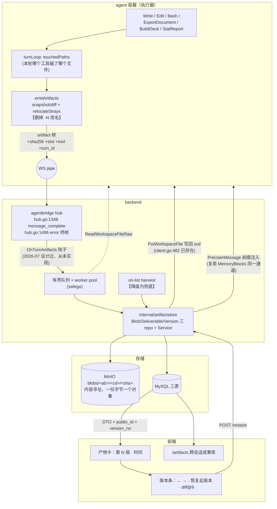

# DESIGN-C · 产物是有身份、有版本、可回滚的实体

> 2026-08-07 · 角度 C（三选一之一，与 A「交付语义/动词」、B「呈现与预览」并列且正交）
> 依据：本目录 01/02/03/05/07/08/10/11 号取证报告 + 主协调者的生产库实测 + 本次复核的代码。
> 读者：熟悉本仓库的架构师。不科普。所有工时按「一个熟悉本仓库的工程师」单人天。

---

## 〇 · 定位与分野

**主张一句话：文件不是产物，文件是产物在某个时刻的字节。产物本身是一个有稳定身份、有线性版本序列、可回滚到任一版的实体；字节按内容寻址、不可变、跨会话去重。**

与另两个角度的分野：

| | 它解决的问题 | 它的失效方式 | 是否依赖其它两个 |
|---|---|---|---|
| **A 交付动词**（`Deliver`/`present_files`） | 「什么算产物」判定从扫描猜变成显式声明 | 模型漏调 → 兜底扫描仍在 → 回到原点 | 不依赖 |
| **B 呈现层**（预览/缩略图/工作区 UI） | 「用户此刻能不能看见」 | 看得见的仍可能是错的那一版 | 不依赖 |
| **C 本方案**（身份+版本+内容寻址） | 「东西会不会丢、改坏了能不能退回、同一份东西是不是同一张卡」 | **不保证用户此刻看得见，也不保证模型改得对** | 不依赖，但 P3 之后与 A 有硬耦合（见 §17.2） |

C 的特殊之处是它**不要求上游先修好**。今天的 Edit 会静默改错地方（R3）、会因为平台背着模型改文件而失配（R2）、会因为压缩失忆而瞎猜 `old_string`（R4）——这三条 C 一条都不修。但 C 把这些错误的**后果**从「不可恢复」降级为「点两下退回上一版」。这是它可以最先上线、且单独就有价值的理由。

反过来必须说清：**C 不是「改不到」的解药，是「改坏了」的保险**。把它当成前者卖会翻车（§17.3）。

C 还有一个别处拿不到的收益，本节先点题、§5 展开：

> **`-N` 后缀分叉（R1）的根因不是 `copyFile`，是「覆盖不可恢复」。**
> `relocateStrays` 之所以要改名避让（`artifacts.ts:253` 用 current 全部 `out/` 键播种 `taken`、`:269-279` 加 `-2..-49`），唯一理由是「不能把用户上一轮已下载的那份字节冲掉」。一旦字节有了内容寻址的不可变副本 + 版本行，**覆盖就是安全的**，改名逻辑失去存在理由，可以整段删掉。
> 也就是说：**版本模型是删掉 `-N` 逻辑的前提条件，而不是相反。** 这是 C 唯一能一击命中「编辑改不到」用户症状的路径，且已被 05 报告的 `repro-edit-divergence.ts` 复现脚本钉死可验证。

---

## 一 · 架构

### 1.1 三层分离（OCI 的 blob / manifest / tag，落到我们的形状）

```
不可变字节层   agent_blobs              sha256 → MinIO 对象。全局去重，refcount 管生死
不可变版本层   agent_deliverable_versions  一次交付 = 一行，永不 UPDATE
可变身份层     agent_deliverables        用户心智里的「那份东西」，持有 current_version 指针
```

对应今天的塌缩状态：`agent_artifacts` 一张表把三层压成一行，`dedup_anchor = sha256(session_id\0rel_path)` 是 UNIQUE，`Upsert` 的 `DoUpdates` 覆盖 `content_sha256`/`storage_key`，MinIO key 是 `claw/<owner>/<sid>/<relPath>` 路径派生 —— 三层同时原地销毁前一版（10 号报告 §3.2 已把这条推论链钉死）。

### 1.2 数据流



### 1.3 三条不变式（必须有测试钉住）

1. **版本行永不 UPDATE。** `agent_deliverable_versions` 只有 INSERT 与 DELETE（保留策略/级联）。任何 `UPDATE ... SET blob_sha256` 都是 bug。
2. **`current_version_id` 只能前进或指向历史上存在过的版本行。** restore 不改指针指向旧行，而是**新建一行**指向旧 blob（v0 的语义：「回滚不丢失后续工作」）。
3. **blob 对象的删除必须以「删 version 行成功」为前提**，顺序不可颠倒（§11.3）。

---

## 二 · 数据模型

### 2.1 命名决策

新表用 `deliverable` 而不是 `artifact_v2`：迁移铁律禁 DROP，`_v2` 会永远尴尬地挂在库里；而且语义确实变了 —— 老 `agent_artifacts` 一行 = **一次收割结果**，新 `agent_deliverables` 一行 = **一个跨版本的交付实体**。两个词在文档与代码注释里必须严格区分，不许混用。

### 2.2 建表（migration `0112_deliverable_fields.sql`）

```sql
-- ① 内容寻址字节层。跨 owner / 跨 session / 跨 feature 全局去重。
CREATE TABLE IF NOT EXISTS `agent_blobs` (
  `sha256`      CHAR(64)        NOT NULL COMMENT '内容 sha256(hex 小写)= 主键 = 身份',
  `size_bytes`  BIGINT UNSIGNED NOT NULL DEFAULT 0,
  `mime`        VARCHAR(160)    NOT NULL DEFAULT '',
  `storage_key` VARCHAR(640)    NOT NULL DEFAULT '' COMMENT 'MinIO key。新写入=blobs/<sha[0:2]>/<sha[2:4]>/<sha>;回填的老对象保留其路径派生 key',
  `refcount`    INT             NOT NULL DEFAULT 0  COMMENT '被 version 行引用次数',
  `unref_at`    DATETIME        NULL COMMENT 'refcount 归零时刻;GC 延迟窗口起点。被重新引用时必须置回 NULL',
  `created_at`  DATETIME        NOT NULL,
  PRIMARY KEY (`sha256`)
) ENGINE=InnoDB DEFAULT CHARSET=utf8mb4 COMMENT='agent 产物字节层(内容寻址)';

-- ② 身份层。用户心智里的「那份东西」。
CREATE TABLE IF NOT EXISTS `agent_deliverables` (
  `id`            BIGINT UNSIGNED NOT NULL AUTO_INCREMENT,
  `public_id`     CHAR(30)     NOT NULL COMMENT '对外唯一寻址 dlv_<base32(128bit random)>。🔴 绝不从 session/path 派生',
  `owner_kind`    VARCHAR(32)  NOT NULL DEFAULT 'user',
  `owner_id`      BIGINT UNSIGNED NOT NULL,
  `feature_key`   VARCHAR(64)  NOT NULL DEFAULT 'claw',
  `session_id`    VARCHAR(191) NOT NULL,

  `slot`          VARCHAR(512) NOT NULL COMMENT '幂等锚。当前取值=rel_path(out/xxx)。🔴 内部字段,绝不出对外 DTO/URL/提示词',
  `slot_source`   VARCHAR(16)  NOT NULL DEFAULT 'rel_path' COMMENT 'rel_path | declared(未来 Deliver 工具的显式 id)',
  `family_key`    CHAR(64)     NOT NULL DEFAULT '' COMMENT 'sha256(session\0feature\0normalize(basename)),仅供 UI 分组与检索,不参与唯一键、不参与版本',

  `display_name`  VARCHAR(255) NOT NULL COMMENT '文件名(basename),无目录',
  `title`         VARCHAR(255) NOT NULL DEFAULT '',
  `description`   VARCHAR(1024) NOT NULL DEFAULT '',
  `kind`          VARCHAR(16)  NOT NULL DEFAULT 'file' COMMENT 'file | bundle(原 dir/zip)',
  `mime`          VARCHAR(160) NOT NULL DEFAULT ''    COMMENT '当前版本冗余,列表页免 join',
  `size_bytes`    BIGINT UNSIGNED NOT NULL DEFAULT 0  COMMENT '同上',

  `state`         VARCHAR(16)  NOT NULL DEFAULT 'ready' COMMENT 'ready | quarantined | deleted',
  `starred`       TINYINT(1)   NOT NULL DEFAULT 0,

  `current_version_id` BIGINT UNSIGNED NULL,
  `version_count` INT          NOT NULL DEFAULT 0,
  `last_seen_at`  DATETIME     NULL COMMENT '最近一次被收割看见(内容未变也更新);与 updated_at 区分',

  `legacy_id`     BIGINT UNSIGNED NULL COMMENT '回填来源 agent_artifacts.id;保证回填幂等',
  `deleted_at`    DATETIME     NULL,
  `created_at`    DATETIME     NOT NULL,
  `updated_at`    DATETIME     NOT NULL,
  PRIMARY KEY (`id`)
) ENGINE=InnoDB DEFAULT CHARSET=utf8mb4 COMMENT='agent 交付物身份层(可变指针)';

-- ③ 不可变版本层。一次交付 = 一行,永不 UPDATE。
CREATE TABLE IF NOT EXISTS `agent_deliverable_versions` (
  `id`             BIGINT UNSIGNED NOT NULL AUTO_INCREMENT,
  `deliverable_id` BIGINT UNSIGNED NOT NULL,
  `version_no`     INT             NOT NULL COMMENT '同 deliverable 内 1,2,3… 递增,不复用',
  `blob_sha256`    CHAR(64)        NOT NULL,
  `size_bytes`     BIGINT UNSIGNED NOT NULL DEFAULT 0,
  `mime`           VARCHAR(160)    NOT NULL DEFAULT '',

  `produced_turn_id` BIGINT UNSIGNED NOT NULL DEFAULT 0 COMMENT '归因:agent_turns.id',
  `produced_tool`    VARCHAR(32)  NOT NULL DEFAULT '' COMMENT 'Write|Edit|Bash|ExportDocument|BuildDeck|StatReport|relocated|platform:citation|restore|harvest',
  `restored_from`    INT          NOT NULL DEFAULT 0 COMMENT '>0 表示本版是对第 N 版的恢复',
  `pinned`           TINYINT(1)   NOT NULL DEFAULT 0 COMMENT '用户钉住:保留策略不得裁剪',
  `note`             VARCHAR(255) NOT NULL DEFAULT '',

  `created_at`     DATETIME NOT NULL,
  PRIMARY KEY (`id`)
) ENGINE=InnoDB DEFAULT CHARSET=utf8mb4 COMMENT='agent 交付物版本层(不可变)';
```

### 2.3 索引（`0113_deliverable_indexes.sql`，全部走 `add_index_if_not_exists`）

```sql
CALL add_index_if_not_exists('agent_blobs','idx_gc','(`refcount`,`unref_at`)',FALSE);

CALL add_index_if_not_exists('agent_deliverables','uk_public','(`public_id`)',TRUE);
-- 🔴 幂等锚:同一 (session, feature, slot) 全局只能有一个身份。同 slot 再交付 = 加版本。
CALL add_index_if_not_exists('agent_deliverables','uk_slot','(`session_id`,`feature_key`,`slot`)',TRUE);
CALL add_index_if_not_exists('agent_deliverables','uk_legacy','(`legacy_id`)',TRUE);
-- 跨会话成果库主查询:某用户的全部产物,按状态过滤、按时间倒序
CALL add_index_if_not_exists('agent_deliverables','idx_owner_state','(`owner_id`,`state`,`updated_at`)',FALSE);
CALL add_index_if_not_exists('agent_deliverables','idx_session','(`session_id`,`state`)',FALSE);
CALL add_index_if_not_exists('agent_deliverables','idx_family','(`session_id`,`family_key`)',FALSE);

CALL add_index_if_not_exists('agent_deliverable_versions','uk_ver','(`deliverable_id`,`version_no`)',TRUE);
CALL add_index_if_not_exists('agent_deliverable_versions','idx_blob','(`blob_sha256`)',FALSE);
CALL add_index_if_not_exists('agent_deliverable_versions','idx_turn','(`produced_turn_id`)',FALSE);
```

**刻意不加外键。** 老表 `agent_artifacts` 就没有（`0025:41-43`），加了会让「删用户」路径的顺序变得脆弱，而级联删除我们要自己控（refcount 必须先减）。

### 2.4 身份规则（这是全套设计里最容易做错的一格）

- **`slot` = `rel_path` 原样，不做任何归一化。**
  曾考虑「剥掉 `-2..-49` 尾缀把老分叉折回同一 artifact」——**否决**。新链路删掉改名逻辑后根本不产生 `-N`；而模型自己写 `out/报告-2.md` 当独立文件是合法的，剥缀会把两个真正不同的产物合并。**多一条归一化规则 = 多一个误判面，收益为零。**
- **`family_key` 只做 UI 分组，绝不做版本。**
  `normalize(basename)` = 去 `-N` 尾缀 + 去 ≥8 位 hex 段 + 扩展名小写。它存在的唯一理由是生产实测那 **629 行（60.8%）含 ≥8 位 hex 段的文件名**（`table1_cn-core_0bad84c81690.docx` / `_442fde7bc89c` / `_cbd60ea49d6f` 同会话三份 37KB 三线表）。
  🔴 **但这三份很可能是三个不同 spec_hash 的不同分析**，不是同一张表的三版。所以 family 在 UI 上只表现为「同组卡片视觉聚拢 + 一行『同名族 3 份』提示」，**不出版本条、不可回滚、不影响任何写路径**。把它做成版本会制造一个比现状更糟的错误共识。
- **`public_id` 与 `slot` 必须是两个字段。** 老的 `DedupAnchorFor` 是派生的，做内部幂等锚很好，做对外 ID 就是可枚举面（11 号报告 §7.3）。`public_id` 用 `crypto/rand` 16 字节 → base32 无填充 26 字符 + `dlv_` 前缀。
- **不透明 ≠ 授权。** 所有按 `public_id` 的读写都必须比对行的 `owner_id`（Anthropic Files API 的 workspace 警告；我们对应 `claw/artifact.go:292-295` 那条已有校验，且要把 claw 缺的 `feature_key` 校验一并补上 —— 02 号报告 §4.2 的镜像漂移）。

### 2.5 版本产生规则

```
收到一条产物声明 (session, feature, slot, bytes) 时：
  sha = sha256(bytes)
  d = SELECT ... WHERE session_id=? AND feature_key=? AND slot=?  FOR UPDATE
  if d == nil:
      d = INSERT deliverable(public_id=rand, slot, display_name=basename, ...)
  if d.current_version != nil AND d.current_version.blob_sha256 == sha:
      UPDATE d SET last_seen_at = NOW()      # 内容没变 → 不产生版本
      return NoChange
  blob = upsertBlob(sha, bytes)              # 已存在则 refcount+1 且 unref_at=NULL,不 PutObject
  v = INSERT version(deliverable_id=d.id, version_no=d.version_count+1, blob_sha256=sha, ...)
  UPDATE d SET current_version_id=v.id, version_count=v.version_no,
               mime=..., size_bytes=..., last_seen_at=NOW(), updated_at=NOW()
```

**「内容没变不产生版本」这一条直接消掉 03 号报告 §3.8 的假阳性**：今天 `diffOut` 按 `size+mtime` 判变更（`artifacts.ts:187`），sci_draw B 车道每轮重跑脚本重新 savefig、prism/boltslides 每轮重物化工作区，都会产生「内容一样但 mtime 变了」的重复卡。内容寻址白拿这个收益。

---

## 三 · 采集：版本从哪来

### 3.1 主路径 —— 轮末事件驱动（帧 → backend 异步收割）

今天的 on-list harvest 是所有静默丢失的根：它跑在 `GetSessionArtifacts` 这个 HTTP GET 的 10s 预算内（`claw/artifact.go:191`、`artifact_harvest.go:34`），单文件失败零日志（`:79-81`），用户关掉标签页就不跑，server-side 无人值守轮永远不跑，workdir 被 30 天 GC 之后才第一次 GET = 永久丢失（02 号报告 §2.2）。

改为：

1. **agent 侧**：`emitArtifacts` 发帧时带上 `sha256`（已在内存里有字节么？没有 —— 需要读一次文件算 sha；文件已在 `out/`，成本可接受，>8MB 的跳过算 sha 走兜底）、`slot`、`tool`、`turn_id`。
2. **backend 侧**：`agentbridge` 在 hub 收到 `artifact` 帧时不再只入 journal（`hub.go:2086-2088`），而是累积到本轮状态；在 **`message_complete`（`hub.go:1348`）和 error 终帧（`hub.go:1496`）两处都**触发 `FeatureSpec.OnTurnArtifacts` 钩子 —— 这正是 2026-07 设计过、从未实现的 `OnArtifact`（02 号报告 §〇 已查实 `grep -rn "OnArtifact"` 零命中）。
3. 钩子把声明推进一个**有界 channel**（`safego` 包装的 worker pool，容量 2048），**绝不在 hub goroutine 里同步做 IO**（那会阻塞 WS pipe）。队列满 → 丢弃 + `slog.Error`（可观测，不静默），下次 on-list 兜底补。
4. worker：`ReadWorkspaceFileRaw` 拉字节 → 校验 sha 与帧一致（不一致说明文件在轮末又被改过 → 以实际字节为准，`produced_tool` 追加 `:drift` 标记）→ 走 §2.5 的版本产生规则。

**两个必须一起做的前置改动：**

- 🔴 **删掉 `turnLoop.ts:954` 的 `!terminalSent` 守卫。** 生产实测 171 轮（19.5%）因为 failed/aborted/blocked 一张 artifact 帧都没发。异常轮恰恰是最需要把已产出内容交给用户的时刻（01 号报告结论 5）。改成：无论是否 terminalSent，只要 `outBaseline` 在就跑 `emitArtifacts`；error 帧的发送时机不变。
- **`turnLoop` 维护 `touchedPaths: Map<absPath, toolName>`**，由 `runTools` 在 Write/Edit/Bash/ExportDocument/BuildDeck/StatReport 成功后填。用途有二：给版本行填 `produced_tool`；识别「本轮没有任何模型工具碰过这个文件、但 sha 变了」的情况 → 那是平台自己改的（`resolveCitations` 就地重写，`artifacts.ts:310-337`）→ 标 `produced_tool='platform:citation'`。

### 3.2 兜底路径 —— on-list harvest 降级

`harvestSession` 保留，但：
- 不再是版本的主要来源，改成「补漏 + 对账」：只处理 `last_seen_at` 早于工作区 mtime 的条目。
- 仍然 upsert-only、仍然绝不按 live 工作区删（`artifact_harvest.go:29-33` 那条事故复盘依然成立）。
- 产生的版本 `produced_tool='harvest'`，在 UI 上与帧驱动的版本可区分 —— 用来观测「主路径漏了多少」。**一条永远绿的规则等于一条不存在的规则**，兜底必须可计数。

### 3.3 为什么不做「编辑级」版本

采集点在轮末，一轮内 Edit 五次只产生一版（最后那版）。做到编辑级需要在 `Write`/`Edit` 工具里同步登记 = 每次工具调用一次 agent→backend 跨容器 RPC，在工具预算内不可接受，且会把 WS pipe 的忙态语义搅乱。**轮级是刻意的上限**，与用户心智（「上一轮那版」）也对得上。

---

## 四 · 协议帧

### 4.1 agent → backend（扩展现有帧，向后兼容：只加字段）

```ts
// 现状 agent/src/turn/artifacts.ts:379
{ type:"artifact", name, path, kind, mime, size }

// 新增字段
{ type:"artifact", name, path, kind, mime, size,
  sha256?: string,        // 64 hex;>8MB 或算 sha 失败时省略 → backend 自己算
  slot: string,           // 幂等锚。当前 == path,语义独立(为 A 方案的 Deliver 预留)
  tool?: string,          // Write|Edit|Bash|ExportDocument|BuildDeck|StatReport|relocated|platform:citation
  turn_id?: number }
```

`EvArtifact` 已入 journal 且 payload 原样重放（`eventlog_store.go:512-528`），加字段自动带上，历史回放兼容。

### 4.2 backend → 前端（新帧，backend 自己产，不经 agent）

```ts
{ type:"deliverable",
  public_id: "dlv_01J9K…", slot_hint?: never,     // 🔴 永不带 path/slot
  display_name: "综述.md", title?: string,
  mime: string, size: number, kind: "file"|"bundle",
  version_no: 3, version_count: 3,
  produced_tool: "Edit", created_at: "2026-08-07T12:00:00+08:00" }
```

发送时机：worker 完成一条版本登记后，经 hub 广播给该会话的所有连接（复用多端扇出 Hub）。

**这条帧顺手解决 03 号报告 §3.5 的「无 id 窗口必然 404 的下载按钮」**：卡片在收到 `deliverable` 帧之前只渲染「正在保存…」，拿到之后才出下载/预览按钮。今天的合成卡（`MessageTurn.tsx:82` 的 `dto ?? {path,...}` 分支）会在 harvest 完成前给二进制产物一颗必然 404 的按钮（`artifact.go:391-393` 的 `default:` 分支）。

---

## 五 · 「编辑」在这个模型下是什么 —— 根治 R1 与 `-N`

### 5.1 机制

今天（05 号报告已用 `repro-edit-divergence.ts` 真实复现）：

| 轮 | 模型动作 | relocateStrays | `out/` | 用户看到 |
|---|---|---|---|---|
| N | `Write("报告.md", v1)`（写在会话根） | `occupied("报告.md")=false` → copyFile | `报告.md`(v1) | 卡「报告.md」 |
| N+1 | `Edit("报告.md")` 改的是**会话根那份** | `taken` 由 current 全部 out/ 键播种（`:253`）→ 已占用 → 改名 `报告-2.md` → copyFile | `报告.md`(v1)<br>`报告-2.md`(v2) | 多一张卡；**点开第一张还是 v1** |
| N+2 | 再改 | `报告-3.md` | 三份 | 三张卡 |

生产已实测发生：`yoyo_long.csv`(903B, 01:10:42) 与 `yoyo_long-2.csv`(900B, 01:12:10) 同会话并存、内容不同，共 14 条 `-N` 副本行且与基名成对同存。

### 5.2 改法

**删掉 `artifacts.ts:253` 的 `taken` 播种与 `:269-279` 的 `-2..-49` 循环，改为无条件覆盖同名。**

推演同一场景：

| 轮 | relocateStrays | `out/` | 版本表 | 用户看到 |
|---|---|---|---|---|
| N | copyFile → `out/报告.md` | 报告.md(v1) | dlv_X v1 | 一张卡「报告.md · 第1版」 |
| N+1 | copyFile **覆盖** `out/报告.md` | 报告.md(v2) | dlv_X v2（v1 的 blob 仍在） | **同一张卡**变成「第2版」，版本条可切回第1版 |
| N+2 | 覆盖 | 报告.md(v3) | dlv_X v3 | 「第3版」 |

- `-N` 从物理上消失 → 卡片不再增殖 → 「点开旧卡还是旧的」这个用户症状消失。
- 覆盖发生前，上一版字节已经在 blob 层（前一轮的钩子已收割），**不丢**。
- 唯一新增的丢版风险：某一轮的钩子没跑成（队列满/agent 不可达）且下一轮就覆盖了。这条由 §3.2 的兜底 harvest + `last_seen_at` 对账缓解，但**不能保证 100%**（诚实标注，见 §17.7）。

### 5.3 残留的分叉（C 治不了的那半）

`copyFile` 建立的仍是**快照关系而非引用关系**：会话根的 `报告.md` 与 `out/报告.md` 是两个 inode。上面的推演之所以成立，是因为**每轮都重新覆盖**。如果模型在某一轮改的是 `out/报告.md`（而不是根那份），下一轮又回去改根那份，会把 out/ 里那次编辑冲掉 —— 这次冲掉**有版本可退**，但模型会困惑。

彻底修法是 05 号报告 C1 的三个候选（hardlink / rename+带内回执 / `out/` 之外禁落交付扩展名），**属于 A 方案的范围，C 不承担**。C 只保证：无论怎么分叉，每一次落到 `out/` 的字节都留下一版。

---

## 六 · 工具签名 —— 模型侧尽量无感

### 6.1 零改动的部分

**`Write` / `Edit` / `Bash` / `ExportDocument` / `BuildDeck` / `StatReport` 的 `input_schema` 与 `description` 一个字都不改。** 这是 C 相对 A 的核心差异：版本完全在平台侧产生，模型不需要知道「版本」这个概念存在。

不给模型任何版本相关工具：没有 `ListVersions`、没有 `RestoreArtifact`、没有 `PinVersion`。理由：

- 用户说「改回上一版」时，模型直接把内容改回去即可（它有对话历史），产生 v4 而不是 restore→v2。**UI 上更诚实** —— 那确实是一次新的修改，归因线（`produced_tool`/`produced_turn_id`）保持完整。
- 给模型回滚工具会让「谁改的」这条线断掉，而归因是版本模型唯一比「一堆文件」多出来的东西。

### 6.2 唯一给模型的信息 —— 每轮开场的交付区状态注入

复用**现成通道**：`agentbridge.Bridge` 的首条 user_message 前缀注入（今天 `MemoryBlocks` 走的就是这条，CLAUDE.md 已描述）。在 `PreUserMessage` 里查本会话 `agent_deliverables` 组装一段中文：

```
【当前交付区】
· 锂电池综述.md —— 12.4 KB,你在上一轮更新过(累计改过 3 次)
· 三线表.docx —— 37 KB,3 轮前生成,之后未改动
· 数据.csv —— 903 B,2 轮前生成
用户已把《锂电池综述.md》恢复到较早的一版,你上一轮的修改已被撤销 —— 改动它之前请先重新读取内容。
```

设计约束：

- **不含任何目录名、不含 public_id、不含 sha、不含版本号 ID。** 只有文件名 + 大小 + 相对轮次 + 一句人话。
- 「累计改过 N 次」是版本模型唯一泄漏给模型的量，且它是**自然语言的**，模型不需要理解版本机制就能用。
- restore 告知那一句是 C 必须有的（否则模型下一轮会拿着被撤销的旧内容继续改，立刻把回滚冲掉）。

**这一段同时是 05 号报告 C3「下一轮开场的工作区状态注入」的最小实现**，那份报告把它评为「本次调研最高杠杆的单点改动」。C 需要它，A/B 也需要它 —— 三方案共用，谁先落地谁做。

⚠️ 诚实标注：这段注入里带的是**文件名**，模型仍需自己拼 `out/<name>` 才能改。也就是说它**仍隐含 `out/` 心智**，只有在 A 方案（删 path / 换 Deliver 动词）落地后才能完全脱钩。

---

## 七 · 提示词改动

**C 单独上线时，四个 feature 的 system prompt 改动量 = 0。**

这是刻意的：`prompts/claw.go:108-138` 那 14 次 `./out/` 与那条否定式铁律，属于 A 方案的手术面。C 不碰它们，也不因为它们而失效。

C 带来的**间接**改善只有一条：`-N` 后缀消失后，模型不会再说出「我生成了报告-3.md」这类畸形名（这类名字在正文里出现时既泄漏路径心智又暴露内部失败）。

后续若 A 落地、`Deliver` 工具上线，C 侧只需把 `slot_source` 从 `rel_path` 切到 `declared` —— 这是 §2.2 里那个字段存在的唯一理由。

---

## 八 · API

### 8.1 新端点（统一层，不按 feature 复制 —— 这是四份镜像收敛的入口）

```
GET    /api/v1/user/deliverables                 列表。query: session_id? feature? kind? q? starred? page/size
GET    /api/v1/user/deliverables/:pid            元数据 + 最近 N 个版本
GET    /api/v1/user/deliverables/:pid/content    当前版本字节
GET    /api/v1/user/deliverables/:pid/versions/:n/content   指定版本字节
POST   /api/v1/user/deliverables/:pid/restore    {version:n, write_back:true}
POST   /api/v1/user/deliverables/:pid/star       {starred:bool}
DELETE /api/v1/user/deliverables/:pid            软删(state=deleted + deleted_at)
```

分层：`internal/artifactstore/{repository,service,handler}.go`（Repository→Service→Handler）。

**鉴权**：`UserAuthMiddleware` + 行 `owner_id` 比对，越权一律 404 防枚举。跨会话列表不需要 `OwnsSession`（`owner_id` 已足够）；单个下载也只查 `owner_id` + `feature_key`（补上 claw 缺的那条，02 号报告 §4.2）。

🔴 **必须同时改 `middleware/timeout.go:48-63` 的 `isObjectServePath` 白名单，加 `/user/deliverables/`。** 白名单里今天只有 `/claw/artifact/`，boltslides/sci_draw/stat_lab 的下载都落在 15s GET 超时里被掐断（02 号报告 §8 认定为真 bug）。新统一层如果忘了这条，会把那个 bug 原样继承。

### 8.2 老端点的过渡

`GET /user/<feature>/session/artifacts` 全部保留，DTO 加字段：

```go
type ArtifactDTO struct {
    ID          uint64 `json:"id,omitempty"`           // 老:agent_artifacts.id,前端回落用
    PublicID    string `json:"public_id,omitempty"`    // 新
    Path        string `json:"path"`                   // 🔴 deprecated,P4 删
    Name        string `json:"name"`
    // …
    VersionNo    int    `json:"version_no,omitempty"`
    VersionCount int    `json:"version_count,omitempty"`
    FamilyKey    string `json:"family_key,omitempty"`
    CreatedAt    string `json:"created_at,omitempty"`
    UpdatedAt    string `json:"updated_at,omitempty"`
}
```

前端优先 `public_id`，缺失回落 `id`，再缺失回落 `path`。这条三级回落让**后端可以单独回滚而前端自愈**（§14.2）。

### 8.3 restore 的完整语义

```
POST /user/deliverables/:pid/restore {version: 2}
  1. 校验 owner
  2. v = 第 2 版;blob 必须仍存在(未被保留策略裁掉)
  3. INSERT version(version_no = version_count+1, blob_sha256 = v.blob_sha256,
                    produced_tool='restore', restored_from=2)
     blob refcount+1（同一 blob 被两个版本行引用,天然去重,不占新空间）
  4. UPDATE deliverable SET current_version_id=新行, version_count+1
  5. write_back（默认 true）：
       agentClient.PutWorkspaceFile(sessionID, slot, bytes)   // client.go:482 已存在
       失败/会话已 GC → 200 但 body 带 warn:"该会话工作区已过期,产物已恢复,但 AI 无法在此会话继续修改它"
  6. 记一条「已恢复」事件,供 §6.2 的下一轮注入消费(Redis key,TTL 到下一轮消费即删)
```

**恢复 = 新增一版，不截断历史**（v0 明说「without losing later work」，Canvas/Claude Artifacts/Lovable 四家共识，10 号报告 §3.1）。

**第 5 步是本仓库特有的**：外部产品的 artifact 本身就是真源，我们的真源是 agent 工作区的文件。不写回，模型下一轮 Read 到的还是被改坏的那份，会立刻把回滚冲掉。

---

## 九 · 前端

严格按 `frontend-user/CLAUDE.md`：第三方优先、features/shared 分层、网络层必须 react-query hook、样式只用 `globals.css` token、禁新建 `.css`、禁 Context 传状态。

### 9.1 数据层

`features/claw/api/artifacts.ts` 扩 DTO（§8.2）；新增：

```ts
// features/artifacts/api/deliverables.ts —— 跨 feature 统一层
export function useDeliverables(params: {...}): UseQueryResult<Deliverable[]>
export function useDeliverableVersions(publicId: string | null): UseQueryResult<DeliverableVersion[]>
export function useDeliverableVersionBytes(publicId, versionNo, enabled): UseQueryResult<ArrayBuffer>
export function useRestoreDeliverable(): UseMutationResult<...>
export function deliverableContentUrl(publicId, opts?: {version?: number; download?: boolean}): string
```

`deliverable` 帧到达时 `invalidateQueries(['deliverables', sessionId])` —— 不再依赖 `message_complete` 后的全量 invalidate（那条今天会触发一次同步全量 harvest，`artifact_harvest.go:34`）。

### 9.2 版本条 `ArtifactVersionBar`

放 `features/claw/components/preview/` 头部（预览态）+ 卡片副标题（列表态）。

- 卡片副标题：`第 3 版 · 2 分钟前`；`version_count === 1` 时不显示（绝大多数产物只有一版，不能给它们加噪音）。
- 版本条：`←` `第 2 / 3 版` `→` + `恢复此版本` + `查看改动`。线性时间轴，不做 git 式 DAG（四家竞品无一这么做）。
- 「恢复此版本」必须二次确认，文案说清「这会新增一版，不会删掉现在这版」。
- `produced_tool='platform:citation'` 的版本在时间轴上**默认折叠**，标「系统自动整理引用」——这是 C 自己引入的噪音，必须自己处理（§17.3）。

### 9.3 diff

`diff@9` **已在 `package.json:59`**（实测），零新依赖、gzip ~5KB，无需动态 import。

- 适用：`md / csv / tsv / txt / html / svg / py / json / tex / bib` —— 走 `diffLines`，红删绿增（Canvas/Lovable 的朴素形态，不是三路合并）。
- 不适用：`docx / pptx / xlsx / pdf / zip / 图片` —— 只显示「大小 37.2 KB → 41.8 KB」+ 两版并排预览（预览器是 B 方案的事，C 只留接口）。
- 大文件保护：单侧 > 200 KB 时只 diff 前 200 KB 并明确标注「仅比较前一部分」——**不要静默截断**。

### 9.4 移动端与窄屏

🔴 版本条**不能只活在右侧扩展区**。今天 `ConversationWorkspace.tsx:223` 的 `rightPanelAvailable = !inlineFigures && !isNarrow`，≤1024px 连开关按钮都不渲染；`/m/claw` 全文没有产物面板。版本条必须挂在**卡片本身**上（卡片在窄屏与移动端都在），预览态走已有的 Sheet。

这一条是硬验收项（§16.10）。「任何号称全端可用的交付方案都要先回答移动端怎么办」——03 号报告结论 6。

### 9.5 跨会话成果库 `/artifacts`

新 feature 目录 `features/artifacts/`，`routes.tsx` 暴露 `RouteObject[]`，页面级 lazy。

- 形态抄 Manus Library（8/10 号报告一致推荐）：类型筛选 / 搜索 / 收藏 / 时间倒序 / 跳回来源会话。
- 🔴 **不做文件树。** 连 Lovable（产物本身就是代码）的官方文档都说 "most people never open the code editor"；给中国科研人员一棵 `out/` 树只会把内部组织逻辑从「偶尔漏进正文」升级成「常驻 UI 一等公民」。`react-arborist` 在必用表里但**当前并未安装**，本场景不该触发它。
- 按 `family_key` 视觉聚拢同名族（那 60.8% 的 hash 名），但不合并、不出版本条（§2.4）。
- 复用 `library` 现成的分享链路（提取码 + 过期 + 转存，migration 0032 + `/s/:token`）—— 10 号报告认定这是最大的「白拿」。

---

## 十 · 生命周期与配额

### 10.1 产物脱离会话生命周期

今天 `claw/artifact.go:10-11` 写着「生命周期 = 会话生命周期」，会话 reset/delete → `cleanupArtifacts` 全清（`artifact_harvest.go:151-161`）。

改为：

| 事件 | 老行为 | 新行为 |
|---|---|---|
| 会话 reset | 产物全删 | `state` 保持 `ready`，`session_id` 保留（成为归档产物），**字节不动** |
| 会话 delete | 产物全删 | 同上 + 前端在库页标「来源会话已删除」 |
| 用户删产物 | 无此功能 | `state='deleted'` + `deleted_at`，字节不动（撤销窗口 30 天） |
| 30 天后 | — | 定时任务：`deleted` 且 `deleted_at < now-30d` → 删 version 行 → blob refcount-1 |
| **注销用户** | 🔴 **产物完全不清，PHI 永久留在 MinIO+MySQL** | 级联：按 `owner_id` 删 version 行 → refcount-1 → GC 收对象；deliverable 行硬删 |

最后一行是 02 号报告 §4.3 逃逸口 2 的修复：`user/repository.go:486-488` 的注释自陈没清 peer_review/prism/staging，`agent_artifacts` **连提都没提**，且表上无 FK。

### 10.2 配额

- **版本保留策略**：per deliverable 保留 `max(最近 20 版, 90 天内全部)` + 全部 `pinned` 版。超出的版本行删除（refcount-1）。`current_version` 永不裁剪。
- **per user 总量**：按 VIP tier 给一个字节上限（去重后的实际占用，即该用户独占引用的 blob 之和）。超限时**不阻断生成**（阻断生成会毁掉一次长任务），改为在库页显示「已用 X / Y，请清理」+ 停止为该用户新建版本（只更新 current，退化成今天的覆盖语义）。默认值待产品定，建议 free 1GB / pro 10GB。
- **单文件上限**：维持 12MB（`artifact.go:54`）。这是 backend 全量读进内存的实现约束，拆它属于「MinIO 预签名 URL」的范围，C 不承担。

### 10.3 GC

🔴 **不能用 MinIO 桶级 lifecycle。** 内容寻址 + refcount 意味着对象的生死由引用决定，桶级 TTL 会删掉仍被引用的对象。这是内容寻址净增的运维负担，必须自己写 GC。

```
每日一次（internal/common/cleanup 加一个任务）：
  候选 = SELECT sha256, storage_key FROM agent_blobs
         WHERE refcount <= 0 AND unref_at < NOW() - INTERVAL 24 HOUR LIMIT 500
  for b in 候选:
      n = DELETE FROM agent_blobs WHERE sha256=? AND refcount<=0     # 🔴 条件必须带 refcount
      if n == 0: continue                                            # 期间被重新引用 → 放弃
      storage.DeleteObjects(key)                                     # 失败只记日志 → orphan,由 reaper 兜
```

**顺序不可颠倒**：先删行再删对象。反过来会造成「行在、对象没了」的死链接，比 orphan 更糟。

**24h 延迟窗口是必须的**：并发上传同一 digest 时「一个在删、一个刚引用」是 OCI registry 都栽过的经典竞态。窗口 + 带条件的 DELETE 是双保险。

**orphan reaper**（独立、低频、手动触发）：列 MinIO `AgentArtifactsBucket` 全部 key，不在 `agent_blobs.storage_key` 集合内的删。首次运行必须 dry-run。

🔴 **本仓库零备份、cron 从未装**（记忆 [线上审计0731]）。因此 GC 上线纪律是硬的：
1. 先跑 **dry-run 模式两周**（只 `slog.Info` 打算删什么、不真删），人工核对日志；
2. 确认「有引用的 blob 从未出现在候选列表里」之后才开真删；
3. 真删上线前必须先解决 MinIO 备份（这是运维前置，不是本方案的一部分，但**没有它就不要开真删**）。
   GC 跑不起来 = 存储单调增长（与现状同样糟，不更糟）；GC 跑错 = 数据丢失（比现状糟得多）。这个不对称决定了纪律。

### 10.4 去重收益（量化预期）

- 老的 `artifactStorageKey = claw/<owner>/<sid>/<relPath>` 是路径派生，**零去重**。同一份 30MB docx 在三个会话各生成一次 = MinIO 三份 90MB。
- 内容寻址后：
  - **跨版本**：「内容没变不产生版本」直接消掉 sci_draw/prism/boltslides 每轮重物化的重复对象（`artifact_harvest.go:86` 的注释已承认目录产物每轮重建 zip 靠 sha 挡住重传 —— 那说明作者已经意识到 sha 有去重价值，只是没跨行生效）。
  - **跨会话/跨用户**：同一份模板、同一份用户上传的原始数据被多次交付时只存一份。
- **不给具体倍数**。1035 行的现存数据里有多少 `content_sha256` 重复是可查的（`SELECT content_sha256, COUNT(*) FROM agent_artifacts GROUP BY 1 HAVING COUNT(*)>1`），**这条查询应当在 P0 动工前先跑一次**，用来决定去重值不值得当卖点。

---

## 十一 · 迁移与回填

### 11.1 迁移文件（编号接 0111）

| 文件 | 内容 |
|---|---|
| `0112_deliverable_fields.sql` | 三张表 `CREATE TABLE IF NOT EXISTS` |
| `0113_deliverable_indexes.sql` | 全部 `CALL add_index_if_not_exists` |
| `0114_deliverable_backfill.sql` | 从 `agent_artifacts` 回填（幂等） |

老表 `agent_artifacts` **永不 DROP**（迁移铁律），P4 之后变只读。

### 11.2 回填

1035 行 / 226 会话。策略是**纯 SQL、零对象搬运、零停机**：

```sql
-- ① blob:老对象不搬,storage_key 直接沿用路径派生 key。
--    content_sha256 相同时 INSERT IGNORE 让第一行赢,后续行共用它的 key(那也是个有效对象)。
INSERT IGNORE INTO agent_blobs (sha256, size_bytes, mime, storage_key, refcount, created_at)
SELECT a.content_sha256, a.size_bytes, a.mime, a.storage_key, 0, a.created_at
FROM agent_artifacts a
WHERE a.content_sha256 <> '' AND a.storage_key <> '';

-- ② deliverable:一行老 artifact = 一个身份。legacy_id 唯一索引保证重放幂等。
INSERT INTO agent_deliverables
  (public_id, owner_kind, owner_id, feature_key, session_id, slot, slot_source,
   family_key, display_name, title, description, kind, mime, size_bytes,
   state, version_count, legacy_id, created_at, updated_at)
SELECT CONCAT('dlv_', <随机 base32 — 见下>), a.owner_kind, a.owner_id, a.feature_key,
       a.session_id, a.rel_path, 'rel_path',
       '', a.filename, a.title, a.description, a.kind, a.mime, a.size_bytes,
       'ready', 0, a.id, a.created_at, a.updated_at
FROM agent_artifacts a
WHERE a.content_sha256 <> '' AND a.storage_key <> ''
  AND NOT EXISTS (SELECT 1 FROM agent_deliverables d WHERE d.legacy_id = a.id);

-- ③ version:每个 deliverable 恰好一版
INSERT INTO agent_deliverable_versions
  (deliverable_id, version_no, blob_sha256, size_bytes, mime, produced_tool, created_at)
SELECT d.id, 1, a.content_sha256, a.size_bytes, a.mime, 'legacy', a.created_at
FROM agent_deliverables d JOIN agent_artifacts a ON a.id = d.legacy_id
WHERE d.version_count = 0;

-- ④ 回填指针与 refcount
UPDATE agent_deliverables d
  JOIN agent_deliverable_versions v ON v.deliverable_id = d.id AND v.version_no = 1
  SET d.current_version_id = v.id, d.version_count = 1, d.last_seen_at = d.updated_at
WHERE d.version_count = 0;

UPDATE agent_blobs b
  SET b.refcount = (SELECT COUNT(*) FROM agent_deliverable_versions v WHERE v.blob_sha256 = b.sha256),
      b.unref_at = NULL;
```

**`public_id` 的随机生成在 SQL 里做不干净。** 两个选项：
- (a) 迁移只建行、`public_id` 留 `''`，由 backend 启动时的一次性 backfill job 逐行填（带唯一索引，冲突重试）。唯一索引对 `''` 会冲突 → 用 `legacy_id` 临时占位：`CONCAT('lgc_', LPAD(a.id, 26, '0'))`，backend job 再换成真随机。
- **(b) 推荐**：直接在 SQL 里用 `CONCAT('lgc_', LPAD(a.id,26,'0'))` 并**接受它是可枚举的**——因为回填的都是老数据，且 API 层的 `owner_id` 校验才是真正的授权闸（不透明 ≠ 授权）。新产生的产物用真随机。在 `public_id` 上加一列注释说明这个分叉。省掉一个 job，少一个失败面。

**回填的三个已知损耗（必须先量化再动工）：**

1. `content_sha256 = ''` 或 `storage_key = ''` 的行被跳过 → 这些行在新表里不存在，前端回落老 `id` 通道。**动工前先跑 `SELECT COUNT(*) FROM agent_artifacts WHERE content_sha256='' OR storage_key=''`。**
2. `content_sha256` 重复的行共用一个 blob 行，但**其余行的老 MinIO 对象变成 orphan**（无引用且不在 `agent_blobs` 里，GC 扫不到）。由 §10.3 的 orphan reaper 兜，**必须延迟到迁移稳定后再跑，且先 dry-run**。
3. **回填后的所有产物 `version_count = 1`，没有历史可回滚。** 用户今天已经丢掉的那些版本**永久不可恢复**。这条要对产品说清楚（§17.4）。

### 11.3 双写与切换

| 阶段 | 老表 | 新表 | 前端 |
|---|---|---|---|
| P0 | 主，前端真源 | 并行写（帧钩子 + 兜底 harvest 都写） | 不变 |
| P1 | 主 | 并行写 | DTO 读 `public_id`/`version_*`，下载仍走老 `id` |
| P2-P3 | 只写不读 | **主** | 全部走 `public_id` |
| P4 | 只读（历史） | 主 | 删 `path` 字段 |

对比判据：P1 结束时 `SELECT COUNT(*)` 新表 ≈ 老表 + 新增；差额逐条查因，**不允许「差不多就行」**。

---

## 十二 · 四份镜像怎么收敛

现状（02 号报告 §8）：`claw/artifact.go`(518) + `artifact_harvest.go`(176) · `boltslides/artifact.go`(381) · `scidraw/artifact.go`(372) · `statlab/artifact.go`(376)，四份近乎复制，已实测漂移出 7 项差异（feature_key 越权校验、目录 zip、manifest 标题、大小预筛、图片实时回退、下载超时豁免…）。

C 的收敛路径：

1. **`internal/artifactstore` 从第一天就是 feature-agnostic**：`feature_key` 是入参，不是包名。三个 repo + 一个 Service + 一个 handler。
2. **P0-P2 期间统一层与四份并存**：统一层负责新三表，四份老实现继续负责老表。互不干扰。
3. **P4 把四份的收割逻辑删掉**，只保留「路由注册 + `OwnsSession` + feature 特有的展示规则」（boltslides 排除 .pptx、sci_draw 的 figure 内联判定等）——这些是真差异，该留。
4. 收敛的净效果：`feature_key` 越权校验、目录 zip、大小预筛、超时白名单 **只有一份实现**，漂移在结构上不可能再发生。

`agentartifact/delivery.go:14-25` 记录的「刻意不抽象」决定是当年 claw 是唯一消费者时写的；现在四个，前提已经失效。**但不要在 P0 就去动老四份** —— 那会把一个可回滚的加表工程变成一次高风险重构。

---

## 十三 · 回滚（部署层面）

| 阶段 | 回滚方式 | 可逆 |
|---|---|---|
| P0（加表 + 双写） | `ARTIFACT_STORE_ENABLED=0` 关钩子与统一层；老链路完好，新表停止增长 | ✅ 完全 |
| P1（版本 API + 前端版本条） | 同上；前端因三级回落（`public_id` → `id` → `path`）自愈 | ✅ 完全 |
| P2（GC 真删） | 关 GC 开关。**已删的对象不可逆** —— 所以有 §10.3 的两周 dry-run 纪律 | ⚠️ 部分 |
| P3（产物脱离会话生命周期） | 恢复 `cleanupArtifacts` 的全清行为。但期间已归档的产物会在下次 reset 时被删 | ⚠️ 部分 |
| P4（删 DTO `path`、老表停写） | **不可逆**。必须在 P3 稳定运行 2 周、且新表行数对账通过之后才做 | ❌ |

**环境变量不做数据完整性的开关。** 记忆里的铁律（[会话耐久journal]）：`ARTIFACT_STORE_ENABLED` 只能控制「是否启用新链路」，不能控制「是否记录版本」——一旦新链路启用，版本记录就是无条件的，不许有第二个 env 能把它关掉。

---

## 十四 · 分期与工时

单人天，熟悉本仓库。

### P0 · 身份与版本落地（8 天）

| 项 | 天 |
|---|---|
| 三份迁移 SQL + 回填 + 幂等重放测试 | 1.5 |
| `internal/artifactstore` 新包（3 repo + Service + blob upsert/refcount 原子性） | 2.5 |
| `agentbridge` 加 `OnTurnArtifacts` 钩子（`hub.go:1348` + `:1496` 两处）+ 有界队列 + worker pool | 1.5 |
| agent 侧：帧加 `sha256/slot/tool/turn_id`；`touchedPaths`；**删 `!terminalSent` 守卫**；**删 `-N` 改名与 `taken` 播种** | 1.5 |
| 兜底 harvest 改造（写新表 + `last_seen_at` 对账） | 1 |

**P0 结束时用户看不到任何变化**，但 171 轮无帧的问题已修、`-N` 增殖已停、版本已在攒。

### P1 · 版本可见与可回滚（7 天）

| 项 | 天 |
|---|---|
| Go handler：list/get/content/versions/restore/star/delete + 归属校验 + timeout 白名单 | 2 |
| restore 写回工作区 + 「已恢复」事件 + `PreUserMessage` 交付区状态注入 | 1.5 |
| 前端 DTO + `useDeliverables`/`useDeliverableVersions`/`useRestore` hooks | 1 |
| `ArtifactVersionBar` + 卡片副标题 + 二次确认 + **窄屏/移动端可达** | 1.5 |
| diff 视图（`diff@9` 文本类；二进制走大小对比） | 1 |

**P1 是最小可交付边界（15 天）。** 到这里「改坏了能退回」这个能力完整成立。

### P2 · 生命周期与配额（4 天）

| 项 | 天 |
|---|---|
| blob refcount GC（dry-run 模式先行）+ orphan reaper（手动） | 1.5 |
| 版本保留策略 + `pinned` | 1 |
| 注销用户级联（修 PHI 残留） | 1 |
| per-user 配额与库页提示 | 0.5 |

### P3 · 跨会话成果库（6 天）

| 项 | 天 |
|---|---|
| 产物脱离会话生命周期（reset/delete 语义改造 + 归档标记） | 1.5 |
| `/artifacts` 页面（筛选/搜索/收藏/family 分组/跳回来源） | 3 |
| 接 `library` 现成分享链路（提取码/过期/转存） | 1.5 |

### P4 · 四份镜像收敛 + 删 `path`（5 天）

| 项 | 天 |
|---|---|
| 四份 `artifact.go` 的收割逻辑收进统一层，只留路由与 feature 特有展示规则 | 3 |
| 删 DTO `path` / 删 `?path=` `?dir=` query / 前端全量走 `public_id` | 2 |

**合计 30 天。** P0+P1 = 15 天最小可交付；P0+P1+P2 = 19 天是「上线安全」的最低线（没有 P2 的注销级联，PHI 残留问题会随产物量线性放大）。

---

## 十五 · 验收判据

刻意写成**可执行的观测**，不写实现手段（记忆教训：判据写了实现手段 = 假红灯）。

| # | 判据 | 怎么验 |
|---|---|---|
| 1 | **版本不丢** | 同一会话对同一交付文件连续 5 轮 Edit（内容每轮不同）→ `agent_deliverable_versions` 恰好 5 行；逐版调 `/versions/:n/content`，取回字节的 sha256 与登记时一致 |
| 2 | **内容未变不产生版本** | 连续 3 轮触碰 mtime 但内容不变（`touch` 或重跑同一脚本）→ `version_count` 仍为 1，`last_seen_at` 前进 |
| 3 | **回滚闭环** | 回滚到 v2 → ① `/content` 的 sha == v2 的 blob sha；② agent 侧 `out/<name>` 的字节 sha 也 == v2；③ 下一轮的模型上下文里出现「已恢复…修改前请先重新读取」 |
| 4 | **`-N` 消失** | 在新分支上跑 05 号报告的 `repro-edit-divergence.ts`：三轮后 `readdir(out/).length === 1`，`version_count === 3`，三版内容各不相同 |
| 5 | **失败轮也有版本** | 构造 `round_cap` 终止的轮次（对应生产 19.5% 那 171 轮）→ 该轮产出的文件仍登记版本，且对话流里出现产物卡 |
| 6 | **去重生效** | 同一份 1 MB 文件在两个会话各交付一次 → `agent_blobs` 1 行、`refcount = 2`、MinIO 该前缀下 1 个对象 |
| 7 | **GC 不误删** | 设一个被持续引用的哨兵 blob，跑 3 轮 GC 后仍可下载；一个 refcount 归零的 blob 在 24h 内不消失、之后消失 |
| 8 | **注销级联** | 删用户后：其 `owner_id` 的 deliverable 行为 0、version 行为 0；他独占的 blob 在下一次 GC 后 MinIO 对象消失；与他人共享的 blob 不消失 |
| 9 | **回填幂等** | `docker-compose restart schema-sync` 连跑 3 次，三张表行数完全不变 |
| 10 | **全端可达** | 375px 视口下：`version_count>1` 的卡片显示版本条；能切版本、能预览旧版、能恢复。**不允许「桌面有、移动端没有」** |
| 11 | **兜底可观测** | `produced_tool='harvest'` 的版本行数 / 总版本行数 有一个可查的比值；该比值是「帧主路径漏了多少」的直接计数器 |

判据 11 是刻意加的：兜底路径必须能被计数，否则它就是又一条永远绿的规则。

---

## 十六 · 刻意不做（及理由）

| 不做 | 理由 |
|---|---|
| 给模型版本工具（`ListVersions`/`Restore`/`Pin`） | 会断掉归因线；模型自己把内容改回去产生新版本在语义上更诚实 |
| git 式分支/合并版本 | 四家竞品（Canvas/Artifacts/v0/Lovable）无一这么做；用户心智不匹配 |
| `-N` 剥缀归一化 | 新链路不产生 `-N`；对老数据做剥缀会把两个真正不同的产物误合并。多一条规则 = 多一个误判面 |
| family 做成版本 | 那 60.8% 的 hash 名很可能是不同 spec 的不同分析，合并会制造比现状更糟的错误共识 |
| MinIO 桶级 lifecycle | 与 refcount 语义冲突，会删掉仍被引用的对象 |
| MinIO 原生 versioning | 版本语义要与 `slot`/`turn`/`tool` 归因绑定，桶级 versioning 表达不了这些，且无法跨会话去重 |
| 编辑级（非轮级）版本 | 需要每次工具调用一次跨容器 RPC，工具预算内不可接受 |
| 文件树 UI | 10 号报告结论 1；会把 `out/` 从「偶尔泄漏」升级成「常驻一等公民」 |
| 拆 12MB 下载上限 | 属于「MinIO 预签名 URL」的范围，与版本正交 |
| 在 P0 就重构四份镜像 | 会把可回滚的加表工程变成高风险重构 |

---

## 十七 · 🔴 这套方案解决不了什么

回避这一节 = 方案不可用。逐条写，每条带证据。

### 17.1 不解决「输出看不到」的主体

生产实测 171 轮（19.5%）一张 artifact 帧都没发，C 顺手删掉 `turnLoop.ts:954` 的 `!terminalSent` 守卫修掉这一半。但「看不到」的另一半 C **完全不碰**：

- **轮中不可见**：claw / stat_lab 不轮询（`ConversationWorkspace.tsx:173` 的 `revealWhileBusy` 只对 sci_draw / boltslides 为真）。一轮跑 8 分钟写三个文件，用户在这 8 分钟里只能看到 `ProcessFold` 里的工具 chip。C 的 `deliverable` 帧仍然在轮末才发。
- **窄屏 ≤1024px 右侧扩展区整体不存在**、`/m/claw` 无产物列表、stat_lab/sci_draw/boltslides 无移动端路由。
- **sci_draw 的非图产物被静默丢弃**（`MessageTurn.tsx:352` 的 `isFigureArtifact` filter + `rightPanelAvailable = !inlineFigures`），`.py`/`.csv` 在 UI 上没有任何入口。

**C 只保证「东西不会丢」，不保证「用户此刻能看见」。** 后者是 B 方案的全部内容。

### 17.2 不解决 `out/` 泄漏，且如果不与 A 对齐会变成纯负债

生产 31.2%（221/709 轮）助手正文出现 `out/`，其中只有 4 轮是 `./out` 形态（1.8%）—— 而 `strip-container-paths.ts:9-11,15` 的正则**刻意只认 `./out/`**，清洗器命中率约 1.8%，是一条几乎永远绿的规则。

C 对这条的贡献只有一个间接项：`-N` 消失后模型不会再说「我生成了报告-3.md」。**31.2% 不会因为有了版本而下降。**

🔴 更要命的是：C 引入 `public_id` 之后，如果**不同时**删掉 DTO 的 `path` 与 URL 的 `?path=out/xxx`、`?dir=out/xxx`，泄漏面**一点没变小**，只是多了一个不透明 ID 可用 —— 新增字段变成纯负债。所以 §14 的 P4「删 path」不是可选项，是 C 的**收尾条件**。而删 path 的前提是模型不再需要路径来表达交付，那属于 A 方案。

**结论：C 可以先上，但 C 不能单独收尾。这是三个方案里唯一一条硬跨方案依赖。**

### 17.3 不解决「编辑改不到」，而且会放大其中两条

05 号报告的四条路径分叉，C 一条都不修：

- **R2**（`resolveCitations` 在 `artifacts.ts:320` 就地改写交付文件 → 模型下轮 Edit 必然 `old_string not found`）：C 不修，**而且 C 会放大它的噪音** —— 平台每轮就地改写会让 sha 每轮都变 → 每轮产生一版，即使模型什么都没改。C 必须自己处理这个自己引入的噪音（§3.1 的 `platform:citation` 标记 + §9.2 的默认折叠）。这是 C 的自付成本，不是收益。
- **R3**（`registry.ts:235` 裸 `indexOf` 首处替换、无唯一性校验、返回 `edited x.md` 且 `isError:false`）：C 不修。**版本会让 R3 更迷惑** —— 静默改错地方会产生一个语义错误的 v2，版本条只会让用户多一次「哪一版是对的」的困惑，而两版看起来都「成功」了。
- **R4**（重连/压缩后 `convertFlatToAnthropic` 把 tool_result 折成一行，模型手里零文件原文）：C 的交付区状态注入（§6.2）能缓解「模型不知道交付区里有什么」，但**不能提供文件内容**，`old_string` 仍然只能靠猜。

**把 C 当成「改不到」的解药会翻车。** C 是「改坏了」的保险。Edit 契约的三道闸（read-before-edit / uniqueness / 结构化 diff 回执）是独立的一天量级改动，收益极高，**应该单独做，不要挂在 C 上等它**。

### 17.4 老数据只有一版，存量零收益

回填后 1035 行全部 `version_count = 1`，没有历史。**用户今天已经丢掉的那些版本永久不可恢复**（旧字节在 MinIO 同 key 上被覆盖时就没了，10 号报告 §3.2 的推论链）。

版本能力只对**上线之后新产生的**产物生效。必须对产品说清，避免「上线就能救回上周那份稿子」的错误预期。

### 17.5 hash 段命名（60.8%）与 `.py` 交付（20.2%）不因版本模型改善

- 629 行含 ≥8 位 hex 段的文件名是 **statkit 生成器起的名字**，属于生产者侧。C 不能改名（改名会破坏 `slot` 幂等），只能在 UI 上按 `family_key` 视觉分组，而分组本身有误合并风险（§2.4）。
- 209 行 `.py`（statkit 的 `analysis_<hash>.py`）被当交付物列给用户，是「什么算交付物」的问题（MCP 的 `audience` 维度）。C 完全不碰。这两条加起来是生产数据里比 `out/` 泄漏**规模更大**的「内部组织逻辑泄漏」。

### 17.6 `manifest.json` 的 `title` 通道仍然是死的

生产实测 **有 title 的行 = 0**。前端 `primary = artifact.title || artifact.name` 从未在生产被用过一次。C 把 `title` 原样搬进新表，**它仍然会是空的**。让产物有人话标题需要模型主动写 manifest（A 方案的 `Deliver(title)` 入参）或后端从内容抽取（新工作量）。C 不承担。

### 17.7 版本仍可能漏

删掉 `-N` 改名、改为无条件覆盖之后，如果某一轮的收割钩子没跑成（队列满 / agent 不可达 / worker 崩），且下一轮就覆盖了同一个 `out/` 文件，**那一版就丢了**。今天的 `-N` 改名虽然制造了一堆垃圾卡片，但它至少物理上保住了每一版的字节。

缓解：兜底 harvest 的 `last_seen_at` 对账 + 判据 11 的比值观测。**但不能保证 100%。** 这是 C 用「卡片不增殖」换来的、明确的可靠性折扣，必须写在这里而不是藏起来。

### 17.8 GC 是净增的运维负担，而本仓库没有备份

内容寻址的代价是不能用桶级 lifecycle，必须自己 GC（§10.3）。本仓库**零备份、cron 从未装**（记忆 [线上审计0731]，被评为 P0 运维问题）。

- GC 跑不起来 = 存储单调增长（与现状同样糟）；
- GC 跑错 = 跨用户共享的 blob 被误删 = 多个用户同时丢产物（比现状糟得多）。

这个不对称决定了：**MinIO 备份是 GC 真删的硬前置**，不是「最好也有」。

### 17.9 跨会话去重的隐私侧信道

blob 层跨 owner 共享。我们不向前端暴露「命中已有 blob」的信号，所以当前不构成问题。但**禁止将来做「上传即秒传」的优化** —— 那会泄漏「某文件是否已在系统中存在」，对处理 PHI/未发表数据的科研用户是真实风险。这条要写进 `artifactstore` 的包头注释，否则三个月后一定有人为了性能加上去。

### 17.10 不解决 boltslides 的 turn 外旁路

`server/http.ts:299-335` 的 `POST /api/sessions/:id/export-pptx` 在任何 turn 之外写 `out/`，永远不产生 artifact 帧；而 boltslides 的 `shouldListArtifact` 又刻意排除 `.pptx/.pdf`（`boltslides/artifact.go:82-91`）。**这条路径的产物永远不会有版本**，只会占会话配额。C 不碰（它的设计是刻意的：字节直接流回浏览器）。

### 17.11 12MB / 20MB 的天花板不动

`maxArtifactBytes = 12MB`（`artifact.go:54`）是 backend 全量读进内存的实现约束，agent 侧 `RAW_CAP = 20MB`（`workspace.ts:11`）。版本历史里的大文件同样受限，且 >8MB 的产物在 agent 侧跳过算 sha、走兜底路径（更慢、更可能漏）。拆天花板需要 MinIO 预签名 URL + agent 直传，改动面远大于 C。

---

## 十八 · 一页速查

**做什么**：`agent_blobs`(内容寻址) + `agent_deliverables`(身份/可变指针) + `agent_deliverable_versions`(不可变版本) 三表；轮末事件驱动的版本采集（`OnTurnArtifacts` 钩子，2026-07 设计过没实现的那个）；删 `!terminalSent` 守卫；删 `-N` 改名；restore = 新增一版 + 写回工作区 + 带内告知；refcount GC；跨会话成果库。

**为什么这样做**：`-N` 分叉的根因是「覆盖不可恢复」，版本是删掉改名逻辑的前提；内容寻址白拿跨版本/跨会话去重与「内容没变不产生版本」的降噪；身份层让「同一份东西」是同一张卡而不是 N 张。

**模型侧代价**：工具签名零改动，只多一段每轮开场的中文交付区状态（无路径、无 ID、无版本号）。

**最小可交付**：P0+P1 = 15 天。

**最大的诚实**：C 不修「看不到」的主体、不修 `out/` 泄漏、不修 Edit 匹配失败，而且会放大 R2/R3 的困惑。它买的是一件事 —— **改坏了能退回去**，以及**卡片不再增殖**。
