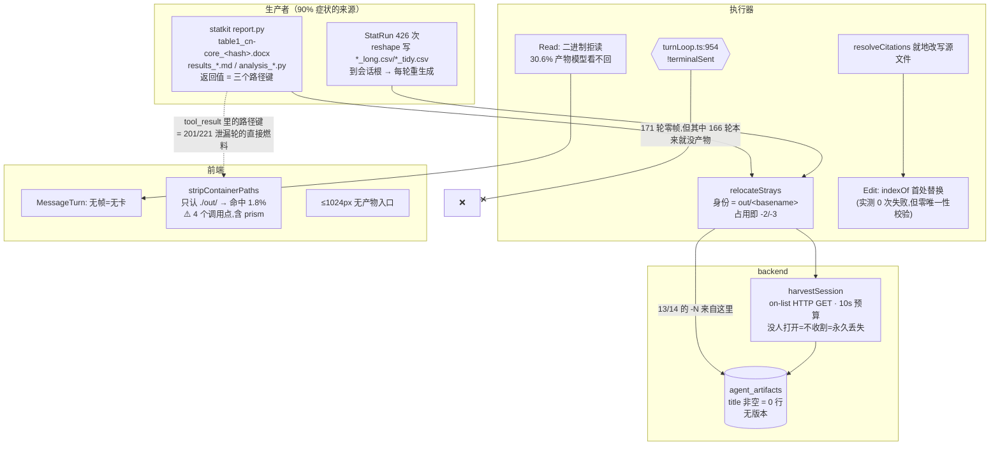
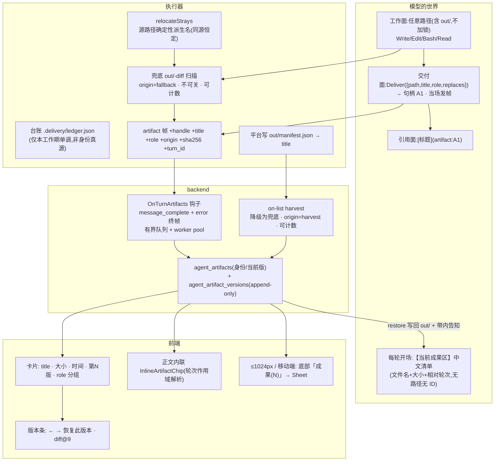

# 成果交付链路 · 定稿设计

> 2026-08-07 · 综合 DESIGN-A（止血）/ DESIGN-B（交付动词）/ DESIGN-C（版本实体）三份候选与六份对抗评审
> 取证真源：本目录 01–11 号报告 + 主协调者生产库实测 + **本文作者 2026-08-07 亲自复跑的生产 SQL 与工作树实读**（下文标 ✅实测 的数字均为本次复核所得，与三份候选稿有出入处以本文为准）。
> 读者：熟悉本仓库的架构师。不科普。工时按「一个熟悉本仓库的工程师」单人天。

---

## 〇 · 定稿主张

**这条链路的病灶不在「交付协议」，在生产者与采集器。**

三份候选稿都把问题建模成「交付语义错层」，然后各自给出协议层、动词层、实体层的解法。但生产数据不支持这个建模：

| 维度 | 全站 | stat_lab 占比 | ✅实测口径 |
|---|---|---|---|
| `agent_artifacts` 行数 | 1035 | **1011（97.7%）** | `GROUP BY feature_key` |
| 含 ≥8 位 hex 段的文件名 | 629（60.8%） | ≈ 全部 | statkit 生成器起名 |
| `.py` 被当交付物列出 | 209（20.2%） | ≈ 全部 | `analysis_<hash>.py` |
| `-N` 后缀分叉行 | 14 | **13（92.9%），且 13 条全是 `.csv`** | `rel_path REGEXP '-[0-9]+\.[a-z0-9]+$'` |
| 正文 `out/` 泄漏轮 | 221/709（31.2%） | 201（90.9%） | 协调者实测 |
| 轮数 | 878 | 559（63.7%） | — |

**也就是说：一个生产者（statkit）造成了这条链路上 90% 以上的可观测症状。** 而三份候选稿里，对准这个生产者的动作只有 A 的 M5（1 人天，排在 P1）与 B 的 P1-4（排在第 10–13 天之后）。

同时，三份稿共同的头号卖点被证伪：

> ✅**实测：171 轮异常轮里，发生过任何 `tool_use` 的只有 5 轮。**160 条 error 事件的 code 分布是 `overloaded` 149 / `upstream` 5 / `internal` 4 / `config` 1 / `round_cap` 1 —— **93% 是上游过载，那些轮里什么都没来得及发生，`out/` 是空的。**
> 拆掉 `turnLoop.ts:954` 的 `!terminalSent` 守卫值得做（方向对、0.5 天、覆盖 `round_cap` 那类长任务尾部），但它的可寻址面是 **≤5 轮（≤0.6%）**，不是 19.5%。**把它当头号 ROI 会让 P0 预算错配一个数量级。**

以及「改不到」的真实形态被三份稿一致误判：

> ✅**实测：`Edit` 共调用 51 次，tool_result 里 `old_string not found` 出现 0 次。** 而 `agent_artifacts` 里 `docx` 253 + `xlsx` 64 = **317 行（30.6%）在 `Read` 层就不可达**（`read failed: binary file not supported`）。
> 真实的「改不到」主体不是 `indexOf` 首处替换，是**模型读不回自己交付的二进制成品，只能整份重新生成** —— 而重新生成必然产生新文件、新卡片、新一行 `agent_artifacts`。

**定稿的排序由此确定，三步不可倒序：**

1. **先修生产者与出口文案** —— 命名、回执、四份 prompt。这是唯一对准 90% 生产分布的动作，零架构变更、可单独上线。
2. **再修采集可靠性** —— 用轮末事件钩子取代 on-list HTTP GET。今天「没人在 30 天内打开过那个会话」= 产物永久丢失且零日志，这是整条链最脆的一根线；在它修好之前，任何版本/身份层都是给一条会漏的管子加账本。
3. **最后才引入交付动词与版本** —— 动词解决「什么算产物」与「轮中可见」，版本解决「改坏了能退回」。两者都**加在已经可靠的采集之上**，而不是用来替代它。

**与三份候选稿的分野（逐条）：**

| | 定稿的取舍 |
|---|---|
| vs A | 采纳 A 的绝大部分单点动作，但**否决 M2（写入时刻重定向）**与**否决 M4 的咽喉点收口位置**。前者在生产上只能命中约 3–4 次 Write 调用（见 §2.3），却会给 stat_lab 的 752 次「Bash 读会话根文件」制造 `FileNotFoundError`，并波及无产物路由的 prism；后者选在 `runTools.ts:130`，那是**全部工具**（含 Read/Glob/Grep/MCP）的唯一 tool_result 咽喉点，在那里做正则改写是篡改模型的读盘结果，会放大它要修的 R3。 |
| vs B | 采纳 `Deliver` 动词、句柄引用、正面模板、`role` 分级、`resolveCitations` 改副本，但**否决 `out/` 进 `RESERVED_DIRS`**（三条硬伤，见 §2.1）与**否决把台账 JSON 当身份真源**（工作区 30 天 GC 会让句柄回收，历史正文里的 `artifact:A1` 指向另一件东西）。 |
| vs C | 采纳版本行、restore 闭环、产物脱离会话生命周期、注销级联，但**否决三表 + 内容寻址 + refcount GC**（跨 owner 共享 blob + 零备份 + cron 从未装，误删的代价不对称）、**否决 `uk_slot` 复合唯一键**（3068 字节 / utf8mb4 大小写不敏感）、**否决「P0 就删 -N」**（那是把物理保险拆掉而版本还没建好，是所有排期里最差的一种）。 |

---

## 一 · 三条痛点的真实归因（对着实测数字重画）



| 用户原话 | 真实主机制（✅实测） | 三份候选稿的误判 |
|---|---|---|
| 输出看不到 | ① `harvestSession` 只在用户打开产物列表时跑，server-side 轮 / 关标签 / 30 天 GC 后 = 永久丢失且零日志；② 轮中结构上不可能发帧（轮首 snapshot / 轮末 diff），claw + stat_lab 不轮询；③ ≤1024px 与移动端零入口 | 三份都把 `!terminalSent` 守卫当主因（可寻址面 ≤0.6%） |
| 编辑改不到 | ① 30.6% 的产物（docx/xlsx）模型 `Read` 不回来，只能整份重生成 → 新文件新卡；② `relocateStrays` 的身份是 `out/<basename>`，同一份源文件每轮重生成即撞占用改名（13 条 csv 分叉的真机制，不是「用户让改第三节」）；③ `resolveCitations` 每轮就地改写源文件 | A/B/C 都把重点放在 `Edit` 的 `indexOf`（实测 0 次可观测失败） |
| 说输出到 out 目录 | ① `statkit report.py` 的返回值就是三个路径键，直接喂进模型上下文，占 201/221；② 四份 prompt 镜像漂移（claw 7.5% / stat_lab 36.0% 且**一个字交付纪律都没有** / sci_draw 76.5% 且写着「也不必加 ./ 前缀」）；③ 前端清洗器只认 `./out/`，命中率 1.8% | A/B 的方向对，但把清洗器/物理保留区当主力，而生产分布指向**生产者返回值** |

---

## 二 · 三条被明确否决的架构分叉（含论据）

这一节先立否决，因为后面的路线图是在这三条否决之上排的。

### 2.1 🔴 否决：`out/` 进 `RESERVED_DIRS`（DESIGN-B 的关键一刀）

三条硬伤，任一条单独成立即足以否决：

1. **它会静默杀死兜底链路。** `artifacts.ts` 的 relocate 入口第一行是
   `const inReserved = inReservedLexical; const deliverable = decls.filter((d) => !inReserved(d.path));`
   —— `RESERVED_DIRS` 一含 `"out"`，`inReservedLexical("out/x.md")` 恒 true ⇒ **本轮全部 `out/` 声明被过滤掉，`emitArtifacts` 发 0 帧**，紧接着的降级分支 `deliverable.filter(d => d.path.startsWith("out/"))` 也恒空。零报错、零日志。而 B 稿第 5 章刚立誓「兜底永远在跑、不加开关」。
2. **它会让三个构建型工具当天全挂。** `ExportDocument` / `BuildDeck` 的产物落盘走 `confinePath(ctx.workDir, "out/…", true)`，`confine.ts` 的 `forWrite` 分支对保留区无条件 `throw`；`StatReport` 走 bwrap，`--ro-bind` 盖住 out/ ⇒ jail 内 EROFS。而 B 稿把这三者的改造排在 P1-4（第 10–13 天之后），中间是一段 **stat_lab（78.8% 流量）与 boltslides 全部交付物无法生成**的窗口。
3. **`bwrap` 的 `writableReserved` 逃生口救不了它** —— 那是 jail 层字段，`confinePath` 根本不读。

**定稿的替代：`out/` 保持可写。** 泄漏的收敛靠「删掉 57 个正面注入点 + 改掉生产者返回值 + 正面模板」，不靠物理锁。物理锁在这个仓库里是一个**已经被两道闸精确实现**的机制，但它服务的是「引擎独占区」语义（evidence/ 与 analysis/ 是数字真源，模型写进去就能伪造），而 `out/` 恰恰相反 —— 它是所有写入路径的**汇合点**。

### 2.2 🔴 否决：把身份真源放在会话工作区的 `.delivery/ledger.json`

`WORKDIR_TTL_MS = 30 天`，`rm(dir, {recursive:true})` 整目录删除。台账一丢 → `seq` 归零 → 下一个产物又叫 `A1`，而 journal 里冻结的历史正文里已经有一个指向别的东西的 `artifact:A1`。B 稿的不变式 I1（「回收会让历史正文里的 A2 指向另一件东西」）在这个存储选点上**物理不可保证**。

**定稿的替代（两层，且这是本文对三份稿的原创补充）：**

- **写侧**：句柄仍由执行器分配、仍存台账（它只需要在**同一次会话工作期内**单调即可）；
- **读侧**：前端解析 `artifact:A1` 时**按轮次作用域回溯** —— 用「该段正文所在轮次 **之前（含）最近一条** 声明了该 handle 的 `artifact` 帧」来解析，而不是查全会话最新表。journal 是耐久且有序的，所以即使工作区被 GC、句柄被重新分配，历史段落解析到的仍是当时那一件。
- 解析不到 → 渲染纯文本 label，**绝不渲染死链接**。

这条 8 行的解析规则同时消灭了 B 稿 §9.5 与评审 F4 提出的整族问题，代价为零。

### 2.3 🔴 否决：写入时刻的落点重定向（DESIGN-A 的 M2「核心动作」）

✅实测 `Write` 工具全部 105 次调用的 `file_path` 分布：绝大多数**模型自己就写了 `out/` 前缀**（`out/xxx.md` / `./out/xxx.md` / 甚至 `/work/out/xxx.md`）——因为那正是我们在 `registry.ts:198` 亲口教它的。真正的裸文件名只有 `document.md`(5)、`src/App.tsx`(4)、`make_tables.py`(2)、`analysis.py`(2)、`references.bib`(2)、`index.html`(2)、`mbi_analysis.py`(2) 等，**其中会被 `deliveryPath()` 重定向的（.md 且不在 ROOT_SKIP_FILES）约 3–4 次**。

而代价是三条：

- **13/14 的 `-N` 分叉是 `.csv`，`Write` 从没写过一个 `.csv`** —— 它们是 `StatRun`/Bash 里的 python 写的。入站重定向对 Bash 写盘零覆盖，恰好完美错过唯一有实证的分叉。
- **它会给 stat_lab 制造一类全新的 `FileNotFoundError`。** 今天 `relocateStrays` 用 `copyFile` 而非 `rename`（注释理由是「跨 bind-mount 比 link 稳」），这个选择顺带保住了会话根那一份，于是「Write 数据 → Bash/python 读数据」这条 stat_lab 主力流程能走通。✅实测 Bash 的 tool_use 入参里引用裸文件名（.csv/.xlsx/.md/.docx）的调用 **752 次**。重定向把复制关系换成搬移关系，等于单方面删掉 Bash 那一侧的输入 —— 而 Bash 跑在 bwrap 里、cwd = 会话目录，入站别名在原理上加不上去。
- **执行器没有 feature key**（`researchTurn.ts:66` 原文「执行器无状态、后端从不下发 feature 名」），所以重定向必然全局生效，会落到 **prism**（放开 Write/Edit、在会话 cwd 原生读写、轮末 `applyStructRound` 读回文件合并进 DB 真源、且**没有任何 artifact 路由**）。模型写一个 `图1.svg`，会被静默搬进 prism 永远看不到的 `out/`。

**定稿的替代**：不改写入落点，改**搬运时的身份规则**（§4.1 的 A8）——把 `relocateStrays` 的目标名从「basename + 占用即加序号」改成「**源路径确定性派生，同源恒定**」。这命中的是真实的 13 条 csv 分叉（同一份 `long.csv` 每轮重生成 → 今天撞占用改名，改后恒定映射到同一个 out 名），且不动任何写入语义、不波及 Bash 与 prism。

---

## 三 · 目标态架构（三期终态）



**三条不变式**（全部有测试钉住，见各期验收）：

> **I1 · 采集不依赖用户行为。** 一轮结束（无论 complete 还是 error）就触发收割，不依赖「有人打开过那个会话」。
> **I2 · 同一份源文件的每一次落盘，映射到同一个交付身份。** 身份键由**源路径**确定性派生，不由 `out/` 的占用状态决定。
> **I3 · 覆盖前必须有版本。** 在版本行连续 7 天覆盖率达标之前，`-N` 物理保险不许拆。

---

## 四 · P0 · 止血（8.5 人天 · ≤2 周 · 零架构变更）

**这一期不引入任何新表、新工具、新帧类型、新端点。** 全部动作可单独 revert，回滚代价 = `git revert` + `restart`。

### 4.0 前置：基线采集（0.3 天，必须先于一切代码改动）

三份候选稿都有「需先测」的指标却把它们跟改动同批上线 —— 那样永远拿不到分母。新建 `scripts/artifact-baseline.sh`，把下列查询打成一份带时间戳的快照落 `docs/research/artifact-delivery-2026-08/baseline-<date>.txt`：

```sql
-- 已由本文作者跑过一次,数值见各判据的「基线」列;上线前需再跑一次固定分界时刻
SELECT status, COUNT(*) FROM agent_turns GROUP BY status;
SELECT feature_key, COUNT(*) FROM agent_artifacts GROUP BY feature_key;
SELECT LOWER(SUBSTRING_INDEX(filename,'.',-1)) e, COUNT(*) c FROM agent_artifacts GROUP BY e ORDER BY c DESC;
SELECT COUNT(*) FROM agent_artifacts WHERE title <> '';
SELECT COUNT(*) FROM agent_artifacts WHERE rel_path REGEXP '[0-9a-f]{8,}';
SELECT COUNT(*) FROM agent_artifacts WHERE rel_path REGEXP '-[0-9]+\\.[a-z0-9]+$';
SELECT COUNT(*) FROM agent_artifacts WHERE updated_at > created_at;
SELECT JSON_UNQUOTE(JSON_EXTRACT(payload,'$.toolName')) n, COUNT(*) c
  FROM agent_turn_events WHERE ev_type='tool_use' GROUP BY n ORDER BY c DESC;
SELECT COUNT(*) FROM agent_turn_events WHERE ev_type='tool_result'
  AND JSON_EXTRACT(payload,'$.isError')=true;
```

### 4.1 动作清单

| # | 动作 | 文件 | 天 |
|---|---|---|---|
| **A1** | **statkit 产物语义命名**（本期最高 ROI）。在 `StatReport` 的**包装层**（不改 python 的计算逻辑）拿到 `report.py` 返回后落盘改名：`table1_cn-core_<hash>.docx` → `三线表_中文核心期刊.docx`、`results_*` → `Results段_*.md`、`analysis_*` → `复现脚本_*.py`。命名模板 `<产物中文名>_<system_name_zh>.<ext>`，冲突用中文序号 `_第2次`。🔴 **模板一次定死 + 单测**：`dedup_anchor = sha256(sid‖rel_path)` 且 harvest 是 upsert-only 永不回收，模板再改一次会在库里留下两行无人清理。 | `agent/src/tools/registry.ts`（StatReport 包装层） | 1.0 |
| **A2** | **statkit 返回值去路径**。`report.py:566` 的 `{"table_docx":"out/table1_...docx", ...}` 改成 `{"delivered":[{"title":"三线表（中文核心期刊格式）","format":"docx"}], "methods_zh":…, "results_zh":…}`，**零路径键**。跨语言常量走既有的 `tools/statkitPaths.test.ts` 模式钉住。⚠️ 单独发、单独观察：`report` 的返回是模型唯一的取数入口，形状改错整个 stat_lab 链路当场哑掉。 | `agent/stat-kit/statkit/verbs/report.py:515,566-567` + `registry.ts` 回执组装 | 0.5 |
| **A3** | **逐工具白名单式出口脱敏**（🔴 **不在 `runTools.ts:130` 做**）。新建纯函数 `agent/src/turn/toolText.ts` 的 `sanitizeDeliveryText()`，只在 **`Write` / `Edit` / `ExportDocument` / `BuildDeck` / `StatReport` 五个工具的回执组装处**调用。**Read / Glob / Grep / Bash / MCP 一律不过** —— 它们的返回值是模型的读盘结果与列目录结果，改写它会让下一次 `Edit` 的 `old_string` 对不上（放大 R3），也会让 sci_draw B/C 车道拼不出 `python3 out/x.py`。同批改死 11 处 description/回执原文（`:198 :210 :219 :239 :357 :513 :694 :776 :834 :898 :1562`）。 | `agent/src/turn/toolText.ts`（新）· `agent/src/tools/registry.ts` 十一处 | 1.0 |
| **A4** | **`prompts/delivery.go` 单一真源 + 四份 include**。正面模板，全段 `out/` 出现 0 次。同批：删 `sci_draw.go:63-64` 整段路径铁律，**尤其那句「也不必加 ./ 前缀」**（它在系统性地生产清洗器唯一不认的形态）；`claw.go` 的 10 处 `./out/` 压到 1 处；**`stat_lab.go` 从零补上**（今天一个字都没有却贡献 201/221 泄漏轮）；`bolt_slides.go:48` 换成公共段。配 `delivery_test.go` 断言四个 `NewStaticPicker` 输出都含标记串。 | `backend/internal/prompts/{delivery.go,claw.go,sci_draw.go,stat_lab.go,bolt_slides.go}` | 1.0 |
| **A5** | **Edit 契约手术**（三方案公约数，实测 0 次可观测失败但零唯一性校验）：新增 `replace_all?: boolean`；命中 >1 处且无 `replace_all` → `isError` + 首处上下文；命中 0 处 → 四要素回执（逐字符匹配提示 / 文件规模与本会话是否 Read 过 / 平台改动过的 stale 提示 / SequenceMatcher 阈值 0.6 的近似片段 ±5 行）；`new_string` 已在文件中而 `old_string` 不在 → 明说「可能已生效，别重复提交」（幂等重试终止条件）。stale 用执行器进程内 Map **软校验**（`resolveCitations` 每轮就地改写，硬拒会让带引用长文的第二次编辑 100% 卡死）。**不加 MultiEdit、不加 undo_edit、不做失败 N 次自动整篇重写。** 顺带修 `registry.ts:183` 的 CJK 假截断（判据用字节、截断用字符）。 | `agent/src/tools/registry.ts:183,217-244` | 1.5 |
| **A6** | **拆 `!terminalSent` 守卫 + hub 侧同批修**。🔴 **只改 agent 侧不够**：`onTurnTimeout` 已 `endTurn()`（`currentTurnID=0`）并置 `timedOutTurn=true`，随后到达的 artifact 帧 ① 走 `suppressStray → continue` 不广播、② `if tid != 0` 不入 journal。改法：`hub.go` 的散帧压制加**帧型例外**（`artifact` 与将来的 `artifact_revoked` 放行广播），并在 `onTurnTimeout` 里把 tid 存进 `h.lastTimedOutTurnID` 供迟到 artifact 帧入账。**不要按 A 稿建议在 abort 路径跳过 deliveryGate** —— 那会回退 2026-08-06 刚补的异常轮过闸。 | `agent/src/turn/turnLoop.ts:954-978` · `backend/internal/agentbridge/hub.go:1244-1265,1598-1619` | 0.7 |
| **A7** | **timeout 白名单补齐 + claw 越权校验**（两个与架构无关的真 bug）。`isObjectServePath` 今天只有 `/claw/artifact/` 与 `/claw/session/artifact`，补 `/boltslides/artifact`、`/sci_draw/artifact`、`/stat_lab/artifact` 及各自的 `/session/artifact`（共 8 条子串，不是 3 条）；`claw` 的 `DownloadArtifactByID` 补 `row.FeatureKey != FeatureKey → 404`（另三份镜像都有，claw 缺）。 | `backend/internal/common/middleware/timeout.go:57` · `backend/internal/claw/artifact.go:283-295` | 0.3 |
| **A8** | **`relocateStrays` 身份规则改为源路径确定性派生**（替代 A 稿 M2）。目标名 `derivedName(srcRel)` = 末两级目录 + basename（`slides/index.html` → `slides-index.html`，`a/b/c/report.md` → `b-c-report.md`），**无条件使用，不只在冲突分支**。同源恒定 ⇒ 同一份 `xxx_long.csv` 每轮重生成映射到同一个 out 名。🔴 **冲突仍加 `-N`，不许删**（`taken` 播种同时挡着「同轮内两个不同源文件的 basename 撞车」，删掉即新增一条静默数据丢失路径；且 I3 要求版本先落地）。顺带补两处静默丢弃的 `log.warn`（`:249` mkdir 早退、`:282` copyFile catch）。 | `agent/src/turn/artifacts.ts:249,269-287` | 0.8 |
| **A9** | **复活 `title` 通道：平台写 `out/manifest.json`**。`emitArtifacts` 发帧前由平台按确定性规则生成/合并（模型写过的条目优先）。🔴 **三处强制配套，缺一即制造新 bug**：① `snapshotOut` 排除 `manifest.json`（今天只跳点开头 ⇒ 每轮多一张 manifest 卡）；② **`statlab` / `scidraw` 的 `shouldListArtifact` 只排除空名与点开头**，会把 manifest.json 收割成一行、列给用户 —— 必须同时补排除（`boltslides` 排了 pptx/pdf 但也没排 manifest）；③ **只有 claw 有 `readArtifactManifest`**，statlab/scidraw/boltslides 三份镜像压根不读 manifest（stat_lab 占 97.7% ⇒ 不补这三份，A9 对生产几乎零效果）。 | `agent/src/turn/artifacts.ts:107-121` + `emitArtifacts` · `backend/internal/{statlab,scidraw,boltslides}/artifact.go` | 1.0 |
| **A10** | **前端渲染五处**（零新依赖、零新 .css、无 Context）：① 卡片补 `title \|\| name` + 大小 + 时间；② 失败轮卡片上方「本轮未完成，但以下成果已生成」；③ `IMAGE_EXTS` 补 `.avif`；④ `DocxPreview.tsx:53` 的三线表全网格边框条件化；⑤ **≤1024px 与 `/m/claw` 底部「成果(N)」入口 → Sheet 复用既有 `ClawArtifactPanel` 列表态**（今天窄屏只有「从卡片点预览」一条路）。 | `frontend-user/src/features/claw/components/chat/{TurnArtifacts,MessageTurn,ConversationWorkspace}.tsx` · `components/preview/DocxPreview.tsx` | 1.2 |
| **A11** | **清洗器扩正则 + 调用点分流**。🔴 `strip-container-paths.ts` 自陈「仅 claw 使用」，实测有 **4 个调用点**：claw `MessageTurn`、**prism `PrismMessageTurn`**、`shared/components/chat/ToolCallBlock`、`shared/components/chat/tool-semantics`。改法：函数加一个 `mode: 'deliver' \| 'verbatim'` 入参，默认 `verbatim`（今天行为），只有 claw 的正文渲染传 `deliver`；`deliver` 档启用「`out/` 后必须跟已知交付扩展名」的锚定正则（覆盖实测 98.2% 的裸 `out/` 形态）。**prism 与 tool-semantics 保持 `verbatim`** —— prism 的路径是合法用户概念，Bash chip 改写会显示模型根本没跑过的命令。顺带给 `ThinkingFold` 接上清洗。**不做「产物名单驱动」那一层**（要把会话 artifacts 列表 prop 钻进 shared 组件，本仓禁 Context，成本远超收益）。 | `frontend-user/src/shared/lib/strip-container-paths.ts` + 四个调用点 | 0.5 |

**合计 8.5 天。** 部署顺序：`agent(A1/A3/A5/A6-agent/A8/A9-agent)` → 观察 24h → `backend(A2 随 agent 镜像 / A4/A6-hub/A7/A9-backend)` → 观察 24h → `frontend(A10/A11)`。A2 单独一次发布、单独观察 48h。

### 4.2 P0 验收判据（每条对着一个实测基线，可证伪）

| # | 判据 | SQL / 口径 | 基线（✅实测） | 目标 |
|---|---|---|---|---|
| V0-1 | 哈希文件名新增归零 | `SELECT COUNT(*) FROM agent_artifacts WHERE rel_path REGEXP '[0-9a-f]{8,}' AND created_at > '<上线时刻>'` | 629/1035 = 60.8% | 新增行占比 **< 5%** |
| V0-2 | `title` 通道活过来 | `SELECT COUNT(*) FROM agent_artifacts WHERE title <> '' AND created_at > '<上线时刻>'` | **0 行** | 新增行 **> 90%**。⚠️ 分 feature 查：stat_lab 必须 >90%，否则说明 A9 的三份镜像配套漏了 |
| V0-3 | 泄漏率（全站与分 feature） | `content_delta` 拼接后 grep `out/` / `out 目录` / `bundle` / `analysis/`，`GROUP BY feature_key` | 全站 31.2%（221/709）· stat_lab 36.0% · sci_draw 76.5% · claw 7.5% | 全站 **< 8%** · stat_lab **< 5%** · sci_draw **< 20%**（B/C 车道 Bash 必须知道路径，下限非零） |
| V0-4 | `-N` 新增下降但**不为零** | `rel_path REGEXP '-[0-9]+\.[a-z0-9]+$' AND created_at > '<上线时刻>'` | 14 条（13 条 csv） | 新增 **≤ 2 条**。🔴 判据刻意不写 0：写 0 会诱使实现者去删 `taken` 播种，而那是 I3 禁止的 |
| V0-5 | 异常轮帧覆盖（诚实分母） | 分子 = `status IN ('failed','aborted','blocked')` 且有 `ev_type='artifact'`；分母 = **该类轮中发生过 `Write`/`ExportDocument`/`BuildDeck`/`StatReport` 的 tool_use 的轮** | 分子 0；**分母实测 ≤5 轮** | 分子/分母 **> 80%**。⚠️ 分母小，这条只能做「不回归」用，不能当 KPI |
| V0-6 | Edit 回执可自纠 | `agent_turn_events` 里 `ev_type='tool_result'` 且 content 含四要素标记的条数 / Edit 调用数 | Edit 51 次、`old_string not found` **0 次** | 只做**存在性**验收（人工造 3 例：多处匹配 / 零匹配 / new_string 已存在），不设比率目标 |
| V0-7 | 三份镜像的 manifest 排除生效 | `SELECT COUNT(*) FROM agent_artifacts WHERE filename='manifest.json'` | 0 | 上线后仍为 **0**（这条防的是 A9 的自伤） |
| V0-8 | 下载不再被 15s 掐断 | 人工：≥8MB docx 在限速 1Mbps 下从 stat_lab 面板下载成功 | 今天必失败 | 成功 |
| V0-9 | 窄屏可达 | 375px / 1000px 视口下能从底部「成果(N)」看到全部产物 | 今天零入口 | 通过 |

### 4.3 P0 回滚

| 动作 | 开关 | 回滚 | 脏数据 |
|---|---|---|---|
| A1/A2 statkit 命名与回执 | `STATKIT_FRIENDLY_NAMES=0` | env + restart | 🔴 **有**：已改名的行留在库里（upsert-only 不删），同会话两种命名并存。**要么不上，要么不回** |
| A3 出口脱敏 | `EXECUTOR_SANITIZE_DELIVERY_TEXT=0` | env + restart | 无 |
| A4 prompt | 无（Go const） | revert backend + restart | 无 |
| A5 Edit / A6 守卫 / A8 relocate / A9 manifest | **无开关**（数据完整性不挂 env） | revert + restart | 无 |
| A7 backend bug fix | 无 | revert | 无 |
| A10/A11 前端 | 无 | revert + rebuild | 无 |

---

## 五 · P1 · 采集换轨 + 交付动词（13 人天）

P0 之后，症状被压住但**结构性缺口原样存在**：产物仍靠猜、收割仍依赖用户打开页面、轮中仍看不到。P1 修这三条。

### 5.1 动作清单

| # | 动作 | 文件 | 天 |
|---|---|---|---|
| **B1** | **`OnTurnArtifacts` 钩子取代 on-list 收割**（本期最高价值，也是 C 稿唯一被完整采纳的架构主张）。`hub.go` 在 `message_complete` 与 error 终帧两处触发 `FeatureSpec.OnTurnArtifacts`；钩子把本轮 artifact 声明推进**有界 channel（2048）+ `safego` worker pool**，绝不在 hub goroutine 同步 IO；队列满 → 丢弃 + `slog.Error`（可观测，不静默）。worker 侧 `ReadWorkspaceFileRaw` 拉字节走既有 upsert。`harvestSession` 保留为兜底，产生的行标 `source='harvest'`。**这条直接消灭「关标签 / server-side 轮 / 30 天 GC = 永久丢失且零日志」。** | `backend/internal/agentbridge/{hub.go,spec.go}` · `backend/internal/agentartifact/` | 3.0 |
| **B2** | **`Deliver` 工具**（不锁 `out/`）。`Deliver({items:[{path,title,summary,role,replaces}]})` → 返回 `{delivered:[{handle,title,kind,size,version}], reminder}`，**零路径**。`ToolCtx` 加受限 sink（🔴 **在 `runOne` 里包一层，只放行 `artifact`/`artifact_revoked` 两个帧型** —— 否则任何工具从此都能伪造 artifact 帧）。**当场发帧 ⇒ 轮中可见，不需要轮询、不触发 on-list 全量 harvest。** 失败一律硬失败 + 可自纠回执（不存在 / 空 / 目录 / >12MB **在交付时刻拒绝**而不是等用户点 404 / replaces 指向不存在的句柄）。同 handle 同 sha 幂等，不发帧不升版本。 | `agent/src/tools/registry.ts` · `agent/src/turn/runTools.ts` · `agent/src/delivery/ledger.ts`（新） | 2.5 |
| **B3** | 🔴 **`backend permissionAllowed` 显式登记**（本仓库自陈「已咬五次」的同一个失效模式）。`ws.go:298` 是 default-deny，新 builtin 不登记 = 模型被告知「没有 Deliver 这个工具」而 prompt 又说「没调 Deliver 用户拿不到」⇒ 重试循环烧 round_cap。三个新工具各一条分支 + 四个 feature 的 `specDeny` 复核（**这是第五份镜像**，A4 只收敛了 prompt 那份）。**同批把 `permissionParity.test.ts` 扩成覆盖 Deliver 族。** | `backend/internal/agentbridge/ws.go:298` · 四个 `spec.go` · `agent/src/tools/permissionParity.test.ts` | 0.5 |
| **B4** | **帧扩字段 + journal 往返测试**。`artifact` 帧加 `handle? / title? / summary? / role? / origin(declared\|fallback\|harvest) / sha256? / turn_id?`；新增 `artifact_revoked` 帧，`classifyJournalEv` 加 case **复用 `EvArtifact`**（不新增 Ev 常量，避免 journal 迁移）。🔴 **上线前实查 `eventlog_validate.go` 是否对 artifact payload 有字段白名单**，并补一条「字段经 journal 往返逐字保留」的断言（本仓已有 `userMessage` 被解析层丢掉的前科）。 | `agent/src/turn/artifacts.ts` · `backend/internal/agentbridge/{hub.go,eventlog_store.go,eventlog_store_test.go}` | 1.0 |
| **B5** | **`resolveCitations` 改写副本，不动模型源文件**（R2 根治，白拿）。`ExportDocument` 早就用隐藏侧车 `.<name>.cited.md` 做对了（`registry.ts:749`），把 `artifacts.ts:310-337` 统一到正确那边。 | `agent/src/turn/artifacts.ts:310-337` | 0.5 |
| **B6** | **带内台账注入 + 兜底告知**。走 `turnLoop.ts:305-320` 已被 `langDirective`/`budgetDisclosure`/`evidenceBlock` 验证过的 seam（append 到最后一条 user 消息尾部，不进 system、不破前缀缓存）。文本只含**中文标题 + 大小 + 相对轮次 + 累计改过 N 次**，🔴 **不含哈希文件名、不含路径、不含 public_id**（A1 之后文件名已语义化，这条才安全；顺序不能倒）。附「上一轮有 N 个文件是系统替你交付的」兜底告知段 —— 它同时是 declared 率的自纠信号。 | `agent/src/turn/turnLoop.ts:305-320` | 1.0 |
| **B7** | **三个构建型工具走同一个 `deliver()`**：`ExportDocument` / `BuildDeck` / `StatReport` **落点不变**（仍写 `out/`），只改「登记 + 回执」—— 内部调 `deliver()` 拿句柄、自动生成 title、`role` 分级（StatReport 的 docx=main / md=main / py=support）。⚠️ 这是把 20.2% 的 `.py` 从主列表移进折叠的唯一机制。 | `agent/src/tools/registry.ts:713-776,831-898,1554+` | 1.5 |
| **B8** | **前端：`artifact:` 内联解析**。🔴 **必须给 `ReactMarkdown` 传 `urlTransform`** —— react-markdown `^9.0.3` 的 `defaultUrlTransform` 白名单是 `/^(https?\|ircs?\|mailto\|xmpp)$/i`，非白名单协议 `return ''`，不改这一行 `href.startsWith('artifact:')` **恒为 false**，机制 100% DOA 而 G7 那类「解析不到渲染 span」的护栏会**恒绿**。解析规则用 §2.2 的**轮次作用域回溯**。`InlineArtifactChip` 放 `shared/components/chat/`，resolver 走 props（禁 Context），缺省时行为逐字不变（该组件被审稿/news 复用）。 | `frontend-user/src/shared/components/chat/{MarkdownRenderer,InlineArtifactChip}.tsx` | 1.5 |
| **B9** | **前端：帧字段透传 + role 分组 + 实时/历史同构**。`TurnArtifact` 扩字段；`fold.ts:142-150` 与 `agent-history.ts:324-342` **必须同构改**（去重键 `handle \|\| path`）；`role==='support'` 收进「配套材料 (N)」折叠行。 | `features/claw/components/chat/fold.ts` · `shared/lib/agent-history.ts` · `shared/types/chat.ts` | 1.0 |
| **B10** | **declared 率指标的独立载体**。🔴 **不要挂 `research_state` 帧** —— 它在 stat_lab / sci_draw / boltslides 上被条件抑制（无检索面 ⇒ Router 判 chat ⇒ 账本恒空 ⇒ 三个条件全不成立 ⇒ 帧不发），而那正是泄漏最重与用量最大的两个 feature。改为在 `agent_turn_events` 里以 `ev_type='artifact'` 的 `payload.origin` 直接切分母，零新载体、可 SQL。 | `backend/internal/agentbridge/eventlog_store.go`（仅确认 origin 入库） | 0.5 |

**合计 13 天。** 上线顺序：`B1`（纯 backend，零模型行为变化，先独立观察一周收割覆盖率）→ `B4/B5/B9`（字段与同构，零行为）→ `B3`（接线，先于工具）→ `B2/B7`（工具上线，模型开始调 Deliver）→ `B6`（带内注入，★行为切换点）→ `B8`（前端引用面）。

### 5.2 P1 验收判据

| # | 判据 | SQL / 口径 | 基线 | 目标 |
|---|---|---|---|---|
| V1-1 | **收割不再依赖用户打开页面** | 构造一个 server-side 轮（无前端连接）产出文件 → 24h 内不打开会话 → `agent_artifacts` 里出现该行 | 今天 **必然没有行** | 有行，且 `source='hook'` |
| V1-2 | 兜底占比可计数 | `SELECT payload->>'$.origin' o, COUNT(*) FROM agent_turn_events WHERE ev_type='artifact' AND created_at>'<上线时刻>' GROUP BY o` | 今天无此字段 | `declared` **> 60%**（P1 目标，不设 85% —— B 稿的 85% 无依据）；`harvest` **< 5%** |
| V1-3 | 轮中可见 | 人工：一轮写 3 个文件、耗时 >3 分钟 → 第一张卡在第一个文件写完后 **≤10s** 出现 | 今天要等整轮结束 | 通过 |
| V1-4 | `.py` 不再当主产物 | `role='support'` 的新增行占 `.py` 新增行的比例 | 209 行全是主产物 | **> 90%**，且配一条 `support 占比 > 0 且 < 100%` 的下界/上界检查（防模型全标 main 或全标 support 这两条永远绿的规则） |
| V1-5 | `artifact:` 真的渲染成 chip | vitest：`[x](artifact:A1)` 在 resolver 命中时渲染 `InlineArtifactChip`、未命中时渲染 `<span>` 且 **不含 `<a>`** | 今天不存在 | 两条断言都过。🔴 命中那条是防「urlTransform 忘了传」的唯一手段 |
| V1-6 | 帧字段往返无损 | `eventlog_store_test.go`：帧 → journal → 回放，`handle/title/role/origin` 逐字相等 | — | 通过 |
| V1-7 | Deliver 接线没漏 | `permissionParity.test.ts` 覆盖 `Deliver`/`ListDeliveries`/`Undeliver`；且生产日志里 `permission denied: Deliver` 计数 = 0 | — | 0 |
| V1-8 | R2 消失 | 人工：带 `[[E1]]` 的长文交付后第二轮 Edit 原文片段 → 成功（今天必然失配） | 今天必失败 | 通过 |

### 5.3 P1 回滚

- `EXECUTOR_DELIVER_VERB=0` → `Deliver` 不注册，兜底扫描独自工作 = P0 行为。**这个开关只控工具可见性，不控兜底。**
- `ARTIFACT_HOOK_ENABLED=0` → 钩子关闭，回落 on-list harvest。⚠️ 这是**可用性**开关不是**数据完整性**开关：关掉只是退回今天的收割方式，不会让已收割的数据不一致。
- 前端无需开关：无 handle 的帧走 P0 渲染路径，`artifact:` 解析不到降级纯文本。
- 🔴 **B6 的带内注入是行为切换点**，prompt 走 Go const ⇒ 回滚 = 回滚一个 backend 版本 + restart。若 `promptregistry` 的 DB-backed picker 可用，**值得先花一天换成 DB 版以获得秒级回滚**。

---

## 六 · P2 · 版本化与产物库（12 人天）

**前置闸（硬）**：P1 的 V1-2 连续 7 天 `declared + hook` 覆盖率 ≥ 95%。采集不可靠时做版本 = 给一条会漏的管子加账本。

### 6.1 数据模型（**否决 C 的三表内容寻址，采用两表 + 版本化 key**）

```sql
-- 0112_artifact_version_fields.sql
-- 身份层沿用 agent_artifacts（不新建 deliverables 表、不改 dedup_anchor）：
CALL add_column_if_not_exists('agent_artifacts','public_id',     "char(30) NOT NULL DEFAULT ''");
CALL add_column_if_not_exists('agent_artifacts','version_count', "int unsigned NOT NULL DEFAULT 1");
CALL add_column_if_not_exists('agent_artifacts','current_version_no',"int unsigned NOT NULL DEFAULT 1");
CALL add_column_if_not_exists('agent_artifacts','artifact_role', "varchar(16) NOT NULL DEFAULT ''");
CALL add_column_if_not_exists('agent_artifacts','origin',        "varchar(16) NOT NULL DEFAULT 'fallback'");
CALL add_column_if_not_exists('agent_artifacts','archived_at',   "datetime NULL");

CREATE TABLE IF NOT EXISTS `agent_artifact_versions` (
  `id`           BIGINT UNSIGNED NOT NULL AUTO_INCREMENT,
  `artifact_id`  BIGINT UNSIGNED NOT NULL,
  `version_no`   INT UNSIGNED    NOT NULL,
  `content_sha256` CHAR(64)      NOT NULL,
  `storage_key`  VARCHAR(640)    NOT NULL COMMENT '<原 key>@v<N>,与身份同前缀 ⇒ 按 owner 前缀即可整体清理',
  `size_bytes`   BIGINT UNSIGNED NOT NULL DEFAULT 0,
  `mime`         VARCHAR(160)    NOT NULL DEFAULT '',
  `produced_turn_id` BIGINT UNSIGNED NOT NULL DEFAULT 0,
  `produced_tool`    VARCHAR(32)  NOT NULL DEFAULT '',
  `restored_from`    INT UNSIGNED NOT NULL DEFAULT 0,
  `pinned`       TINYINT(1)      NOT NULL DEFAULT 0,
  `created_at`   DATETIME        NOT NULL,
  PRIMARY KEY (`id`)
) ENGINE=InnoDB DEFAULT CHARSET=utf8mb4 COLLATE=utf8mb4_unicode_ci;
```

```sql
-- 0113_artifact_version_indexes.sql
CALL add_index_if_not_exists('agent_artifacts','uk_public_id','(`public_id`)',TRUE);
CALL add_index_if_not_exists('agent_artifact_versions','uk_ver','(`artifact_id`,`version_no`)',TRUE);
CALL add_index_if_not_exists('agent_artifact_versions','idx_turn','(`produced_turn_id`)',FALSE);
```

**四条与 C 稿的关键分野，每条都是评审逼出来的：**

1. **不新建 `agent_deliverables`、不引入 `uk_slot(session_id,feature_key,slot)`。** 那是 191+64+512 = **3068 字节**的复合唯一索引，距 InnoDB 3072 上限只剩 4 字节（任何一次列宽微调 ⇒ `CREATE UNIQUE INDEX` 启动即失败 ⇒ backend 起不来），且 utf8mb4 默认 collation 大小写/重音不敏感，与 Linux 文件系统语义不一致（`out/Report.md` 与 `out/report.md` 在盘上是两个文件、在索引上是一个键）。**既有的 `dedup_anchor CHAR(64) = sha256(session‖rel_path)` 正是当年为避开这个坑而设计的，沿用它。**
2. **不做跨 owner 的内容寻址 blob 去重 + refcount GC。** ✅实测重复 sha 分组只有 **79 组 / 1035 行**，去重收益不足以支付代价；而代价是不对称的：GC 跑不起来 = 存储单调增长（与现状同样糟）；GC 跑错 = **跨用户共享的 blob 被误删**（多个用户同时丢产物，比现状糟得多）。本仓库**零备份、cron 从未装**（记忆 [线上审计0731] 的 P0）。此外跨 owner 共享 blob 会让「注销用户级联删除」与「会话 reset 清理」在同一段迁移窗口里互相踩（A 用户 reset 打死 B 用户产物）。**版本 key 用 `<原 key>@v<N>`：同 owner 前缀、无共享、注销时按前缀整体清，零 refcount、零 reaper。**
3. **版本回填不写 `UPDATE ... SET refcount=(子查询)` 这类无 WHERE 的语句。** 本仓迁移是**按序重放**，每次容器启动全跑一遍；C 稿 §11.2 第 ⑤ 段无 WHERE 守卫，会在每次重启把所有 `unref_at` 抹成 NULL ⇒ GC 候选集恒空 ⇒ 一条真正意义上「永远绿」的规则。定稿的回填只有一条带 `WHERE version_count = 0` 守卫的 INSERT。
4. **`public_id` 用 `crypto/rand` 16 字节 → base32 无填充 26 字符 + `art_` 前缀**；老行回填用 `CONCAT('lgc_', LPAD(id,26,'0'))` 并在列注释里写明**它是可枚举的**，授权闸永远是 API 层的 `owner_id` + `feature_key` 比对（不透明 ≠ 授权）。

### 6.2 动作清单

| # | 动作 | 天 |
|---|---|---|
| C1 | 迁移三支 + 回填（幂等，`WHERE version_count=0` 守卫）+ 重放幂等测试 | 1.0 |
| C2 | `internal/artifactstore` 版本 repo/service：版本产生规则（**新 sha == current 时只更 `last_seen_at`，不建版本**）+ `@vN` key 写入 + 与 upsert 事务化 | 2.0 |
| C3 | `turnLoop` 维护 `touchedPaths: Map<absPath,toolName>`，版本行填 `produced_tool`；「本轮无模型工具碰过但 sha 变了」→ 标 `platform:citation`（B5 之后这条应当趋近 0，是 B5 生效的探针） | 0.8 |
| C4 | 统一层 API `/api/v1/user/deliverables{,/:pid,/:pid/versions,/:pid/versions/:n/content,/:pid/restore,/:pid/star}`，Repository→Service→Handler；**同批把 `/user/deliverables/` 加进 `isObjectServePath`** | 2.0 |
| C5 | `restore` 闭环：新增一版（不截断历史）→ `PutWorkspaceFile` 写回 `out/<rel_path>` → 记「已恢复」事件供下一轮 B6 注入消费。⚠️ 工作区已 GC → 200 + warn，不失败 | 1.0 |
| C6 | 前端：`features/artifacts/api/deliverables.ts`（react-query hooks）+ `ArtifactVersionBar`（`version_count===1` 时不渲染）+ `diff@9` 文本 diff（**已在 package.json:59，零新依赖**）+ 🔴 **版本条挂卡片本身而非只在右侧扩展区**（≤1024px 与 `/m/claw` 都在） | 2.5 |
| C7 | 🔴 **I3 闸开：flip `relocateStrays` 为无条件覆盖（删 `-N`）** —— 仅当 V2-1 连续 7 天达标。**同时保留同轮内两个不同源文件 basename 撞车时的 `-N`**（那不是版本，是两份东西） | 0.5 |
| C8 | 注销用户级联（`user/repository.go` 的清理清单里 `agent_artifacts` 连提都没提，PHI 永久残留）+ 产物脱离会话生命周期（`cleanupArtifacts` 改归档标记） | 1.5 |
| C9 | 四份镜像收割逻辑收进统一层，只留路由 + `OwnsSession` + feature 特有展示规则 | 2.0（**放最后，且不是 P2 的前置**） |

**明确不做（P2 及以后）**：跨会话成果库 `/artifacts` 页面、`library` 分享链路对接、文件树 UI、编辑级版本、拆 12MB 上限、删 DTO 的 `path` 字段。理由见 §7 与 §8。

### 6.3 P2 验收判据

| # | 判据 | 口径 | 基线 | 目标 |
|---|---|---|---|---|
| V2-1 | **I3 闸（C7 的前置）** | `SELECT COUNT(*) FROM agent_artifact_versions WHERE created_at>?` / `SELECT COUNT(*) FROM agent_turn_events WHERE ev_type='artifact' AND created_at>?` | — | **连续 7 天 ≥ 95%**。未达标不许 flip |
| V2-2 | 版本不丢 | 同一文件连续 5 轮改动 → 恰好 5 行版本；逐版取回字节 sha 与登记一致 | — | 通过 |
| V2-3 | 内容没变不产生版本 | 连续 3 轮 `touch` 但内容不变 → `version_count` 仍为 1 | 今天 `diffOut` 按 size+mtime，会重复发帧 | 通过 |
| V2-4 | 原地更新率 | `SELECT COUNT(*) FROM agent_artifacts WHERE updated_at>created_at AND created_at>?` / 新增行 | **0.6%（6/1035）** | **> 20%** |
| V2-5 | `-N` 新增归零（**只有 C7 之后才计**） | 同 V0-4 | 14 条 | 新增 0（跨源同名那类除外，单列计数） |
| V2-6 | 回滚闭环 | 恢复到 v2 → ① `/content` sha == v2；② agent 侧 `out/<name>` sha == v2；③ 下一轮模型上下文出现「已恢复…改动前请先重新读取」 | — | 三条全过 |
| V2-7 | 迁移重放幂等 | `docker-compose restart schema-sync` 连跑 3 次，两张表行数与**全部 `version_count`/`current_version_no` 取值**完全不变 | — | 通过。🔴 判据刻意含「取值不变」而非只查行数 —— C 稿的无 WHERE UPDATE 正是只查行数测不出来的那种 |
| V2-8 | 注销级联 | 删用户后其 `owner_id` 的 artifact 行 = 0、version 行 = 0、MinIO 该 owner 前缀下对象 = 0 | 今天全部残留 | 通过 |
| V2-9 | 全端可达 | 375px 视口下 `version_count>1` 的卡片显示版本条、能切版本、能恢复 | — | 通过。**不允许「桌面有、移动端没有」** |

### 6.4 P2 回滚

| 阶段 | 回滚 | 可逆 |
|---|---|---|
| C1–C6（加表 + 版本 API + 前端） | `ARTIFACT_VERSIONING=0`：停止新建版本行，老链路完好；前端三级回落 `public_id → id → path` 自愈 | ✅ 完全 |
| **C7（flip -N）** | revert agent + restart | ⚠️ **代码可逆，字节不可逆**：flip 后被覆盖的版本若恰好没被收割就永久丢失。这正是 V2-1 闸存在的理由 |
| C8 生命周期改造 | 恢复 `cleanupArtifacts` 全清 | ⚠️ 期间归档的产物会在下次 reset 被删 |
| C9 镜像收敛 | revert | ✅ |

---

## 七 · 【本方案解决不了什么】

逐条写，每条带证据。回避这一节 = 方案不可用。

### 7.1 🔴 二进制产物的「编辑」在结构上仍然不可能

✅实测 `docx` 253 + `xlsx` 64 = **317 行（30.6%）** 的产物，模型 `Read` 不回来（`read failed: binary file not supported`）。用户说「把三线表第二列改一下」，模型唯一的路是**整份重新生成** —— 新文件、新卡片、新一行。P2 的版本模型能让这件事看起来像「第 2 版」（因为 rel_path 相同 ⇒ 同一 `dedup_anchor` ⇒ 同一身份），但那是**重生成而非增量编辑**：任何用户在原文件上的期待（保留格式、保留未提及的部分）都不成立。

真正的解是 docx/xlsx 的 XML 级增量编辑（unpack → 改 XML → repack），或者「三线表的真源是结构化数据、docx 只是渲染产物」。后者其实是 statkit 已经具备的形态（bundle 是数字真源），但**没有一条链路让用户改 bundle**。这两条都远超本方案。

### 7.2 兜底扫描的 8 类结构性漏点一条都没修

`DELIVERABLE_EXTS` 不收 `.png`/`.txt`/`.json`/`.py`/`.tex`（`plt.savefig('fig.png')` 写在会话根 = 两条通道同时永久看不见，这是 sci_draw 的主力产物形态）、`DEEP_SKIP_DIRS` 任意层跳 `src/ build/ public/ tmp/`、`ROOT_SKIP_FILES` 误伤「帮我写一份 README」这类完全合法的诉求、`ARTIFACT_MAX_FRAMES=20`、根扫描三预算、`stat()` 失败静默 skip。

定稿的判断：**P1 的 `Deliver` 让模型能显式交付任意扩展名的文件，这是对这一族问题的正解**；继续补白名单是继续投资「扫描 + 启发式识别」这条错路。**唯一例外是 `.png` 进 `DELIVERABLE_EXTS`**（sci_draw 的主力形态，一行，建议随 P1 顺手做，但要同时确认 `role` 分级能把中间图收进折叠）。

如果 P1 上线后 `declared` 率长期低于 40%，**正确动作是回滚 `Deliver` 而不是补白名单**。

### 7.3 路径泄漏的下限非零

三条硬约束：① sci_draw 的 B/C 车道（Bash 跑 python 渲染 svg）物理上要求模型知道路径，`python3 out/x.py` 必须写对，所以 sci_draw 的目标只能定到 <20%；② `Bash` 的 stdout、`Read`/`Glob` 的返回值刻意不脱敏（改写它们会篡改模型的读盘认知，放大 R3）；③ 前端清洗是**渲染层**，journal 里存的是原文，后台会话监控 transcript、导出通道、小程序镜像各自会再暴露一次。

✅实测泄漏轮里 **71.2%（153/215）该轮的 tool_use 入参中模型自己就写了 `out/`** —— 素材的主渠道是模型自己构造的入参，而 tool_use 入参在协议上无法在出口脱敏。唯一被数据验证为 0 泄漏的形态是 prism（0/19），它的做法是**架构上让模型没有理由提文件**（交付走 DB 真源 + 工具栏导出按钮）。那是一次 feature 级重设计，不在范围。

### 7.4 内容真实性完全不管

`Deliver` 校验文件存在、非空、大小合规，所以「宣称交付了不存在的文件」被堵死。但 `Deliver(path:"三线表.docx", title:"MBI 三因子验证性因子分析")` 而文件里是空表 —— 过；数据是编的 —— 过。那是 `deliveryGate` / statkit numcheck 的地盘，而**那道闸的三条防线在 stat_lab 全栈审计里已被证伪**（ENFORCE/TTL 两个 env 零接线、数字锁只查键在不在、golden 只判非空）。**「交付这个动作变可信」与「产物变可信」是两件事，不要混。**

### 7.5 轮中可见性只被部分解决

`Deliver` 当场发帧 ⇒ 模型**主动交付**的部分轮中可见（V1-3）。但兜底路径（`origin=fallback`）仍然是「轮首 snapshot → 轮末 diff」，**结构上不可能在轮中发帧**。定稿刻意**不做条件轮询**（A 稿 M9.5）：每次触发一次 on-list 全量 harvest（读所有 out 文件 + base64 + MinIO PUT，跑在 10s HTTP 预算里，claw 侧还没有大小预筛），一轮产出 3 个 15MB docx 会把 45MB 拉进 Go 堆。根治需要 agent 侧 fs watch + 增量帧，不在范围。

### 7.6 老数据零收益

回填后 1035 行全部 `version_count=1`。**用户今天已经丢掉的版本永久不可恢复**（旧字节在 MinIO 同 key 上被覆盖时就没了）。P0 的 A1 改名只影响新产物，629 行哈希名与 221 轮历史泄漏在 journal 里冻结、**无法回溯清洗**（journal 是历史真源）。必须对产品说清，避免「上线就能救回上周那份稿」的错误预期。

### 7.7 移动端只有 `/m/claw` 一条路由

A10 给窄屏加了成果入口，但 stat_lab / sci_draw / boltslides **没有移动端路由**：用户在桌面生成三线表、手机打开那个会话链接 → feature 作用域的 `OwnsSession` 判否 → 404 → 静默跳回空白页。加三条移动路由 = 三个新页面，超出本方案。pptx 在自家预览器里完全没有分支（「我们自己生成、自己看不了」）。

### 7.8 第五份镜像：小程序

`miniprogram/services/claw.ts` 独立消费 `/user/claw/session/artifacts` 的 DTO，并实现「`id>0` 走 `/claw/artifact/:id`，`id=0` 走 `path` 实时回退」这条二级回落；它的 markdown 渲染把 `[x](y)` 降级成不可点的 `<span>`（保留 label，可接受）。**小程序要过审、旧版本长期在用户机器上跑** ⇒ 这是定稿**明确不删 DTO `path` 字段**的直接理由（C 稿把「删 path」定成收尾条件，那会被一个它没提到的客户端卡死）。`path` 只是内部 join key，不进 UI 就不构成泄漏面。

### 7.9 P0 的 A1 会留下唯一一处不可回滚的脏数据

改名与 `dedup_anchor = sha256(sid‖rel_path)` 绑定，且 harvest 是 upsert-only 永不删。命名模板一旦上线后再改一次，同一份产物会在库里留下两行且无人清理。**模板必须一次定死 + 配单测；A1 要么不上，要么不回。**

---

## 八 · 【本仓库特有的失败模式如何规避】

四种模式在本仓库都有具名前科，定稿逐条给出机械防线。

### 8.1 「引擎造好没接线」

**前科**：`OnArtifact` 钩子 2026-07 设计过、`grep` 零命中；`ReadDocument`/`ExportDocument`/`BuildDeck`/`EvidenceGet`/`StatRun` 五次漏接 `permissionAllowed`（`ws.go` 的注释自陈「这是本仓库第五次接同类线」）；`ENFORCE`/`TTL` 两个 env 零接线。

**本方案的暴露面与防线**：

| 暴露面 | 防线 |
|---|---|
| `Deliver`/`ListDeliveries`/`Undeliver` 三个新 builtin | **B3 是 P1 的独立条目、排在 B2 之前**；`permissionParity.test.ts` 扩成覆盖 Deliver 族。⚠️ 这次漏接的后果比以往严重：prompt 说「没调 Deliver 用户拿不到」+ 工具不存在 ⇒ 模型重试循环烧 round_cap，不是优雅降级 |
| `OnTurnArtifacts` 钩子 | V1-1 是**行为判据**（server-side 轮 24h 不打开会话仍有行），不是「代码里有这个函数」 |
| `state='quarantined'` 一类只声明不写入的枚举 | **定稿不引入任何无写入方的枚举**。C 稿的 `state` 枚举里 `quarantined` 无人写 —— 定稿的 `agent_artifacts.archived_at` 只有 C8 一个写入点，且 V2-8 直接验它 |
| 交付闸（`runDeliveryGate`）与新链路的关系 | 🔴 **定稿不把 artifact 帧提到交付闸之前**。B 稿的「Deliver 当场发帧 + 闸在轮末物理搬走文件」会精确生产「点了 404 的死卡」（闸的立论正是「压住帧是假闸、闸必须动盘上的文件」）。定稿的处理：`Deliver` 当场发帧，但**闸在轮末命中该文件时补发一条 `artifact_revoked`**，前端置灰 + 一行说明。这条是 B2 的强制配套，写进验收 V1-9（人工造一例含无源数字的交付 → 开 ENFORCE → 卡片置灰而非 404） |

### 8.2 「一条永远绿的规则」

**前科**：`stripContainerPaths` 只认 `./out/` ⇒ 命中率 1.8%；`permissionParity.test.ts` 在唯一自动执行点整族 skip；数字锁只查键在不在；golden 只判非空。

**本方案里所有可能变绿的规则，逐条给对策**：

| 可能变绿的规则 | 对策 |
|---|---|
| `role` 是模型声明的，可全标 `main`（或全标 `support`） | V1-4 配**双侧界**检查：`0 < support 占比 < 100%` |
| `origin=declared` 的计数载体 | 🔴 **不挂 `research_state` 帧**（它在 stat_lab/sci_draw/boltslides 上被条件抑制，恒不发）。改为直接切 `agent_turn_events` 的 `payload.origin`（B10） |
| 「解析不到渲染 `<span>`」的护栏（B 稿 G7） | 它测的是**失败路径**，机制全线 DOA 时照样通过。V1-5 **必须同时断言命中路径渲染出 chip** —— 这是唯一能抓住「`urlTransform` 忘了传」的手段 |
| 「`out/` 全文计数 = 0」的 grep 型护栏（B 稿 G4） | **定稿不采用**。它要跨包 grep（`backend/internal/prompts` + `agent-skills/**`），而 agent 的 Docker 构建 context 只有 `./agent` ⇒ 整族 skip；本仓库无 CI。改为 **A4 的 `delivery_test.go`（纯 Go 包内测试，随 `go test ./...` 必跑）+ 生产泄漏率 SQL（V0-3）** —— 一条编译期真跑的、一条生产端真测的 |
| 「新增 `-N` = 0」 | V0-4 刻意写 **≤2 而不是 0**：写 0 会诱使实现者删 `taken` 播种，而那会删掉「同轮两个不同源文件撞名」的保护 |
| 迁移幂等判据 | V2-7 断言的是「行数**与取值**都不变」，不是只查行数 |
| 「异常轮帧覆盖率」 | V0-5 明写分母 ≤5 轮、只做不回归用，不当 KPI —— **不可证伪的判据本身就是一条永远绿的规则** |

### 8.3 「四份镜像漂移」

**实际是五份**（backend 四份 `artifact.go` + 小程序），加上 prompt 四份、`shouldListArtifact` 四份、`readArtifactManifest` **只有一份**。

| 动作 | 镜像面 | 定稿的处理 |
|---|---|---|
| A4 prompt | 4 份 | 抽 `prompts.DeliverySection` + Go 测试断言四个 Picker 输出都含标记串。**已知残余**：新增第五个 feature 时没人会想起来加进那个表（B 稿 §9.7 说得对，测试是防线不是保证） |
| A7 timeout 白名单 | 8 条路径子串 | 一处改完 |
| A9 manifest | **`shouldListArtifact` 4 份 + `readArtifactManifest` 1 份** | 🔴 三份镜像必须同批补读 + 补排除，否则 A9 对 97.7% 的产物零效果、且会给用户一张 `manifest.json` 卡。V0-2 分 feature 查 + V0-7 直接验 |
| C4 统一层 API | 新增一份 | `artifactstore` 从第一天 feature-agnostic（`feature_key` 是入参不是包名） |
| C9 收割逻辑收敛 | 4 份 | **放在整个路线图最后**，且不是任何东西的前置 —— 把可回滚的加表工程变成高风险重构是 C 稿排期里的另一个坑 |
| 小程序 | 第 5 份 | **不删 DTO `path`**（§7.8）；`artifact:` 在小程序降级成纯文本 label，可接受 |
| 前端清洗器 | 4 个调用点（含 prism） | A11 用 `mode` 入参分流，默认 `verbatim` = 今天行为 |

工时里已按五份镜像计（A7 0.3 天 / A9 1.0 天 / C9 独立 2.0 天）—— 这正是三份候选稿被评审判为低估的那一格。

### 8.4 「env 开关兜数据完整性」

**铁律**：数据的**位置**与**记录**不许挂 env；文案、命名、体验、可用性可以。

| 开关 | 控什么 | 为什么合法 |
|---|---|---|
| `STATKIT_FRIENDLY_NAMES` | 命名 | 文案类。但 §7.9 已声明它会留脏数据 ⇒ 要么不上要么不回 |
| `EXECUTOR_SANITIZE_DELIVERY_TEXT` | 回执文案 | 文案类 |
| `EXECUTOR_DELIVER_VERB` | `Deliver` 工具是否注册 | 可用性类；**兜底扫描不受它控，永远在跑** |
| `ARTIFACT_HOOK_ENABLED` | 收割走钩子还是 on-list | 可用性类：关掉退回今天的收割方式，不产生不一致数据 |
| `ARTIFACT_VERSIONING` | 是否新建版本行 | ⚠️ 边界情况：关掉期间的修改**不产生版本**。因此它只允许在 C7（flip -N）**之前**存在；C7 之后这个开关必须**删掉**（否则「关掉版本 + 无条件覆盖」= 静默丢字节）。写进 C7 的 checklist |
| ❌ 落点重定向开关 | — | **定稿没有这个开关**：A 稿的 `EXECUTOR_DELIVERY_REDIRECT` 中途翻转会让同一会话里翻转前后的文件分处两地，别名规则给出相反解析 ⇒ 分裂脑。定稿直接否决了重定向本身（§2.3） |

---

## 九 · 一页速查

| | P0 止血 | P1 采集换轨 + 交付动词 | P2 版本化 |
|---|---|---|---|
| **人天** | 8.5 | 13 | 12 |
| **架构变更** | 零 | 新工具 ×3、新钩子、帧扩字段 | 新表 ×1、列 ×6、新端点族 |
| **单独上线有价值** | ✅ 是 | ✅ 是 | ⚠️ 需 P1 的 V1-2 达标 |
| **主要动作** | statkit 命名与回执 · 四份 prompt 收敛 · Edit 契约 · relocate 身份规则 · manifest title（五份镜像）· timeout/越权两个真 bug · 窄屏入口 | `OnTurnArtifacts` 钩子 · `Deliver` 动词（不锁 out/）· 轮次作用域的 `artifact:` 解析 · 带内成果区注入 · role 分级 | 版本行 + `@vN` key · restore 闭环 · 版本条与 diff · **闸达标后才 flip `-N`** · 注销级联 |
| **头号风险** | A1 的命名模板不可回滚 | `Deliver` 漏接 `permissionAllowed` ⇒ 重试循环 | flip `-N` 之后覆盖不可逆 |
| **最大的诚实** | 它只压症状，产物仍靠猜 | declared 率低于 40% 就该回滚而不是补白名单 | 二进制产物的「编辑」仍是重生成 |

**总计 33.5 人天**，三期各自可停。**P0 单独上线即覆盖生产上 90% 的可观测症状** —— 因为那 90% 出自一个生产者。

---

## 附 · 与三份候选稿动作的逐条裁决表

| 候选动作 | 裁决 | 落点 |
|---|---|---|
| A-M1 拆 `!terminalSent` 守卫 | ✅ 采纳，**但必须连 hub 侧 `suppressStray`/`endTurn` 一起改**；ROI 从「19.5%」降级为「≤0.6% + 理顺语义」 | A6 |
| A-M2 写入时刻落点重定向 | ❌ **否决**（命中 3–4 次 / 破 752 次 Bash 读 / 波及 prism） | §2.3 |
| A-M3 relocate 派生名 | ✅ 采纳，**但改为无条件使用**（只在冲突分支用等于指标转绿问题原样），**且保留 `-N`** | A8 |
| A-M4 `runTools` 咽喉点脱敏 | ⚠️ **改造后采纳**：位置从咽喉点改为五个工具的白名单；11 处文案原文照改 | A3 |
| A-M5 statkit 语义命名 | ✅ **采纳并提为 P0 第一条** | A1 |
| A-M6 Edit 契约 | ✅ 采纳（三方案公约数） | A5 |
| A-M7 平台写 manifest | ✅ 采纳，**但必须补三份镜像的读取与排除**（否则对 97.7% 产物零效果） | A9 |
| A-M8 帧扩字段 | ✅ 采纳，并入 P1；`revision` 改由 DB `version_count` 提供（进程内计数会失忆，比没有角标更容易被当成谎） | B4 / C2 |
| A-M9.3 清洗器「产物名单驱动」 | ❌ 否决（要把列表 prop 钻进 shared 组件，禁 Context）；只留扩展名锚定 + 调用点分流 | A11 |
| A-M9.5 条件轮询 | ❌ 否决（每次触发全量 harvest，claw 无大小预筛） | §7.5 |
| A-8.2 轮首成果区注入 | ✅ 采纳，**但排在 A1 之后**（先语义化文件名，再注入，否则等于每轮给模型发泄漏素材） | B6 |
| B-`Deliver` 动词 | ✅ 采纳 | B2 |
| B-`out/` 进 `RESERVED_DIRS` | ❌ **否决**（杀兜底 / 挂三工具 / bwrap 逃生口无效） | §2.1 |
| B-台账当身份真源 | ❌ 否决（30 天 GC → 句柄回收）；改为**读侧轮次作用域回溯** | §2.2 |
| B-`artifact:` 正文引用 | ✅ 采纳，**必须传 `urlTransform`**，且验收要断言命中路径 | B8 / V1-5 |
| B-`role` 分级 | ✅ 采纳 + 双侧界检查 | B7 / V1-4 |
| B-`resolveCitations` 改副本 | ✅ 采纳（白拿） | B5 |
| B-G4 跨包 grep 护栏 | ❌ 否决（唯一自动执行点整族 skip）；换 Go 包内测试 + 生产 SQL | §8.2 |
| C-`OnTurnArtifacts` 钩子 | ✅ **采纳并提为 P1 第一条**（这是 C 稿最有价值的主张） | B1 |
| C-三表内容寻址 + refcount GC | ❌ 否决（79 组重复不值 / 零备份 / 跨租户误删 / 迁移无 WHERE 重放） | §6.1 |
| C-`uk_slot` 复合唯一键 | ❌ 否决（3068 字节 / collation 大小写不敏感）；沿用 `dedup_anchor` | §6.1 |
| C-P0 就删 `-N` | ❌ 否决（拆保险在前、建版本在后，是最差排序）；改为 V2-1 闸后 flip | C7 / I3 |
| C-restore 闭环 | ✅ 采纳，**但写回目标沿用 `rel_path`，并接受 §5.3 的双 inode 残留**（不宣称它解决 R1） | C5 |
| C-产物脱离会话生命周期 + 注销级联 | ✅ 采纳 | C8 |
| C-跨会话成果库 `/artifacts` | ⏸ 推迟（6 天、与三条痛点均不直接相关） | §6.2 |
| C-删 DTO `path` | ❌ 否决（小程序是第五份镜像、无法强制升级） | §7.8 |
